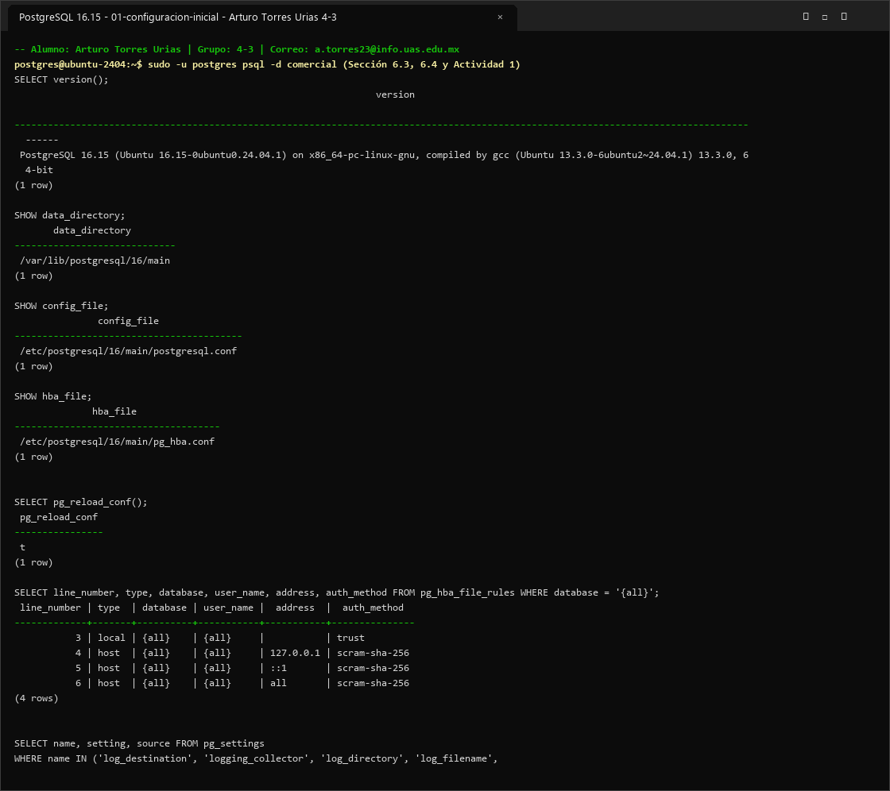

# Evidencia 01 — Preparación del Entorno y Configuración de Registro por Defecto

- **Alumno:** Arturo Torres Urias
- **Grupo:** 4-3
- **Correo institucional:** a.torres23@info.uas.edu.mx
- **Materia:** Gestión de Seguridad y Desempeño de Bases de Datos
- **Unidad:** III — Auditoría, trazabilidad y gobierno práctico de datos
- **Laboratorio:** LAB-01 — Bitácoras y auditoría del dato en PostgreSQL
- **Motor:** PostgreSQL 16.15 (Ubuntu 16.15-0ubuntu0.24.04.1 on x86_64-pc-linux-gnu)
- **Actividades cubiertas:** Secciones 6.3, 6.4, 6.5 y Actividad 1

---

## 1. Identificación de la instalación desde el motor (Sección 6.3)

### Comando ejecutado
```sql
SELECT version();
SHOW data_directory;
SHOW config_file;
SHOW hba_file;
```

### Resultado obtenido
```text
                                                                 version                                                                  
------------------------------------------------------------------------------------------------------------------------------------------
 PostgreSQL 16.15 (Ubuntu 16.15-0ubuntu0.24.04.1) on x86_64-pc-linux-gnu, compiled by gcc (Ubuntu 13.3.0-6ubuntu2~24.04.1) 13.3.0, 64-bit
(1 row)

       data_directory        
-----------------------------
 /var/lib/postgresql/16/main
(1 row)

               config_file               
-----------------------------------------
 /etc/postgresql/16/main/postgresql.conf
(1 row)

              hba_file               
-------------------------------------
 /etc/postgresql/16/main/pg_hba.conf
(1 row)
```

---

## 2. Revisión y endurecimiento de reglas de autenticación (Sección 6.4)

### Comando ejecutado
```sql
SELECT line_number, type, database, user_name, address, auth_method
FROM pg_hba_file_rules
WHERE database = '{all}';
```

### Resultado observado antes del ajuste
```text
 line_number | type  | database | user_name |  address  |  auth_method  
-------------+-------+----------+-----------+-----------+---------------
           3 | local | {all}    | {all}     |           | trust
           4 | host  | {all}    | {all}     | 127.0.0.1 | trust
           5 | host  | {all}    | {all}     | ::1       | trust
           6 | host  | {all}    | {all}     | all       | scram-sha-256
(4 rows)
```

### Ajuste aplicado y recarga (`SELECT pg_reload_conf();`)
Se sustituyó `trust` por `scram-sha-256` en las reglas `host` para `127.0.0.1/32` y `::1/128` en `/etc/postgresql/16/main/pg_hba.conf` y se ejecutó `SELECT pg_reload_conf();`:

```text
 line_number | type  | database | user_name |  address  |  auth_method  
-------------+-------+----------+-----------+-----------+---------------
           3 | local | {all}    | {all}     |           | trust
           4 | host  | {all}    | {all}     | 127.0.0.1 | scram-sha-256
           5 | host  | {all}    | {all}     | ::1       | scram-sha-256
           6 | host  | {all}    | {all}     | all       | scram-sha-256
(4 rows)
```

### Pregunta de la Sección 6.4
- **¿Por qué una regla `trust` afecta lo que la bitácora puede demostrar sobre la identidad del usuario?**
  Porque el método `trust` acepta cualquier nombre de rol declarado por el cliente sin exigir ninguna prueba criptográfica ni contraseña. En consecuencia, aunque la bitácora registre `user=app_ventas` o `user=postgres`, ese registro **no constituye evidencia de autenticidad**: cualquier persona o proceso con acceso al socket o dirección cubierta por `trust` pudo haber afirmado ser ese usuario sin poseer su credencial, invalidando el principio de no repudio y atribución de responsabilidad.

---

## 3. Preparación de datos y roles del escenario (Sección 6.5)

### Comando ejecutado
```sql
CREATE TABLE clientes (
    id BIGSERIAL PRIMARY KEY,
    nombre VARCHAR(120) NOT NULL,
    correo VARCHAR(150) NOT NULL,
    telefono VARCHAR(20),
    rfc VARCHAR(13),
    edad INTEGER,
    ciudad VARCHAR(80),
    codigo_postal VARCHAR(10),
    fecha_alta DATE DEFAULT CURRENT_DATE
);

INSERT INTO clientes (nombre, correo, telefono, rfc, edad, ciudad, codigo_postal) VALUES
('Ana López', 'ana.lopez@example.test', '6671234567', 'LOAA850315ABC', 41, 'Culiacán', '80000'),
('Carlos Pérez', 'carlos.perez@example.test', '6672345678', 'PECA900720DEF', 35, 'Culiacán', '80100'),
('María García', 'maria.garcia@example.test', '6673456789', 'GAMA780912GHI', 47, 'Mazatlán', '82000'),
('Luis Torres', 'luis.torres@example.test', '6674567890', 'TOLU920201JKL', 34, 'Los Mochis', '81200'),
('Laura Sánchez', 'laura.sanchez@example.test', '6675678901', 'SALA880525MNO', 38, 'Culiacán', '80200');

CREATE ROLE app_ventas LOGIN;
CREATE ROLE soporte_ana LOGIN;
-- Asignación interactiva con \password (credenciales <REDACTED>)
GRANT SELECT, UPDATE ON clientes TO app_ventas;
GRANT SELECT ON clientes TO soporte_ana;
```

---

## 4. Actividad 1 — Revisar la configuración de registro por defecto

### Comando ejecutado
```sql
SELECT name, setting, source FROM pg_settings
WHERE name IN ('log_destination', 'logging_collector', 'log_directory', 'log_filename',
               'log_connections', 'log_disconnections', 'log_line_prefix',
               'log_statement', 'log_min_error_statement', 'log_timezone') ORDER BY name;
```

### Resultado obtenido


```text
          name           |            setting             |       source       
-------------------------+--------------------------------+--------------------
 log_connections         | off                            | default
 log_destination         | stderr                         | default
 log_directory           | log                            | default
 log_disconnections      | off                            | default
 log_filename            | postgresql-%Y-%m-%d_%H%M%S.log | default
 log_line_prefix         | %m [%p]                        | default
 log_min_error_statement | error                          | default
 log_statement           | none                           | default
 log_timezone            | Etc/UTC                        | configuration file
 logging_collector       | off                            | default
(10 rows)
```

---

## 5. Respuestas a las Preguntas de la Actividad 1

1. **Con esta configuración, ¿se registra quién se conecta?**
   **No.** El parámetro `log_connections` tiene el valor `off` (`source = default`) y `logging_collector` también está en `off`, por lo que los intentos de conexión exitosos no se escriben en una bitácora administrada por el servidor.

2. **¿Se registran las sentencias `UPDATE`?**
   **No.** El parámetro `log_statement` vale `none` (`default`), lo que significa que PostgreSQL no registra sentencias SQL válidas (ni DDL, ni modificaciones `INSERT`/`UPDATE`/`DELETE`, ni consultas `SELECT`). Solo se registrarían aquellas sentencias que provoquen un error de severidad igual o mayor a `error` (`log_min_error_statement = error`).

3. **¿La línea de bitácora incluye el usuario o la dirección IP del cliente?**
   **No.** El prefijo por defecto `log_line_prefix` es únicamente `%m [%p] ` (marca de tiempo con milisegundos `%m` e identificador del proceso `%p`). Carece de los marcadores `%u` (usuario), `%d` (base de datos), `%a` (aplicación) y `%h` (host/IP del cliente), por lo que una línea aislada no indica quién ejecutó la acción ni desde qué dirección IP.

4. **¿En qué zona horaria se registran los eventos? ¿Por qué importa al reconstruir una cronología?**
   Se registran en **`Etc/UTC`** (`source = configuration file`). Es fundamental conocer y estandarizar la zona horaria (preferiblemente UTC) al reconstruir una cronología forense porque en un incidente suelen correlacionarse registros de múltiples fuentes (servidor de base de datos, servidor web, firewall, estaciones de trabajo en distintas regiones o con cambios de horario de verano). Si no se verifica el huso horario de `log_timezone`, una diferencia de 6 o 7 horas respecto a la hora local llevaría a conclusiones falsas sobre qué ocurrió antes o después.

5. **Con `logging_collector = off`, ¿quién decide dónde termina la bitácora: PostgreSQL o el mecanismo con que se desplegó el servidor?**
   Lo decide **el mecanismo con que se desplegó el servidor** (el script de inicio de `systemd` en Linux, el servicio de Homebrew en macOS, o el motor de contenedores Docker/Podman que captura `stderr`). Con `logging_collector = off`, PostgreSQL simplemente emite sus mensajes hacia la salida de error estándar (`stderr`) y no administra ni conoce la ruta final del archivo (`pg_current_logfile()` devuelve `NULL`).
