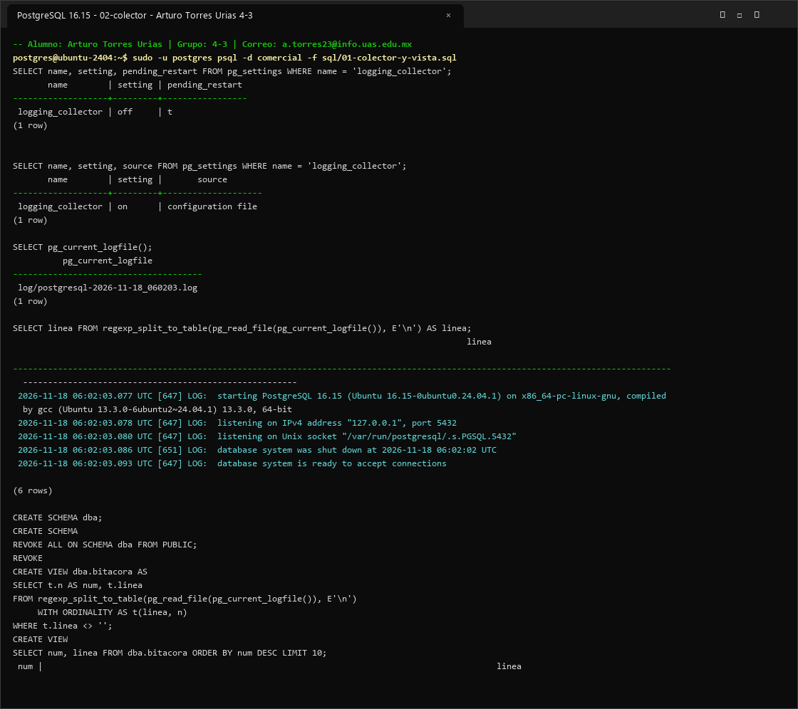

# Evidencia 02 — Que el Servidor Administre su Propia Bitácora

- **Alumno:** Arturo Torres Urias
- **Grupo:** 4-3
- **Correo institucional:** a.torres23@info.uas.edu.mx
- **Materia:** Gestión de Seguridad y Desempeño de Bases de Datos
- **Unidad:** III — Auditoría, trazabilidad y gobierno práctico de datos
- **Laboratorio:** LAB-01 — Bitácoras y auditoría del dato en PostgreSQL
- **Motor:** PostgreSQL 16.15 (Ubuntu 16.15-0ubuntu0.24.04.1 on x86_64-pc-linux-gnu)
- **Actividad:** Actividad 2 — Activar `logging_collector` y crear la vista `dba.bitacora`
- **Script asociado:** `sql/01-colector-y-vista.sql`

---

## 1. Comandos Ejecutados

```sql
ALTER SYSTEM SET logging_collector = on;
SELECT name, setting, pending_restart FROM pg_settings WHERE name = 'logging_collector';
-- Reinicio del servicio: sudo systemctl restart postgresql
SELECT name, setting, source FROM pg_settings WHERE name = 'logging_collector';
SELECT pg_current_logfile();

SELECT linea
FROM regexp_split_to_table(pg_read_file(pg_current_logfile()), E'\n') AS linea;

CREATE SCHEMA dba;
REVOKE ALL ON SCHEMA dba FROM PUBLIC;

CREATE VIEW dba.bitacora AS
SELECT t.n AS num, t.linea
FROM regexp_split_to_table(pg_read_file(pg_current_logfile()), E'\n')
     WITH ORDINALITY AS t(linea, n)
WHERE t.linea <> '';

SELECT num, linea FROM dba.bitacora ORDER BY num DESC LIMIT 10;
SELECT linea FROM dba.bitacora WHERE linea ILIKE '%update%';
SELECT linea FROM dba.bitacora WHERE linea ~ '(FATAL|ERROR)';
SELECT * FROM pg_ls_logdir();
```

---

## 2. Resultado Obtenido



```text
-- Antes del reinicio:
       name        | setting | pending_restart 
-------------------+---------+-----------------
 logging_collector | off     | t
(1 row)

-- Después del reinicio:
       name        | setting |       source       
-------------------+---------+--------------------
 logging_collector | on      | configuration file
(1 row)

          pg_current_logfile          
--------------------------------------
 log/postgresql-2026-11-18_060203.log
(1 row)

 num |                                                                                           linea                                                                                           
-----+-------------------------------------------------------------------------------------------------------------------------------------------------------------------------------------------
   5 | 2026-11-18 06:02:03.093 UTC [647] LOG:  database system is ready to accept connections
   4 | 2026-11-18 06:02:03.086 UTC [651] LOG:  database system was shut down at 2026-11-18 06:02:02 UTC
   3 | 2026-11-18 06:02:03.080 UTC [647] LOG:  listening on Unix socket "/var/run/postgresql/.s.PGSQL.5432"
   2 | 2026-11-18 06:02:03.078 UTC [647] LOG:  listening on IPv4 address "127.0.0.1", port 5432
   1 | 2026-11-18 06:02:03.077 UTC [647] LOG:  starting PostgreSQL 16.15 (Ubuntu 16.15-0ubuntu0.24.04.1) on x86_64-pc-linux-gnu, compiled by gcc (Ubuntu 13.3.0-6ubuntu2~24.04.1) 13.3.0, 64-bit
(5 rows)

               name               | size |      modification      
----------------------------------+------+------------------------
 postgresql-2026-11-18_060203.log |  560 | 2026-11-18 06:02:03+00
(1 row)
```

---

## 3. Respuestas a las Preguntas de la Actividad 2

1. **¿Por qué `logging_collector` requiere reinicio y `log_statement` solo recarga?**
   Porque `logging_collector` (contexto `postmaster`) requiere que el proceso principal de PostgreSQL cree un proceso auxiliar dedicado (*syslogger*) y redirija los descriptores de archivo de salida de error (`stderr`) de todos los procesos hijos hacia un *pipe* al momento de arrancar el clúster; esa plomería de procesos del sistema operativo no puede reconfigurarse en caliente. En cambio, `log_statement` (contexto `superuser` / `sighup`) es simplemente una variable de decisión interna que cada proceso *backend* evalúa antes de ejecutar una consulta, por lo que basta con recargar la configuración (`pg_reload_conf()`) para actualizar su valor en memoria.

2. **¿Qué ventaja tiene que la bitácora se lea con SQL y no con una herramienta del sistema operativo o del contenedor? ¿Qué riesgo introduce?**
   - **Ventaja:** Permite consultar, filtrar con expresiones regulares (`~`, `ILIKE`), numerar líneas (`WITH ORDINALITY`) y cruzar eventos de la bitácora de manera uniforme desde cualquier cliente SQL y en cualquier plataforma (Linux, Windows, macOS o contenedor), sin necesitar acceso SSH al servidor ni permisos de `root`/`Administrator` en el sistema operativo.
   - **Riesgo:** La vista utiliza `pg_read_file()`, una función administrativa capaz de leer cualquier archivo del servidor al que tenga acceso el usuario del sistema `postgres` (incluyendo archivos de configuración, certificados o datos). Si se otorgara permiso sobre `pg_read_file` o sobre la vista `dba.bitacora` a usuarios no autorizados, podrían leer secretos, contraseñas accidentalmente registradas o datos sensibles de otros usuarios contenidos en el log.

3. **¿Quién debería poder consultar `dba.bitacora`?**
   Únicamente el **administrador de la base de datos (`postgres` / `dba`)** o un rol específico de **auditoría de seguridad** debidamente autorizado. Por ello se ejecutó `REVOKE ALL ON SCHEMA dba FROM PUBLIC;`, garantizando que ni `app_ventas`, ni `soporte_ana`, ni ningún otro rol operativo tenga acceso al esquema `dba` ni a la vista `dba.bitacora`.
