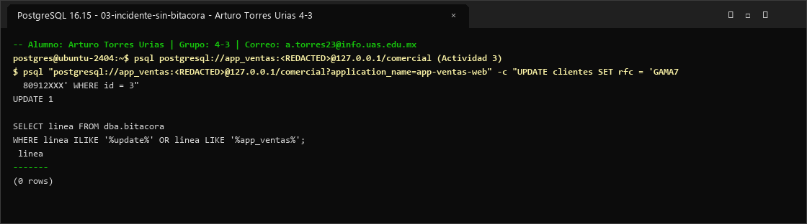

# Evidencia 03 — El Incidente sin Bitácora

- **Alumno:** Arturo Torres Urias
- **Grupo:** 4-3
- **Correo institucional:** a.torres23@info.uas.edu.mx
- **Materia:** Gestión de Seguridad y Desempeño de Bases de Datos
- **Unidad:** III — Auditoría, trazabilidad y gobierno práctico de datos
- **Laboratorio:** LAB-01 — Bitácoras y auditoría del dato en PostgreSQL
- **Motor:** PostgreSQL 16.15 (Ubuntu 16.15-0ubuntu0.24.04.1 on x86_64-pc-linux-gnu)
- **Actividad:** Actividad 3 — Simulación del incidente con la configuración de registro por defecto

---

## 1. Comandos Ejecutados

### Sesión por red (simulando a la aplicación de ventas)
```bash
psql "postgresql://app_ventas:<REDACTED>@127.0.0.1/comercial?application_name=app-ventas-web" \
  -c "UPDATE clientes SET rfc = 'GAMA780912XXX' WHERE id = 3"
```

### Sesión de administrador (búsqueda de evidencia en `dba.bitacora`)
```sql
SELECT linea FROM dba.bitacora
WHERE linea ILIKE '%update%' OR linea LIKE '%app_ventas%';
```

---

## 2. Resultado Obtenido



```text
-- En la terminal de app_ventas:
UPDATE 1

-- En la sesión del administrador:
SELECT linea FROM dba.bitacora
WHERE linea ILIKE '%update%' OR linea LIKE '%app_ventas%';
 linea 
-------
(0 rows)
```

---

## 3. Respuestas a las Preguntas de la Actividad 3

1. **¿Puedes demostrar quién modificó el RFC?**
   **No.** Aunque sabemos que la tabla `clientes` ahora tiene `rfc = 'GAMA780912XXX'` en el registro `id = 3`, en `dba.bitacora` hay **0 filas** relacionadas con `UPDATE` o con `app_ventas`. No existe ninguna evidencia técnica que demuestre si el cambio lo realizó `app_ventas`, el superusuario `postgres` u otro rol que hubiera tenido permisos en ese momento, ni a qué hora ni desde qué dirección IP ocurrió.

2. **¿Puedes demostrar que el cambio no lo hizo `soporte_ana`?**
   Con la bitácora **no** se puede demostrar qué hizo o no hizo `soporte_ana` porque no hay registro de conexiones ni de sentencias. Únicamente se podría argumentar de forma *indirecta* revisando los permisos actuales (`\dp clientes`), donde `soporte_ana` solo tiene `SELECT`; pero ni siquiera eso prueba que un administrador no le haya otorgado `UPDATE` temporalmente y luego se lo haya revocado, pues tampoco se registraban los comandos `GRANT`/`REVOKE`.

3. **Los privilegios de la Unidad II, ¿impidieron el cambio? ¿Debían impedirlo?**
   **No lo impidieron, y no debían impedirlo.** El control de acceso de la Unidad II está diseñado correctamente porque la aplicación de ventas (`app_ventas`) necesita legítimamente el privilegio `UPDATE` sobre `clientes` para operar el negocio. El control de acceso responde a *«¿quién puede hacerlo?»* (prevención), pero cuando un actor autorizado comete un error o abusa de su permiso legítimo, solo la **auditoría** puede responder *«¿quién lo hizo, cuándo y qué valor tenía antes?»*.

4. **¿Qué tendría que haber estado configurado antes del incidente?**
   Antes del incidente tendrían que haber estado activos:
   - En la bitácora del servidor: `logging_collector = on`, `log_connections = on`, `log_disconnections = on`, un `log_line_prefix` enriquecido con `%u`, `%d`, `%a`, `%h`, y `log_statement = 'mod'` para registrar las sentencias de modificación junto con su autor, aplicación e IP.
   - A nivel de dato: una **tabla de auditoría con disparador (`AFTER UPDATE`)** que conservara el valor anterior (`OLD.rfc = 'GAMA780912GHI'`) y el valor nuevo (`NEW.rfc = 'GAMA780912XXX'`).
