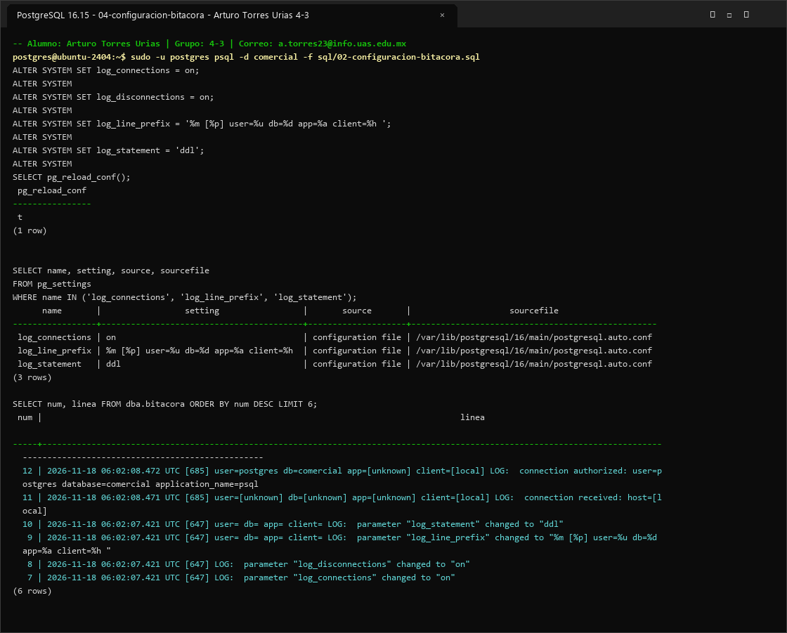

# Evidencia 04 — Configurar la Bitácora del Servidor

- **Alumno:** Arturo Torres Urias
- **Grupo:** 4-3
- **Correo institucional:** a.torres23@info.uas.edu.mx
- **Materia:** Gestión de Seguridad y Desempeño de Bases de Datos
- **Unidad:** III — Auditoría, trazabilidad y gobierno práctico de datos
- **Laboratorio:** LAB-01 — Bitácoras y auditoría del dato en PostgreSQL
- **Motor:** PostgreSQL 16.15 (Ubuntu 16.15-0ubuntu0.24.04.1 on x86_64-pc-linux-gnu)
- **Actividad:** Actividad 4 — Configuración de `log_connections`, `log_disconnections`, `log_line_prefix` y `log_statement`
- **Script asociado:** `sql/02-configuracion-bitacora.sql`

---

## 1. Comandos Ejecutados

```sql
ALTER SYSTEM SET log_connections = on;
ALTER SYSTEM SET log_disconnections = on;
ALTER SYSTEM SET log_line_prefix = '%m [%p] user=%u db=%d app=%a client=%h ';
ALTER SYSTEM SET log_statement = 'ddl';
SELECT pg_reload_conf();

-- Consulta en bloque posterior (tras la recarga asíncrona):
SELECT name, setting, source, sourcefile
FROM pg_settings
WHERE name IN ('log_connections', 'log_line_prefix', 'log_statement');

SELECT num, linea FROM dba.bitacora ORDER BY num DESC LIMIT 6;
```

---

## 2. Resultado Obtenido



```text
      name       |                 setting                 |       source       |                    sourcefile                    
-----------------+-----------------------------------------+--------------------+--------------------------------------------------
 log_connections | on                                      | configuration file | /var/lib/postgresql/16/main/postgresql.auto.conf
 log_line_prefix | %m [%p] user=%u db=%d app=%a client=%h  | configuration file | /var/lib/postgresql/16/main/postgresql.auto.conf
 log_statement   | ddl                                     | configuration file | /var/lib/postgresql/16/main/postgresql.auto.conf
(3 rows)

 num |                                                                                     linea                                                                                     
-----+-------------------------------------------------------------------------------------------------------------------------------------------------------------------------------
  12 | 2026-11-18 06:02:08.472 UTC [685] user=postgres db=comercial app=[unknown] client=[local] LOG:  connection authorized: user=postgres database=comercial application_name=psql
  11 | 2026-11-18 06:02:08.471 UTC [685] user=[unknown] db=[unknown] app=[unknown] client=[local] LOG:  connection received: host=[local]
  10 | 2026-11-18 06:02:07.421 UTC [647] user= db= app= client= LOG:  parameter "log_statement" changed to "ddl"
   9 | 2026-11-18 06:02:07.421 UTC [647] user= db= app= client= LOG:  parameter "log_line_prefix" changed to "%m [%p] user=%u db=%d app=%a client=%h "
   8 | 2026-11-18 06:02:07.421 UTC [647] LOG:  parameter "log_disconnections" changed to "on"
   7 | 2026-11-18 06:02:07.421 UTC [647] LOG:  parameter "log_connections" changed to "on"
(6 rows)
```

---

## 3. Respuestas a las Preguntas de la Actividad 4

1. **¿Por qué el proceso que registra el cambio es el principal y no tu sesión?**
   Porque cuando la sesión del administrador ejecuta `SELECT pg_reload_conf()`, únicamente envía la señal `SIGHUP` al proceso principal del servidor (*postmaster*, aquí con `PID 647`). Es el proceso principal quien relee `postgresql.conf` y `postgresql.auto.conf`, detecta qué parámetros globales cambiaron, registra en la bitácora los mensajes `LOG: parameter "..." changed to "..."` (con `user= db= app= client=` vacíos porque el *postmaster* no es una sesión de cliente) y propaga la señal a los procesos hijos.

2. **¿Qué pasaría si alguien ejecutara `ALTER SYSTEM SET log_statement = 'none'`? ¿Quedaría rastro?**
   **Sí quedaría rastro en dos niveles:**
   - Primero, como en ese momento `log_statement` ya vale `'ddl'` (o `'mod'`), la propia sentencia `ALTER SYSTEM SET log_statement = 'none'` se registra como `LOG: statement: ALTER SYSTEM SET log_statement = 'none'` con el usuario, IP y aplicación de la sesión que la ejecutó.
   - Segundo, al ejecutar `SELECT pg_reload_conf()`, el proceso principal registra `LOG: parameter "log_statement" changed to "none"`, dejando evidencia exacta del instante en que se apagó el registro de sentencias.

3. **¿Por qué no se recomienda editar `postgresql.auto.conf` a mano?**
   Porque `postgresql.auto.conf` es un archivo administrado exclusivamente de forma automática por el comando `ALTER SYSTEM`. Si un administrador lo edita manualmente, cualquier ejecución futura de `ALTER SYSTEM` reescribirá el archivo completo pudiendo sobrescribir o corromper cambios manuales, además de que un error de sintaxis introducido a mano impediría que el servidor recargue su configuración o vuelva a arrancar, y se perdería el registro en bitácora de la sentencia `ALTER SYSTEM` que realizó el cambio.
