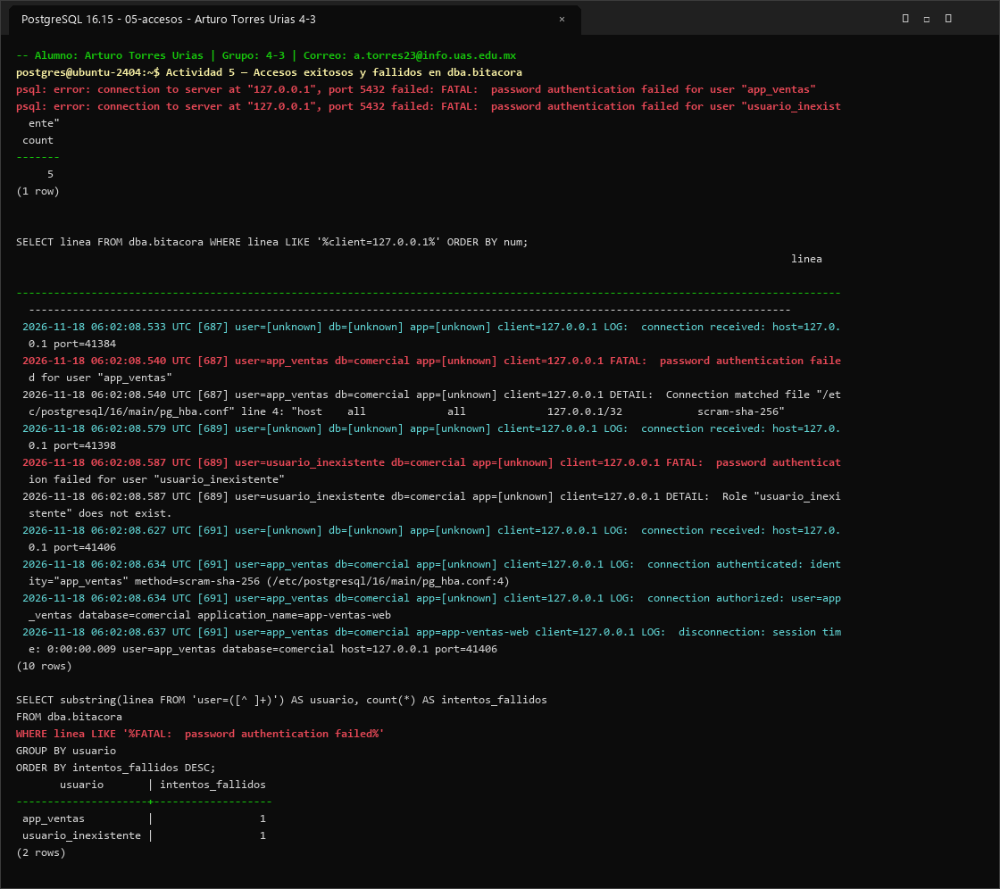

# Evidencia 05 — Accesos Exitosos y Fallidos

- **Alumno:** Arturo Torres Urias
- **Grupo:** 4-3
- **Correo institucional:** a.torres23@info.uas.edu.mx
- **Materia:** Gestión de Seguridad y Desempeño de Bases de Datos
- **Unidad:** III — Auditoría, trazabilidad y gobierno práctico de datos
- **Laboratorio:** LAB-01 — Bitácoras y auditoría del dato en PostgreSQL
- **Motor:** PostgreSQL 16.15 (Ubuntu 16.15-0ubuntu0.24.04.1 on x86_64-pc-linux-gnu)
- **Actividad:** Actividad 5 — Registro e interpretación de intentos de conexión exitosos y fallidos

---

## 1. Comandos Ejecutados

### En la terminal (tres intentos de conexión por red)
```bash
psql "postgresql://app_ventas:<REDACTED>@127.0.0.1/comercial" -c "SELECT 1"
psql "postgresql://usuario_inexistente:<REDACTED>@127.0.0.1/comercial" -c "SELECT 1"
psql "postgresql://app_ventas:<REDACTED>@127.0.0.1/comercial?application_name=app-ventas-web" -c "SELECT count(*) FROM clientes"
```

### En la sesión del administrador
```sql
SELECT linea FROM dba.bitacora WHERE linea LIKE '%client=127.0.0.1%' ORDER BY num;
```

---

## 2. Resultado Obtenido



```text
-- Salida en terminal de los 3 intentos:
psql: error: connection to server at "127.0.0.1", port 5432 failed: FATAL:  password authentication failed for user "app_ventas"
psql: error: connection to server at "127.0.0.1", port 5432 failed: FATAL:  password authentication failed for user "usuario_inexistente"
 count 
-------
     5
(1 row)

-- Líneas en dba.bitacora:
2026-11-18 06:02:08.533 UTC [687] user=[unknown] db=[unknown] app=[unknown] client=127.0.0.1 LOG:  connection received: host=127.0.0.1 port=41384
2026-11-18 06:02:08.540 UTC [687] user=app_ventas db=comercial app=[unknown] client=127.0.0.1 FATAL:  password authentication failed for user "app_ventas"
2026-11-18 06:02:08.540 UTC [687] user=app_ventas db=comercial app=[unknown] client=127.0.0.1 DETAIL:  Connection matched file "/etc/postgresql/16/main/pg_hba.conf" line 4: "host    all             all             127.0.0.1/32            scram-sha-256"
2026-11-18 06:02:08.579 UTC [689] user=[unknown] db=[unknown] app=[unknown] client=127.0.0.1 LOG:  connection received: host=127.0.0.1 port=41398
2026-11-18 06:02:08.587 UTC [689] user=usuario_inexistente db=comercial app=[unknown] client=127.0.0.1 FATAL:  password authentication failed for user "usuario_inexistente"
2026-11-18 06:02:08.587 UTC [689] user=usuario_inexistente db=comercial app=[unknown] client=127.0.0.1 DETAIL:  Role "usuario_inexistente" does not exist.
	Connection matched file "/etc/postgresql/16/main/pg_hba.conf" line 4: "host    all             all             127.0.0.1/32            scram-sha-256"
2026-11-18 06:02:08.627 UTC [691] user=[unknown] db=[unknown] app=[unknown] client=127.0.0.1 LOG:  connection received: host=127.0.0.1 port=41406
2026-11-18 06:02:08.634 UTC [691] user=app_ventas db=comercial app=[unknown] client=127.0.0.1 LOG:  connection authenticated: identity="app_ventas" method=scram-sha-256 (/etc/postgresql/16/main/pg_hba.conf:4)
2026-11-18 06:02:08.634 UTC [691] user=app_ventas db=comercial app=[unknown] client=127.0.0.1 LOG:  connection authorized: user=app_ventas database=comercial application_name=app-ventas-web
2026-11-18 06:02:08.637 UTC [691] user=app_ventas db=comercial app=app-ventas-web client=127.0.0.1 LOG:  disconnection: session time: 0:00:00.009 user=app_ventas database=comercial host=127.0.0.1 port=41406
```

---

## 3. Tabla 11.1 — Leer una línea campo por campo

| Campo | Valor observado | Significado |
| :--- | :--- | :--- |
| **Fecha y hora** | `2026-11-18 06:02:08.540 UTC` | Marca de tiempo exacta (con milisegundos y huso horario UTC) en que ocurrió el evento (`%m`). |
| **PID** | `687` | Identificador del proceso *backend* (`%p`) que atendió ese intento de conexión y permite correlacionar todas sus líneas. |
| **Usuario** | `app_ventas` | Nombre del rol de PostgreSQL solicitado en el paquete de arranque de la conexión (`%u`). |
| **Base de datos** | `comercial` | Base de datos a la que el cliente solicitó conectarse (`%d`). |
| **Aplicación** | `[unknown]` | Nombre de aplicación (`%a`), aún desconocido porque no se ha completado la fase de autorización de la sesión. |
| **Cliente** | `127.0.0.1` | Dirección IP de origen desde donde se abrió el socket TCP (`%h`). |
| **Severidad** | `FATAL` | Nivel de error que aborta de inmediato el intento de sesión. |
| **Mensaje** | `password authentication failed for user "app_ventas"` | Causa del rechazo: la contraseña proporcionada no superó la validación `scram-sha-256`. |
| **Regla aplicada** | `pg_hba.conf` línea 4 (`host all all 127.0.0.1/32 scram-sha-256`) | Línea exacta del archivo `pg_hba.conf` que coincidió con la conexión y exigió autenticación `scram-sha-256`. |

---

## 4. Respuestas a las Preguntas de la Actividad 5

1. **La bitácora registra el usuario `app_ventas` en el intento fallido. ¿Eso prueba que la aplicación de ventas intentó entrar? ¿Qué prueba realmente?**
   **No prueba que haya sido la aplicación legítima de ventas.** Lo único que prueba realmente es que un proceso desde la dirección IP `127.0.0.1` (puerto efímero `41384`) envió un paquete de inicio solicitando autenticarse con el nombre de usuario `app_ventas` hacia la base `comercial` y **no conocía la contraseña correcta** (o tenía mal configurada su credencial).

2. **¿Qué información adicional registra PostgreSQL cuando el rol no existe? ¿Por qué aparece en la bitácora y no en el mensaje que recibe el cliente?**
   En la bitácora interna registra la línea adicional `DETAIL: Role "usuario_inexistente" does not exist.`, mientras que al cliente externo le devuelve exactamente el mismo mensaje genérico `FATAL: password authentication failed for user "usuario_inexistente"`. Esto se hace por seguridad para **impedir la enumeración de usuarios**: si el servidor le dijera al cliente externo qué usuarios existen y cuáles no, un atacante podría descubrir nombres de cuentas válidas antes de lanzar un ataque de diccionario. En cambio, el DBA sí necesita ver ese `DETAIL` en la bitácora para distinguir errores de escritura de ataques de reconocimiento.

3. **¿Por qué `app=[unknown]` en el intento fallido, pero `app=app-ventas-web` en la desconexión?**
   Porque PostgreSQL procesa y asigna los parámetros de sesión (como `application_name`) recién **después** de que la autenticación y la autorización tienen éxito (`LOG: connection authorized: ... application_name=app-ventas-web`). Durante `connection received`, `connection authenticated` o un fallo `FATAL` de autenticación, `application_name` aún no se ha aplicado al contexto del proceso y por eso `%a` muestra `[unknown]`.

4. **¿Qué patrón de varias líneas te haría sospechar de un ataque de fuerza bruta? Escribe la consulta que contaría los intentos fallidos por usuario.**
   Un patrón de múltiples líneas `FATAL: password authentication failed` en un intervalo muy corto (varios intentos por segundo o por minuto), con distintos PIDs consecutivos desde una misma dirección IP (`client=...`), ya sea contra un mismo rol (ataque de fuerza bruta/diccionario contra `postgres` o `app_ventas`) o probando decenas de nombres de rol inexistentes (`Role "..." does not exist`, ataque de enumeración/credential stuffing).

   **Consulta SQL para contar intentos fallidos por usuario:**
   ```sql
   SELECT substring(linea FROM 'user=([^ ]+)') AS usuario,
          count(*) AS intentos_fallidos
   FROM dba.bitacora
   WHERE linea LIKE '%FATAL:  password authentication failed%'
   GROUP BY usuario
   ORDER BY intentos_fallidos DESC;
   ```
   **Resultado obtenido:**
   ```text
          usuario       | intentos_fallidos 
   ---------------------+-------------------
    app_ventas          |                 1
    usuario_inexistente |                 1
   (2 rows)
   ```
