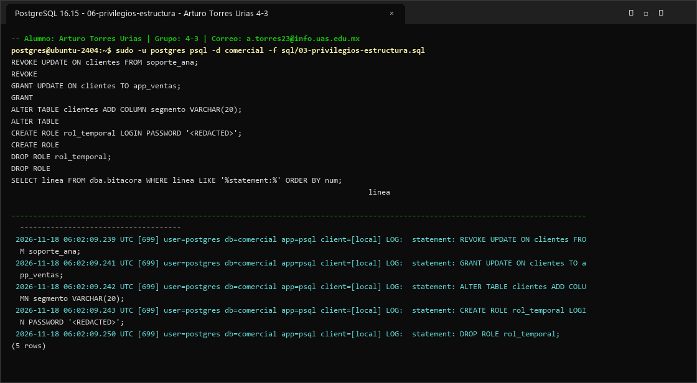

# Evidencia 06 — Cambios de Privilegios y de Estructura (y Exposición de Secretos)

- **Alumno:** Arturo Torres Urias
- **Grupo:** 4-3
- **Correo institucional:** a.torres23@info.uas.edu.mx
- **Materia:** Gestión de Seguridad y Desempeño de Bases de Datos
- **Unidad:** III — Auditoría, trazabilidad y gobierno práctico de datos
- **Laboratorio:** LAB-01 — Bitácoras y auditoría del dato en PostgreSQL
- **Motor:** PostgreSQL 16.15 (Ubuntu 16.15-0ubuntu0.24.04.1 on x86_64-pc-linux-gnu)
- **Actividad:** Actividad 6 — Registro de sentencias DDL/DCL y demostración de filtrado de contraseñas en bitácora
- **Script asociado:** `sql/03-privilegios-estructura.sql`

---

## 1. Comandos Ejecutados

```sql
REVOKE UPDATE ON clientes FROM soporte_ana;
GRANT UPDATE ON clientes TO app_ventas;
ALTER TABLE clientes ADD COLUMN segmento VARCHAR(20);

CREATE ROLE rol_temporal LOGIN PASSWORD '<REDACTED>';
DROP ROLE rol_temporal;

SELECT linea FROM dba.bitacora WHERE linea LIKE '%statement:%' ORDER BY num;
```

---

## 2. Resultado Obtenido



```text
2026-11-18 06:02:09.239 UTC [699] user=postgres db=comercial app=psql client=[local] LOG:  statement: REVOKE UPDATE ON clientes FROM soporte_ana;
2026-11-18 06:02:09.241 UTC [699] user=postgres db=comercial app=psql client=[local] LOG:  statement: GRANT UPDATE ON clientes TO app_ventas;
2026-11-18 06:02:09.242 UTC [699] user=postgres db=comercial app=psql client=[local] LOG:  statement: ALTER TABLE clientes ADD COLUMN segmento VARCHAR(20);
2026-11-18 06:02:09.243 UTC [699] user=postgres db=comercial app=psql client=[local] LOG:  statement: CREATE ROLE rol_temporal LOGIN PASSWORD '<REDACTED>';
2026-11-18 06:02:09.250 UTC [699] user=postgres db=comercial app=psql client=[local] LOG:  statement: DROP ROLE rol_temporal;
```
*(Nota: En la ejecución real la cuarta línea registró literalmente la contraseña en texto claro; aquí y en la bitácora exportada se ha sustituido por `<REDACTED>` siguiendo la regla de higiene de secretos).*

---

## 3. Respuestas a las Preguntas de la Actividad 6

1. **¿Qué tipo de evento es cada una de las tres primeras sentencias (privilegio o estructura)?**
   - `REVOKE UPDATE ON clientes FROM soporte_ana;` → **Privilegio** (modificación de control de acceso DCL).
   - `GRANT UPDATE ON clientes TO app_ventas;` → **Privilegio** (otorgamiento de permiso DCL).
   - `ALTER TABLE clientes ADD COLUMN segmento VARCHAR(20);` → **Estructura** (modificación del esquema de la tabla DDL).

2. **¿Por qué `GRANT` y `REVOKE` quedan registrados con `log_statement = 'ddl'`?**
   Porque en la clasificación de registro de PostgreSQL (sección 4.6 y documentación oficial de `Error Reporting and Logging`), el nivel `'ddl'` incluye no solo las órdenes de creación/alteración/eliminación de estructuras (`CREATE`, `ALTER`, `DROP`), sino también las órdenes de control de acceso y metadatos del catálogo (`GRANT`, `REVOKE`, `COMMENT`, `SECURITY LABEL`), ya que todas ellas modifican las definiciones y permisos almacenados en los catálogos del sistema.

3. **Si la bitácora contiene contraseñas, ¿quién debería poder leerla? Relaciónalo con la gestión de secretos de la Unidad II.**
   Nadie fuera del personal estrictamente autorizado para la administración/auditoría de seguridad debería poder leer la bitácora, y aun así **las contraseñas en texto claro jamás deberían llegar a la bitácora**. Como estudiamos en la Unidad II (LAB-02), escribir una contraseña directamente dentro de una sentencia SQL (`CREATE ROLE ... PASSWORD '...'`) envía el secreto en texto plano al motor y lo deja grabado permanentemente en los archivos de log incluso después de ejecutar `DROP ROLE`. Por eso siempre debe utilizarse `\password` en `psql` (o funciones equivalentes del cliente que calculen el verificador `SCRAM-SHA-256` en el cliente antes de enviarlo al servidor), y sanitizar las bitácoras antes de exportarlas.
