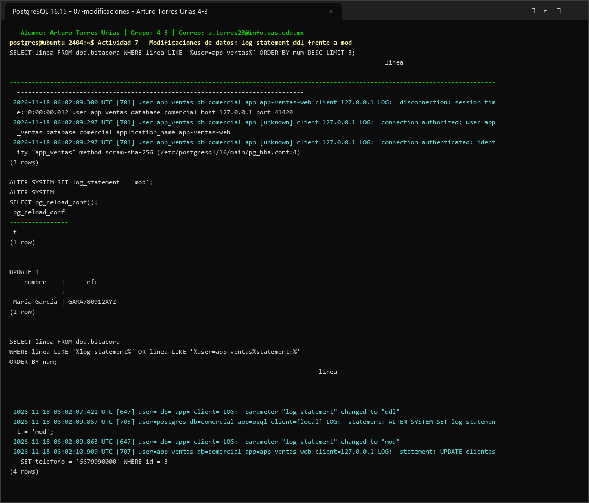

# Evidencia 07 — Modificaciones de Datos: `ddl` frente a `mod`

- **Alumno:** Arturo Torres Urias
- **Grupo:** 4-3
- **Correo institucional:** a.torres23@info.uas.edu.mx
- **Materia:** Gestión de Seguridad y Desempeño de Bases de Datos
- **Unidad:** III — Auditoría, trazabilidad y gobierno práctico de datos
- **Laboratorio:** LAB-01 — Bitácoras y auditoría del dato en PostgreSQL
- **Motor:** PostgreSQL 16.15 (Ubuntu 16.15-0ubuntu0.24.04.1 on x86_64-pc-linux-gnu)
- **Actividad:** Actividad 7 — Comparación entre `log_statement = 'ddl'` y `log_statement = 'mod'` ante cambios en datos

---

## 1. Comandos Ejecutados

### Parte 1: Con `log_statement = 'ddl'`
```bash
psql "postgresql://app_ventas:<REDACTED>@127.0.0.1/comercial?application_name=app-ventas-web" \
  -c "UPDATE clientes SET rfc = 'GAMA780912XYZ' WHERE id = 3"
```
```sql
SELECT linea FROM dba.bitacora WHERE linea LIKE '%user=app_ventas%' ORDER BY num DESC LIMIT 3;
```

### Parte 2: Cambio a `log_statement = 'mod'` y nueva modificación + consulta
```sql
ALTER SYSTEM SET log_statement = 'mod';
SELECT pg_reload_conf();
```
```bash
psql "postgresql://app_ventas:<REDACTED>@127.0.0.1/comercial?application_name=app-ventas-web" \
  -c "UPDATE clientes SET telefono = '6679990000' WHERE id = 3" \
  -c "SELECT nombre, rfc FROM clientes WHERE id = 3"
```
```sql
SELECT linea FROM dba.bitacora
WHERE linea LIKE '%log_statement%' OR linea LIKE '%user=app_ventas%statement:%'
ORDER BY num;
```

---

## 2. Resultado Obtenido



```text
-- Con log_statement = 'ddl' (solo aparecen conexión y desconexión, NO el UPDATE):
2026-11-18 06:02:09.300 UTC [701] user=app_ventas db=comercial app=app-ventas-web client=127.0.0.1 LOG:  disconnection: session time: 0:00:00.012 user=app_ventas database=comercial host=127.0.0.1 port=41420
2026-11-18 06:02:09.297 UTC [701] user=app_ventas db=comercial app=[unknown] client=127.0.0.1 LOG:  connection authorized: user=app_ventas database=comercial application_name=app-ventas-web
2026-11-18 06:02:09.297 UTC [701] user=app_ventas db=comercial app=[unknown] client=127.0.0.1 LOG:  connection authenticated: identity="app_ventas" method=scram-sha-256 (/etc/postgresql/16/main/pg_hba.conf:4)

-- Tras cambiar a log_statement = 'mod':
2026-11-18 06:02:07.421 UTC [647] user= db= app= client= LOG:  parameter "log_statement" changed to "ddl"
2026-11-18 06:02:09.857 UTC [705] user=postgres db=comercial app=psql client=[local] LOG:  statement: ALTER SYSTEM SET log_statement = 'mod';
2026-11-18 06:02:09.863 UTC [647] user= db= app= client= LOG:  parameter "log_statement" changed to "mod"
2026-11-18 06:02:10.909 UTC [707] user=app_ventas db=comercial app=app-ventas-web client=127.0.0.1 LOG:  statement: UPDATE clientes SET telefono = '6679990000' WHERE id = 3
```

---

## 3. Respuestas a las Preguntas de la Actividad 7

1. **¿Qué nivel habría registrado la lectura del RFC? ¿Qué costo tendría en un servidor con miles de consultas por minuto?**
   La lectura (`SELECT nombre, rfc FROM clientes WHERE id = 3`) solo se habría registrado con **`log_statement = 'all'`**. En un servidor productivo con miles de consultas por minuto, activar `'all'` tendría un **costo muy alto en tres dimensiones**:
   - **Desempeño e I/O de disco:** El proceso colector tendría que escribir continuamente miles de líneas por minuto en disco, generando contención de E/S.
   - **Almacenamiento y rotación:** Los archivos de bitácora crecerían rápidamente (gigabytes por hora), agotando el espacio en disco o provocando rotaciones tan frecuentes que dificultarían su conservación y análisis.
   - **Privacidad y seguridad:** Todas las consultas con filtros o parámetros literales sensibles quedarían copiadas en texto claro dentro de los archivos de log.

2. **¿Qué le falta a esta bitácora para revertir el cambio con certeza?**
   Le falta **el valor anterior del dato (`OLD`)** y saber exactamente **qué filas fueron afectadas**. La línea `LOG: statement: UPDATE clientes SET telefono = '6679990000' WHERE id = 3` muestra qué nuevo valor se escribió (`'6679990000'`), pero no conserva qué número telefónico tenía María García antes de esa sentencia (`'6673456789'`). Sin una auditoría a nivel de dato (Parte B), no es posible restaurar el valor previo a partir únicamente de la bitácora de sentencias.
