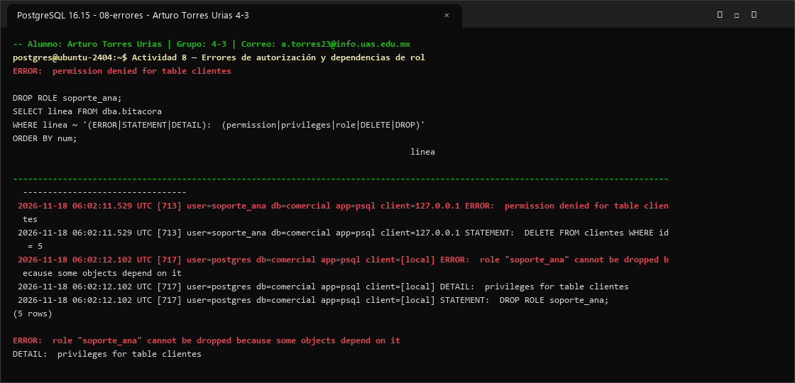

# Evidencia 08 — Errores y Operaciones Rechazadas

- **Alumno:** Arturo Torres Urias
- **Grupo:** 4-3
- **Correo institucional:** a.torres23@info.uas.edu.mx
- **Materia:** Gestión de Seguridad y Desempeño de Bases de Datos
- **Unidad:** III — Auditoría, trazabilidad y gobierno práctico de datos
- **Laboratorio:** LAB-01 — Bitácoras y auditoría del dato en PostgreSQL
- **Motor:** PostgreSQL 16.15 (Ubuntu 16.15-0ubuntu0.24.04.1 on x86_64-pc-linux-gnu)
- **Actividad:** Actividad 8 — Registro de errores de autorización y de integridad de objetos (`log_min_error_statement = error`)

---

## 1. Comandos Ejecutados

### Como analista de soporte (`soporte_ana`)
```bash
psql "postgresql://soporte_ana:<REDACTED>@127.0.0.1/comercial" \
  -c "DELETE FROM clientes WHERE id = 5"
```

### Como administrador (`postgres`)
```sql
DROP ROLE soporte_ana;

SELECT linea FROM dba.bitacora
WHERE linea ~ '(ERROR|STATEMENT|DETAIL):  (permission|privileges|role|DELETE|DROP)'
ORDER BY num;
```

---

## 2. Resultado Obtenido



```text
-- En la terminal de soporte_ana:
ERROR:  permission denied for table clientes

-- En la sesión del administrador:
ERROR:  role "soporte_ana" cannot be dropped because some objects depend on it
DETAIL:  privileges for table clientes

-- En dba.bitacora:
2026-11-18 06:02:11.529 UTC [713] user=soporte_ana db=comercial app=psql client=127.0.0.1 ERROR:  permission denied for table clientes
2026-11-18 06:02:11.529 UTC [713] user=soporte_ana db=comercial app=psql client=127.0.0.1 STATEMENT:  DELETE FROM clientes WHERE id = 5
2026-11-18 06:02:12.102 UTC [717] user=postgres db=comercial app=psql client=[local] ERROR:  role "soporte_ana" cannot be dropped because some objects depend on it
2026-11-18 06:02:12.102 UTC [717] user=postgres db=comercial app=psql client=[local] DETAIL:  privileges for table clientes
2026-11-18 06:02:12.102 UTC [717] user=postgres db=comercial app=psql client=[local] STATEMENT:  DROP ROLE soporte_ana;
```

---

## 3. Respuestas a las Preguntas de la Actividad 8

1. **¿El intento de `soporte_ana` causó algún daño? ¿Por qué debe auditarse de todos modos?**
   **No causó daño a los datos**, porque el control de acceso (`GRANT SELECT`) rechazó la operación `DELETE` antes de que tocara la fila. Sin embargo, **debe auditarse obligatoriamente** porque un intento rechazado de eliminar o modificar datos para los que no se tiene permiso es un indicador temprano de:
   - Un intento de **abuso de privilegios o sabotaje interno** por parte del usuario autenticado.
   - Una **cuenta comprometida** donde un atacante está explorando qué acciones puede ejecutar lateralmente.
   - Una **mala configuración de una aplicación** que está intentando ejecutar operaciones indebidas.

2. **¿Qué diferencia hay entre un error de autorización (esta actividad) y uno de autenticación (Actividad 5)?**
   - En un **error de autenticación** (Actividad 5, severidad `FATAL`), el cliente no logra demostrar su identidad ante `pg_hba.conf` (contraseña incorrecta o rol inexistente) y **no llega a abrir una sesión** en la base de datos.
   - En un **error de autorización** (Actividad 8, severidad `ERROR`), el usuario `soporte_ana` **ya se autenticó válidamente y tiene una sesión abierta**, pero intenta ejecutar una operación (`DELETE FROM clientes`) sobre un objeto para el cual sus privilegios vigentes no se lo permiten; la sentencia se aborta pero la sesión puede continuar.

3. **¿Qué indica el error de `DROP ROLE` sobre el orden correcto para dar de baja a un usuario?**
   Indica que PostgreSQL protege la integridad referencial del catálogo de permisos: no permite eliminar un rol mientras existan objetos o privilegios que dependan de él (`DETAIL: privileges for table clientes`). El procedimiento correcto para dar de baja una cuenta es:
   1. Primero bloquear su acceso inmediato con `ALTER ROLE soporte_ana NOLOGIN;` y terminar sus sesiones activas si las hubiera.
   2. Reasignar sus objetos si fuera propietario (`REASSIGN OWNED BY soporte_ana TO ...`) y revocar todos sus privilegios (`REVOKE ALL PRIVILEGES ON ALL TABLES IN SCHEMA public FROM soporte_ana;` o `DROP OWNED BY soporte_ana;`).
   3. Finalmente ejecutar `DROP ROLE soporte_ana;`, dejando constancia completa de cada paso en la bitácora.
