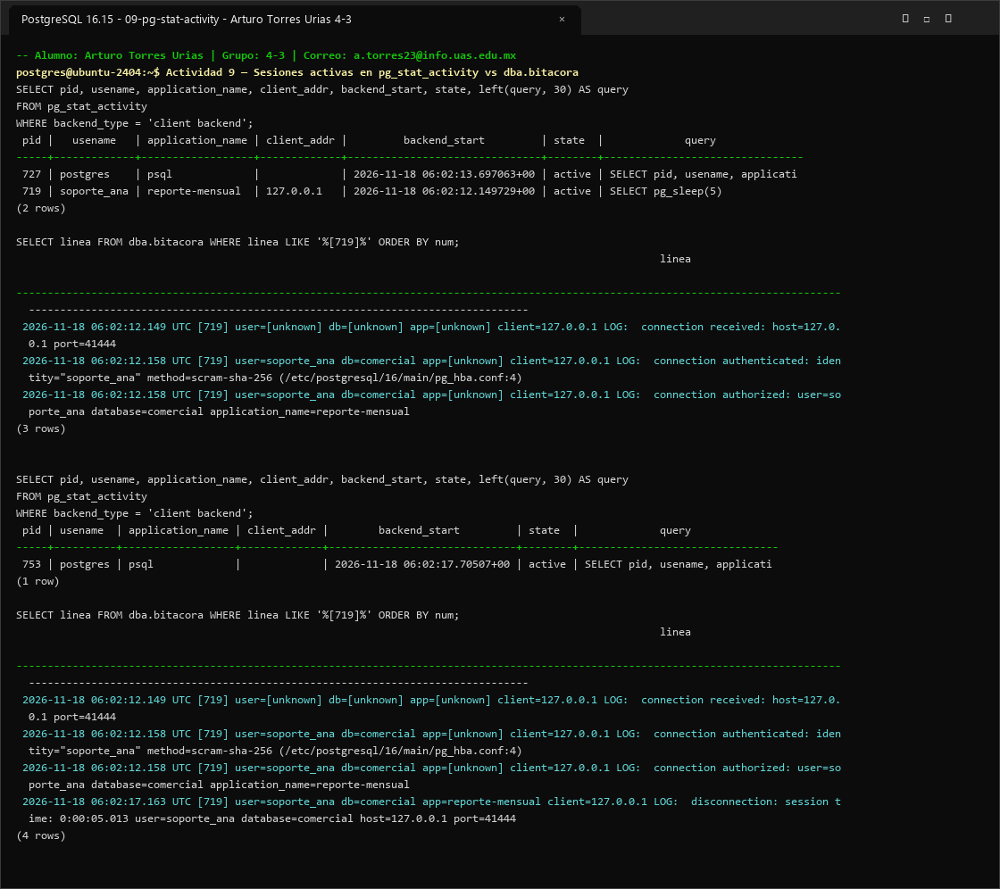

# Evidencia 09 — Sesiones Activas con `pg_stat_activity`

- **Alumno:** Arturo Torres Urias
- **Grupo:** 4-3
- **Correo institucional:** a.torres23@info.uas.edu.mx
- **Materia:** Gestión de Seguridad y Desempeño de Bases de Datos
- **Unidad:** III — Auditoría, trazabilidad y gobierno práctico de datos
- **Laboratorio:** LAB-01 — Bitácoras y auditoría del dato en PostgreSQL
- **Motor:** PostgreSQL 16.15 (Ubuntu 16.15-0ubuntu0.24.04.1 on x86_64-pc-linux-gnu)
- **Actividad:** Actividad 9 — Comparación entre estado actual (`pg_stat_activity`) e historia (`dba.bitacora`)

---

## 1. Comandos Ejecutados

### En una segunda terminal (simulando reporte de larga duración)
```bash
psql "postgresql://soporte_ana:<REDACTED>@127.0.0.1/comercial?application_name=reporte-mensual" \
  -c "SELECT pg_sleep(90)"
```

### En la sesión de administrador (mientras el reporte está en ejecución y después de que termina)
```sql
SELECT pid, usename, application_name, client_addr, backend_start, state, left(query, 30) AS query
FROM pg_stat_activity
WHERE backend_type = 'client backend';

SELECT linea FROM dba.bitacora WHERE linea LIKE '%[719]%' ORDER BY num;
```

---

## 2. Resultado Obtenido



```text
-- 1. Mientras el reporte está en ejecución en pg_stat_activity:
 pid |   usename   | application_name | client_addr |         backend_start         | state  |             query              
-----+-------------+------------------+-------------+-------------------------------+--------+--------------------------------
 727 | postgres    | psql             |             | 2026-11-18 06:02:13.697063+00 | active | SELECT pid, usename, applicati
 719 | soporte_ana | reporte-mensual  | 127.0.0.1   | 2026-11-18 06:02:12.149729+00 | active | SELECT pg_sleep(5)
(2 rows)

-- 2. Después de que termina el reporte, al repetir la consulta a pg_stat_activity:
 pid | usename  | application_name | client_addr |        backend_start         | state  |             query              
-----+----------+------------------+-------------+------------------------------+--------+--------------------------------
 753 | postgres | psql             |             | 2026-11-18 06:02:17.70507+00 | active | SELECT pid, usename, applicati
(1 row)

-- 3. Búsqueda del PID [719] en dba.bitacora después de terminar la sesión:
2026-11-18 06:02:12.149 UTC [719] user=[unknown] db=[unknown] app=[unknown] client=127.0.0.1 LOG:  connection received: host=127.0.0.1 port=41444
2026-11-18 06:02:12.158 UTC [719] user=soporte_ana db=comercial app=[unknown] client=127.0.0.1 LOG:  connection authenticated: identity="soporte_ana" method=scram-sha-256 (/etc/postgresql/16/main/pg_hba.conf:4)
2026-11-18 06:02:12.158 UTC [719] user=soporte_ana db=comercial app=[unknown] client=127.0.0.1 LOG:  connection authorized: user=soporte_ana database=comercial application_name=reporte-mensual
2026-11-18 06:02:17.163 UTC [719] user=soporte_ana db=comercial app=reporte-mensual client=127.0.0.1 LOG:  disconnection: session time: 0:00:05.013 user=soporte_ana database=comercial host=127.0.0.1 port=41444
```

---

## 3. Respuestas a las Preguntas de la Actividad 9

1. **¿Qué columna permite relacionar una sesión con sus líneas de bitácora?**
   La columna **`pid`** (identificador del proceso del servidor en `pg_stat_activity`), que corresponde exactamente al marcador **`%p`** entre corchetes (`[719]`) configurado en `log_line_prefix`.

2. **Después de que termina el reporte, ¿qué fuente conserva evidencia de que existió?**
   Únicamente **la bitácora del servidor (`dba.bitacora`)**, donde permanecen registradas la recepción de la conexión, la autenticación, la autorización con `application_name=reporte-mensual` y la desconexión con la duración total (`session time`). En cuanto el proceso termina, su fila desaparece inmediatamente de `pg_stat_activity` porque esta vista solo muestra una fotografía de los procesos vivos en ese instante.

3. **¿Por qué `client_addr` aparece vacío en la sesión del administrador?**
   Porque la sesión del administrador se abrió localmente mediante un **socket de dominio Unix** (`/var/run/postgresql/.s.PGSQL.5432`, regla `local` en `pg_hba.conf`) y no mediante la pila de red TCP/IP. Al no existir dirección IP de origen en una conexión por socket Unix local, `client_addr` (e `inet_client_addr()`) devuelve `NULL` (vacío) en `pg_stat_activity`, mientras que en la bitácora el marcador `%h` muestra `[local]`.
