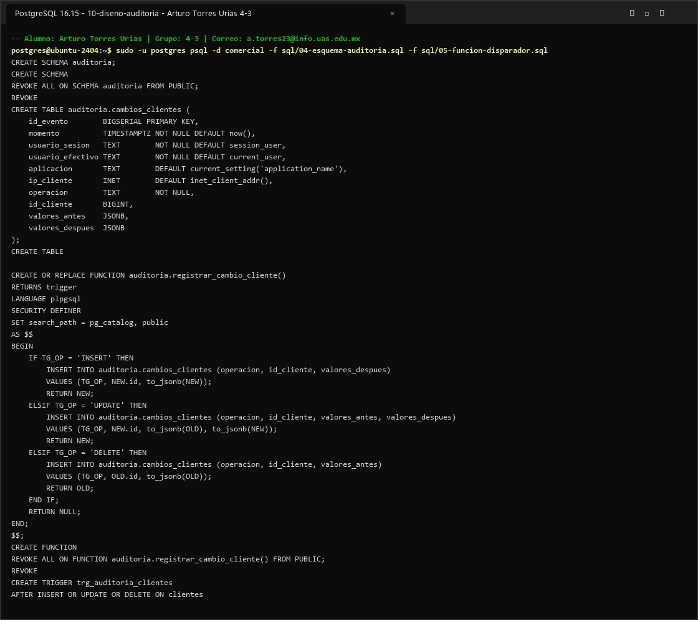

# Evidencia 10 — Diseñar y Crear el Registro de Auditoría (y Función/Disparador)

- **Alumno:** Arturo Torres Urias
- **Grupo:** 4-3
- **Correo institucional:** a.torres23@info.uas.edu.mx
- **Materia:** Gestión de Seguridad y Desempeño de Bases de Datos
- **Unidad:** III — Auditoría, trazabilidad y gobierno práctico de datos
- **Laboratorio:** LAB-01 — Bitácoras y auditoría del dato en PostgreSQL
- **Motor:** PostgreSQL 16.15 (Ubuntu 16.15-0ubuntu0.24.04.1 on x86_64-pc-linux-gnu)
- **Actividades cubiertas:** Actividad 10 y Actividad 11
- **Scripts asociados:** `sql/04-esquema-auditoria.sql` y `sql/05-funcion-disparador.sql`

---

## 1. Tabla de Diseño del Registro de Auditoría (Actividad 10)

| Campo propuesto | Tipo | ¿Qué pregunta de Dirección responde? | ¿Puede ser nulo? ¿Por qué? |
| :--- | :--- | :--- | :--- |
| `id_evento` | `BIGSERIAL` | Identificador único y secuencial de cada evento auditable (permite referenciar y ordenar eventos). | **No** (`PRIMARY KEY NOT NULL`): cada fila de auditoría debe tener una clave primaria irrepetible. |
| `momento` | `TIMESTAMPTZ` | **2. ¿Cuándo ocurrió el cambio?** | **No** (`NOT NULL DEFAULT now()`): todo evento ocurre en un instante temporal exacto y un registro sin fecha/hora carece de valor cronológico. |
| `usuario_sesion` | `TEXT` | **1. ¿Quién hizo el cambio?** (Rol con que se autenticó originalmente la sesión: `session_user`). | **No** (`NOT NULL DEFAULT session_user`): toda sesión en PostgreSQL pertenece siempre a un rol autenticado. |
| `usuario_efectivo` | `TEXT` | **1. ¿Quién hizo el cambio?** (Rol cuyos privilegios estaban vigentes al insertar en la auditoría: `current_user`). | **No** (`NOT NULL DEFAULT current_user`): siempre existe un contexto de privilegios activo durante la ejecución. |
| `aplicacion` | `TEXT` | **3. ¿Desde qué aplicación o equipo?** (`current_setting('application_name')`). | **Sí** (o cadena vacía): un cliente puede conectarse sin declarar `application_name`, aunque por defecto recibe el valor de la sesión. |
| `ip_cliente` | `INET` | **3. ¿Desde qué aplicación o equipo?** (`inet_client_addr()`, dirección IP de origen). | **Sí**: cuando la conexión ocurre mediante socket Unix local (`[local]`), no existe dirección IP TCP y `inet_client_addr()` devuelve `NULL`. |
| `operacion` | `TEXT` | **¿Qué tipo de modificación ocurrió?** (`INSERT`, `UPDATE` o `DELETE` vía `TG_OP`). | **No** (`NOT NULL`): todo disparo proviene obligatoriamente de una operación DML específica. |
| `id_cliente` | `BIGINT` | **¿Sobre qué registro de `clientes` ocurrió el cambio?** (`NEW.id` u `OLD.id`). | **Sí** (en definición general, aunque siempre se llena con `NEW.id`/`OLD.id`): permite indexar y buscar rápido por el cliente afectado (ej. `id = 3`). |
| `valores_antes` | `JSONB` | **5. ¿Qué valor tenía el RFC (y demás campos) antes del cambio?** (`to_jsonb(OLD)`). | **Sí**: en una operación **`INSERT`** no existe registro previo (`OLD` no aplica), por lo que `valores_antes` debe ser `NULL`. |
| `valores_despues` | `JSONB` | **5. ¿A qué nuevo valor cambió el registro?** (`to_jsonb(NEW)`). | **Sí**: en una operación **`DELETE`** el registro deja de existir (`NEW` no aplica), por lo que `valores_despues` debe ser `NULL`. |

---

## 2. Comandos Ejecutados (Actividades 10 y 11)

```sql
CREATE SCHEMA auditoria;
REVOKE ALL ON SCHEMA auditoria FROM PUBLIC;

CREATE TABLE auditoria.cambios_clientes (
    id_evento        BIGSERIAL PRIMARY KEY,
    momento          TIMESTAMPTZ NOT NULL DEFAULT now(),
    usuario_sesion   TEXT        NOT NULL DEFAULT session_user,
    usuario_efectivo TEXT        NOT NULL DEFAULT current_user,
    aplicacion       TEXT        DEFAULT current_setting('application_name'),
    ip_cliente       INET        DEFAULT inet_client_addr(),
    operacion        TEXT        NOT NULL,
    id_cliente       BIGINT,
    valores_antes    JSONB,
    valores_despues  JSONB
);

CREATE OR REPLACE FUNCTION auditoria.registrar_cambio_cliente()
RETURNS trigger
LANGUAGE plpgsql
SECURITY DEFINER
SET search_path = pg_catalog, public
AS $$
BEGIN
    IF TG_OP = 'INSERT' THEN
        INSERT INTO auditoria.cambios_clientes (operacion, id_cliente, valores_despues)
        VALUES (TG_OP, NEW.id, to_jsonb(NEW));
        RETURN NEW;
    ELSIF TG_OP = 'UPDATE' THEN
        INSERT INTO auditoria.cambios_clientes (operacion, id_cliente, valores_antes, valores_despues)
        VALUES (TG_OP, NEW.id, to_jsonb(OLD), to_jsonb(NEW));
        RETURN NEW;
    ELSIF TG_OP = 'DELETE' THEN
        INSERT INTO auditoria.cambios_clientes (operacion, id_cliente, valores_antes)
        VALUES (TG_OP, OLD.id, to_jsonb(OLD));
        RETURN OLD;
    END IF;
    RETURN NULL;
END;
$$;

REVOKE ALL ON FUNCTION auditoria.registrar_cambio_cliente() FROM PUBLIC;

CREATE TRIGGER trg_auditoria_clientes
AFTER INSERT OR UPDATE OR DELETE ON clientes
FOR EACH ROW EXECUTE FUNCTION auditoria.registrar_cambio_cliente();

SELECT tgname, tgenabled, tgrelid::regclass FROM pg_trigger WHERE NOT tgisinternal;
```

---

## 3. Resultado Obtenido



```text
CREATE SCHEMA
REVOKE
CREATE TABLE
CREATE FUNCTION
REVOKE
CREATE TRIGGER
         tgname         | tgenabled | tgrelid  
------------------------+-----------+----------
 trg_auditoria_clientes | O         | clientes
(1 row)

-- Verificación en dba.bitacora de la creación del esquema, tabla, función y disparador:
 num |                                                                                     linea                                                                                      
-----+--------------------------------------------------------------------------------------------------------------------------------------------------------------------------------
  83 | 2026-11-18 06:02:17.753 UTC [757] user=postgres db=comercial app=psql client=[local] LOG:  statement: CREATE SCHEMA auditoria;
  84 | 2026-11-18 06:02:17.755 UTC [757] user=postgres db=comercial app=psql client=[local] LOG:  statement: REVOKE ALL ON SCHEMA auditoria FROM PUBLIC;
  85 | 2026-11-18 06:02:17.755 UTC [757] user=postgres db=comercial app=psql client=[local] LOG:  statement: CREATE TABLE auditoria.cambios_clientes (
 100 | 2026-11-18 06:02:17.805 UTC [761] user=postgres db=comercial app=psql client=[local] LOG:  statement: CREATE OR REPLACE FUNCTION auditoria.registrar_cambio_cliente()
 123 | 2026-11-18 06:02:17.809 UTC [761] user=postgres db=comercial app=psql client=[local] LOG:  statement: REVOKE ALL ON FUNCTION auditoria.registrar_cambio_cliente() FROM PUBLIC;
 124 | 2026-11-18 06:02:17.810 UTC [761] user=postgres db=comercial app=psql client=[local] LOG:  statement: CREATE TRIGGER trg_auditoria_clientes
(6 rows)
```

---

## 4. Respuestas a las Preguntas de la Actividad 10

1. **¿Por qué `momento` usa `TIMESTAMPTZ` y no `TIMESTAMP`?**
   Porque `TIMESTAMPTZ` (*timestamp with time zone*) almacena internamente el instante absoluto en UTC y conserva la referencia de huso horario. Esto evita ambigüedades cuando interactúan sesiones con distintas configuraciones de `TimeZone`, cuando ocurren cambios de horario de verano o cuando se correlacionan los eventos de `auditoria.cambios_clientes` con las líneas de `dba.bitacora` (registradas en UTC). Un `TIMESTAMP` sin zona horaria guardaría una hora flotante sin saber a qué huso pertenece.

2. **¿Por qué se guarda el registro completo en `JSONB` y no solo la columna que cambió?**
   Por dos razones fundamentales:
   - **Independencia y resiliencia ante cambios de esquema (DDL):** `to_jsonb(OLD)` y `to_jsonb(NEW)` serializan automáticamente todas las columnas de la fila como un documento binario indexable (`JSONB`). Si mañana se agrega o elimina una columna en `clientes` (como `segmento`), no hay que alterar la tabla de auditoría ni reescribir la función del disparador.
   - **Contexto forense completo:** Conservar la fotografía íntegra del registro antes y después permite verificar no solo qué columna cambió, sino también qué valores tenían los demás atributos de ese cliente en ese preciso instante.

3. **La tabla de auditoría también contendrá RFC. ¿Qué implica eso para su clasificación y su control de acceso?**
   Implica que `auditoria.cambios_clientes` **hereda el mismo nivel máximo de clasificación de sensibilidad y confidencialidad (PII / dato fiscal sensible)** que la tabla `clientes`, e incluso mayor porque acumula el historial de todos los clientes modificados o eliminados. Por lo tanto, su control de acceso debe ser aún más estricto (`REVOKE ALL ON SCHEMA auditoria FROM PUBLIC`), impidiendo que cuentas operativas (`app_ventas`, `soporte_ana`) puedan leerla o modificarla.

---

## 5. Respuestas a las Preguntas de la Actividad 11

1. **¿Por qué se ejecuta `REVOKE ALL ON FUNCTION ... FROM PUBLIC` si el disparador seguirá funcionando para `app_ventas`?**
   Porque por defecto en PostgreSQL toda función nueva otorga el privilegio `EXECUTE` al pseudo-rol `PUBLIC`. Al revocar `EXECUTE` a `PUBLIC` (y dado que el esquema `auditoria` tampoco es accesible a `PUBLIC`), impedimos que un usuario invoque manualmente la función fuera de contexto, mientras que el motor de disparadores de PostgreSQL sigue ejecutando el *trigger* automáticamente al ser propietario de la tabla/función con `SECURITY DEFINER`.

2. **¿Qué pasaría si la función no fuera `SECURITY DEFINER`? Formula una hipótesis antes de la Actividad 12.**
   **Hipótesis:** Si la función fuera `SECURITY INVOKER` (el comportamiento por defecto), se ejecutaría con los permisos del usuario que dispara el evento (`app_ventas`). Como `app_ventas` no tiene permiso `USAGE` sobre el esquema `auditoria` ni permiso `INSERT` sobre `auditoria.cambios_clientes`, cualquier `UPDATE` de `app_ventas` sobre `clientes` **fallaría con `ERROR: permission denied for schema auditoria`**, rompiendo la operación de ventas. Y si para evitar ese error le diéramos permiso `INSERT` directo a `app_ventas` sobre la tabla de auditoría, `app_ventas` podría insertar registros falsos en la auditoría.

3. **Consulta `dba.bitacora`. ¿Quedó registrada la creación del esquema, la tabla, la función y el disparador? ¿Por qué?**
   **Sí**, quedaron registradas las sentencias `CREATE SCHEMA auditoria`, `REVOKE ALL ON SCHEMA auditoria FROM PUBLIC`, `CREATE TABLE auditoria.cambios_clientes`, `CREATE OR REPLACE FUNCTION`, `REVOKE ALL ON FUNCTION` y `CREATE TRIGGER` (líneas 83 a 126 de `dba.bitacora`). Esto ocurrió porque `log_statement = 'mod'` incluye todas las sentencias del nivel `'ddl'` (`CREATE`, `ALTER`, `DROP`, `GRANT`, `REVOKE`).
