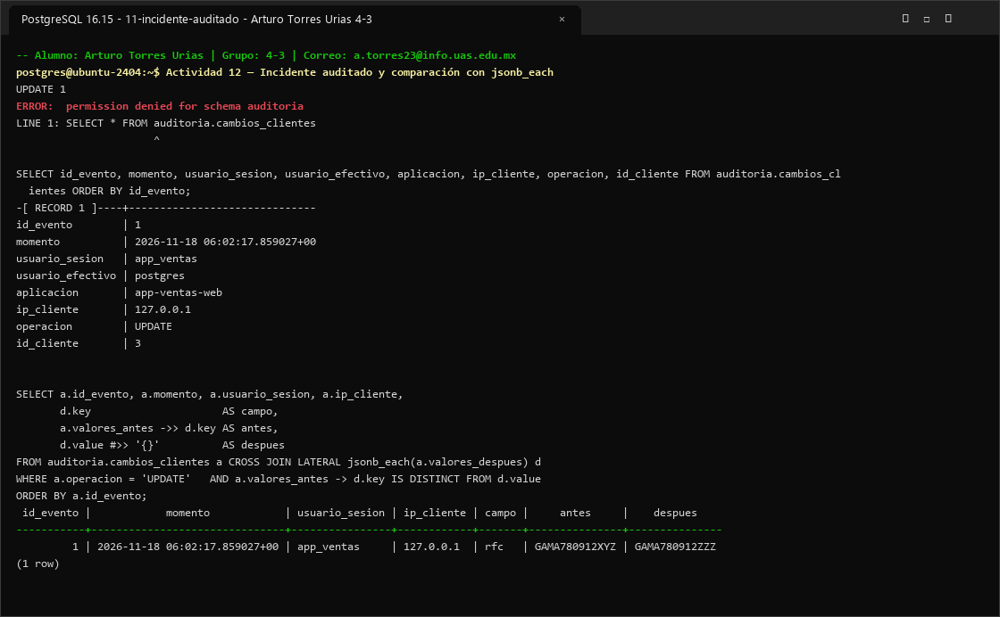

# Evidencia 11 — El Incidente Auditado

- **Alumno:** Arturo Torres Urias
- **Grupo:** 4-3
- **Correo institucional:** a.torres23@info.uas.edu.mx
- **Materia:** Gestión de Seguridad y Desempeño de Bases de Datos
- **Unidad:** III — Auditoría, trazabilidad y gobierno práctico de datos
- **Laboratorio:** LAB-01 — Bitácoras y auditoría del dato en PostgreSQL
- **Motor:** PostgreSQL 16.15 (Ubuntu 16.15-0ubuntu0.24.04.1 on x86_64-pc-linux-gnu)
- **Actividad:** Actividad 12 — Ejecución del cambio en `clientes`, bloqueo de acceso directo a `auditoria` y comparación campo por campo con `jsonb_each`
- **Script asociado:** `sql/06-campos-modificados.sql`

---

## 1. Comandos Ejecutados

### Como `app_ventas` (actualización y tentativa de leer la auditoría)
```bash
psql "postgresql://app_ventas:<REDACTED>@127.0.0.1/comercial?application_name=app-ventas-web" \
  -c "UPDATE clientes SET rfc = 'GAMA780912ZZZ' WHERE id = 3"

psql "postgresql://app_ventas:<REDACTED>@127.0.0.1/comercial" \
  -c "SELECT * FROM auditoria.cambios_clientes"
```

### Como administrador (`postgres`)
```sql
\x
SELECT id_evento, momento, usuario_sesion, usuario_efectivo, aplicacion, ip_cliente, operacion, id_cliente
FROM auditoria.cambios_clientes ORDER BY id_evento;
\x

SELECT a.id_evento, a.momento, a.usuario_sesion, a.ip_cliente,
       d.key                     AS campo,
       a.valores_antes ->> d.key AS antes,
       d.value #>> '{}'          AS despues
FROM auditoria.cambios_clientes a CROSS JOIN LATERAL jsonb_each(a.valores_despues) d
WHERE a.operacion = 'UPDATE'   AND a.valores_antes -> d.key IS DISTINCT FROM d.value
ORDER BY a.id_evento;
```

---

## 2. Resultado Obtenido



```text
-- Salida de app_ventas:
UPDATE 1
ERROR:  permission denied for schema auditoria
LINE 1: SELECT * FROM auditoria.cambios_clientes
                      ^

-- Salida en sesión de administrador (\x):
-[ RECORD 1 ]----+------------------------------
id_evento        | 1
momento          | 2026-11-18 06:02:17.859027+00
usuario_sesion   | app_ventas
usuario_efectivo | postgres
aplicacion       | app-ventas-web
ip_cliente       | 127.0.0.1
operacion        | UPDATE
id_cliente       | 3

-- Comparación campo por campo (valores_antes vs valores_despues):
 id_evento |            momento            | usuario_sesion | ip_cliente | campo |     antes     |    despues    
-----------+-------------------------------+----------------+------------+-------+---------------+---------------
         1 | 2026-11-18 06:02:17.859027+00 | app_ventas     | 127.0.0.1  | rfc   | GAMA780912XYZ | GAMA780912ZZZ
(1 row)
```

---

## 3. Respuestas a las Preguntas de la Actividad 12

1. **Compara tu hipótesis de la Actividad 11 con este resultado.**
   El resultado **confirma exactamente la hipótesis**: gracias a `SECURITY DEFINER`, cuando `app_ventas` ejecutó el `UPDATE` sobre `clientes`, el disparador se ejecutó con los privilegios de su propietario (`usuario_efectivo = postgres`), permitiendo insertar el registro en `auditoria.cambios_clientes` mientras conservaba `usuario_sesion = app_ventas` (`session_user`). En cambio, cuando `app_ventas` intentó consultar directamente `SELECT * FROM auditoria.cambios_clientes`, operó con sus propios privilegios y fue bloqueado con `ERROR: permission denied for schema auditoria`.

2. **Escribe la sentencia `UPDATE` que restauraría el valor anterior.**
   Conociendo con certeza que en `id_evento = 1` el campo `rfc` de `id_cliente = 3` tenía el valor `antes = 'GAMA780912XYZ'` (o para restaurar el valor original del alta inicial `'GAMA780912GHI'`), la sentencia para revertir el cambio del evento 1 es:
   ```sql
   UPDATE clientes
   SET rfc = 'GAMA780912XYZ'
   WHERE id = 3;
   ```
   *(O bien de forma dinámica desde la propia tabla de auditoría:)*
   ```sql
   UPDATE clientes c
   SET rfc = a.valores_antes ->> 'rfc'
   FROM auditoria.cambios_clientes a
   WHERE c.id = a.id_cliente
     AND a.id_evento = 1;
   ```

3. **¿Qué columna conserva más valor para una investigación: `aplicacion` o `ip_cliente`? ¿Cuál puede falsificar el cliente con más facilidad?**
   - Conserva **mucho más valor probatorio `ip_cliente` (`inet_client_addr()`)**, porque la dirección IP la toma el núcleo del sistema operativo y el servidor PostgreSQL directamente del socket TCP establecido tras el *three-way handshake* de red.
   - En cambio, **`aplicacion` (`application_name`) es trivial de falsificar** por el cliente: basta con escribir `?application_name=cualquier-nombre` en la cadena de conexión URI o ejecutar `SET application_name = '...'` dentro de la sesión. Por tanto, `aplicacion` es útil para distinguir módulos legítimos en operación normal, pero no es evidencia fuerte de identidad ante un atacante.
