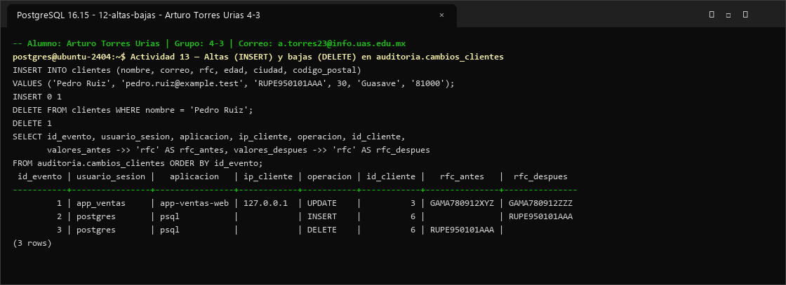

# Evidencia 12 — Altas y Bajas en la Tabla de Auditoría

- **Alumno:** Arturo Torres Urias
- **Grupo:** 4-3
- **Correo institucional:** a.torres23@info.uas.edu.mx
- **Materia:** Gestión de Seguridad y Desempeño de Bases de Datos
- **Unidad:** III — Auditoría, trazabilidad y gobierno práctico de datos
- **Laboratorio:** LAB-01 — Bitácoras y auditoría del dato en PostgreSQL
- **Motor:** PostgreSQL 16.15 (Ubuntu 16.15-0ubuntu0.24.04.1 on x86_64-pc-linux-gnu)
- **Actividad:** Actividad 13 — Auditoría de operaciones `INSERT` y `DELETE` sobre `clientes`

---

## 1. Comandos Ejecutados

```sql
INSERT INTO clientes (nombre, correo, rfc, edad, ciudad, codigo_postal)
VALUES ('Pedro Ruiz', 'pedro.ruiz@example.test', 'RUPE950101AAA', 30, 'Guasave', '81000');

DELETE FROM clientes WHERE nombre = 'Pedro Ruiz';

SELECT id_evento, usuario_sesion, aplicacion, ip_cliente, operacion, id_cliente,
       valores_antes ->> 'rfc' AS rfc_antes, valores_despues ->> 'rfc' AS rfc_despues
FROM auditoria.cambios_clientes ORDER BY id_evento;
```

---

## 2. Resultado Obtenido



```text
INSERT 0 1
DELETE 1
 id_evento | usuario_sesion |   aplicacion   | ip_cliente | operacion | id_cliente |   rfc_antes   |  rfc_despues  
-----------+----------------+----------------+------------+-----------+------------+---------------+---------------
         1 | app_ventas     | app-ventas-web | 127.0.0.1  | UPDATE    |          3 | GAMA780912XYZ | GAMA780912ZZZ
         2 | postgres       | psql           |            | INSERT    |          6 |               | RUPE950101AAA
         3 | postgres       | psql           |            | DELETE    |          6 | RUPE950101AAA | 
(3 rows)
```

---

## 3. Respuestas a las Preguntas de la Actividad 13

1. **El cliente Pedro Ruiz ya no existe en `clientes`. ¿Dónde queda evidencia de que existió y de sus datos?**
   Queda evidencia en **dos fuentes complementarias**:
   - En la **tabla de auditoría `auditoria.cambios_clientes`**: el evento `id_evento = 2` (`INSERT`) conserva el registro completo en `valores_despues` y el evento `id_evento = 3` (`DELETE`) conserva el estado íntegro del registro justo antes de borrarse en `valores_antes` (`{"id": 6, "nombre": "Pedro Ruiz", "correo": "pedro.ruiz@example.test", "rfc": "RUPE950101AAA", ...}`).
   - En la **bitácora del servidor (`dba.bitacora`)**: las líneas 147–149 registran las sentencias `INSERT INTO clientes ...` y `DELETE FROM clientes WHERE nombre = 'Pedro Ruiz';` ejecutadas por `postgres`.

2. **¿Por qué `ip_cliente` está vacía en los eventos 2 y 3?**
   Porque los eventos 2 y 3 fueron ejecutados desde la **sesión local de administrador** (`sudo -u postgres psql -d comercial`), la cual se conecta a través del **socket de dominio Unix** (`/var/run/postgresql/.s.PGSQL.5432`) y no por red TCP/IP. En conexiones por socket local, la función `inet_client_addr()` devuelve `NULL`.

3. **La política de retención de la Unidad II pedía eliminar datos cuando ya no fueran necesarios. ¿Qué conflicto aparece? ¿Quién debe resolverlo?**
   Aparece un **conflicto directo entre el principio de limitación del plazo de conservación / derecho de Cancelación (privacidad, Unidad II) y el requisito de trazabilidad e inmutabilidad de la evidencia (auditoría, Unidad III)**: aunque se ejecute `DELETE FROM clientes` para cumplir con la depuración o cancelación de un titular, sus datos personales completos (`nombre`, `correo`, `rfc`) **siguen almacenados dentro de `valores_antes` y `valores_despues` en `auditoria.cambios_clientes` y en las bitácoras**.
   - **¿Quién debe resolverlo?** No debe decidirlo unilateralmente el DBA; debe resolverlo el **Comité de Gobierno de Datos / Responsable de Privacidad junto con Seguridad de la Información y el área Jurídica/Cumplimiento**, definiendo una política formal de retención de bitácoras y registros de auditoría (por ejemplo, conservar el detalle fiscal durante el plazo legal obligatorio y posteriormente aplicar anonimización o expurgo controlado de los campos PII antiguos en la auditoría).
