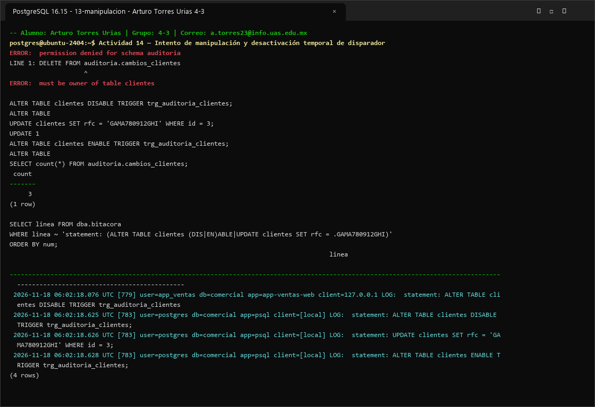

# Evidencia 13 — Intentar Manipular la Auditoría

- **Alumno:** Arturo Torres Urias
- **Grupo:** 4-3
- **Correo institucional:** a.torres23@info.uas.edu.mx
- **Materia:** Gestión de Seguridad y Desempeño de Bases de Datos
- **Unidad:** III — Auditoría, trazabilidad y gobierno práctico de datos
- **Laboratorio:** LAB-01 — Bitácoras y auditoría del dato en PostgreSQL
- **Motor:** PostgreSQL 16.15 (Ubuntu 16.15-0ubuntu0.24.04.1 on x86_64-pc-linux-gnu)
- **Actividad:** Actividad 14 — Prueba de resistencia frente a `app_ventas` y desactivación temporal del disparador por el administrador

---

## 1. Comandos Ejecutados

### Desde la cuenta de la aplicación (`app_ventas`)
```bash
psql "postgresql://app_ventas:<REDACTED>@127.0.0.1/comercial?application_name=app-ventas-web" \
  -c "DELETE FROM auditoria.cambios_clientes" \
  -c "ALTER TABLE clientes DISABLE TRIGGER trg_auditoria_clientes"
```

### Desde la cuenta de administrador (`postgres`)
```sql
ALTER TABLE clientes DISABLE TRIGGER trg_auditoria_clientes;
UPDATE clientes SET rfc = 'GAMA780912GHI' WHERE id = 3;
ALTER TABLE clientes ENABLE TRIGGER trg_auditoria_clientes;
SELECT count(*) FROM auditoria.cambios_clientes;

SELECT linea FROM dba.bitacora
WHERE linea ~ 'statement: (ALTER TABLE clientes (DIS|EN)ABLE|UPDATE clientes SET rfc = .GAMA780912GHI)'
ORDER BY num;
```

---

## 2. Resultado Obtenido



```text
-- Intento de app_ventas:
ERROR:  permission denied for schema auditoria
LINE 1: DELETE FROM auditoria.cambios_clientes
                    ^
ERROR:  must be owner of table clientes

-- Ejecución como postgres:
ALTER TABLE
UPDATE 1
ALTER TABLE
 count 
-------
     3
(1 row)

-- Evidencia registrada en dba.bitacora:
2026-11-18 06:02:18.076 UTC [779] user=app_ventas db=comercial app=app-ventas-web client=127.0.0.1 LOG:  statement: ALTER TABLE clientes DISABLE TRIGGER trg_auditoria_clientes
2026-11-18 06:02:18.625 UTC [783] user=postgres db=comercial app=psql client=[local] LOG:  statement: ALTER TABLE clientes DISABLE TRIGGER trg_auditoria_clientes;
2026-11-18 06:02:18.626 UTC [783] user=postgres db=comercial app=psql client=[local] LOG:  statement: UPDATE clientes SET rfc = 'GAMA780912GHI' WHERE id = 3;
2026-11-18 06:02:18.628 UTC [783] user=postgres db=comercial app=psql client=[local] LOG:  statement: ALTER TABLE clientes ENABLE TRIGGER trg_auditoria_clientes;
```

---

## 3. Respuestas a las Preguntas de la Actividad 14

1. **¿Qué evidencia permite detectar que hubo un cambio sin auditar?**
   Existen **dos evidencias técnicas contundentes**:
   - **En la bitácora del servidor (`dba.bitacora`, líneas 163–165):** Quedaron registradas con marca de tiempo, PID `[783]` y usuario `postgres` las tres sentencias exactas: `ALTER TABLE clientes DISABLE TRIGGER trg_auditoria_clientes;`, `UPDATE clientes SET rfc = 'GAMA780912GHI' WHERE id = 3;` y `ALTER TABLE clientes ENABLE TRIGGER trg_auditoria_clientes;`.
   - **Discrepancia de estado en `auditoria.cambios_clientes`:** En el evento `id_evento = 1` el RFC de `id_cliente = 3` quedó en `'GAMA780912ZZZ'`, pero en el siguiente evento sobre `id_cliente = 3` (o al consultar la tabla `clientes` actual) su `valores_antes ->> 'rfc'` aparece como `'GAMA780912GHI'`, revelando una discontinuidad en la cadena de custodia de la tabla de auditoría.

2. **¿Qué control administrativo (no técnico) reduciría este riesgo?**
   - Implementar un **procedimiento formal de Gestión de Cambios y Ventanas de Mantenimiento** donde cualquier desactivación de disparadores o uso de cuentas de superusuario requiera un ticket aprobado previamente y revisión por pares (*four-eyes principle* / doble custodia).
   - Realizar **auditorías periódicas independientes** que concilien las alertas de comandos `DISABLE TRIGGER` / `ALTER SYSTEM` en la bitácora contra los tickets de cambio autorizados.

3. **Relaciona esta actividad con el principio de separación de funciones de la Unidad II.**
   El principio de **separación de funciones (*Segregation of Duties*, SoD)** establece que quien administra y opera la base de datos (el DBA) **no debe ser la misma persona ni tener control exclusivo sobre el resguardo de la evidencia que audita sus propias acciones**. Como demostró esta actividad, dentro del propio servidor el superusuario `postgres` puede desactivar disparadores, borrar filas de `auditoria.cambios_clientes` o incluso modificar los archivos de `log/`. Por ello, la separación de funciones exige enviar las bitácoras en tiempo real hacia un **servidor externo de recolección de logs (SIEM / syslog remoto)** administrado por un equipo de Seguridad independiente donde el DBA no tenga permisos de borrado ni modificación.
