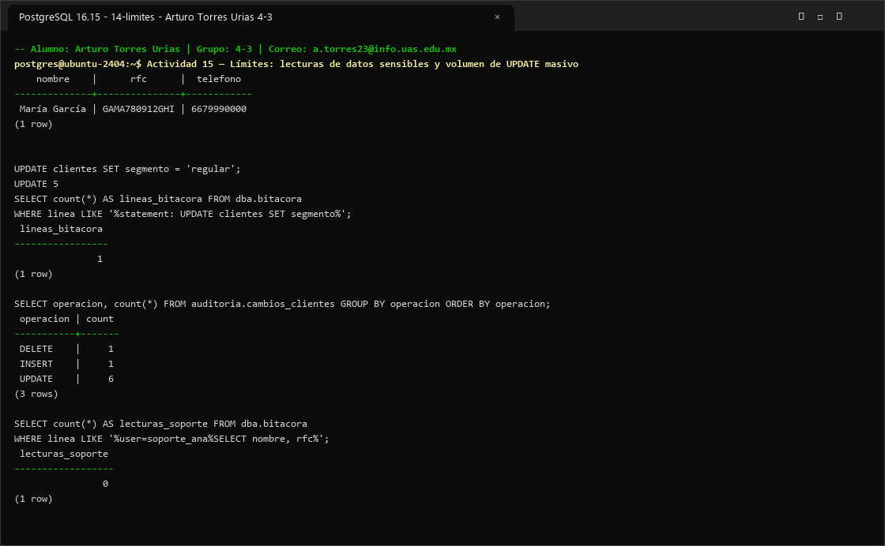

# Evidencia 14 — Límites: Lecturas y Volumen

- **Alumno:** Arturo Torres Urias
- **Grupo:** 4-3
- **Correo institucional:** a.torres23@info.uas.edu.mx
- **Materia:** Gestión de Seguridad y Desempeño de Bases de Datos
- **Unidad:** III — Auditoría, trazabilidad y gobierno práctico de datos
- **Laboratorio:** LAB-01 — Bitácoras y auditoría del dato en PostgreSQL
- **Motor:** PostgreSQL 16.15 (Ubuntu 16.15-0ubuntu0.24.04.1 on x86_64-pc-linux-gnu)
- **Actividad:** Actividad 15 — Demostración de límites de los disparadores y de `log_statement = 'mod'` frente a consultas `SELECT` y actualizaciones masivas

---

## 1. Comandos Ejecutados

### Lectura de datos sensibles como `soporte_ana`
```bash
psql "postgresql://soporte_ana:<REDACTED>@127.0.0.1/comercial" \
  -c "SELECT nombre, rfc, telefono FROM clientes WHERE id = 3"
```

### Actualización masiva sin `WHERE` y verificación como administrador
```sql
UPDATE clientes SET segmento = 'regular';

SELECT count(*) AS lineas_bitacora FROM dba.bitacora
WHERE linea LIKE '%statement: UPDATE clientes SET segmento%';

SELECT operacion, count(*) FROM auditoria.cambios_clientes GROUP BY operacion ORDER BY operacion;

SELECT count(*) AS lecturas_soporte FROM dba.bitacora
WHERE linea LIKE '%user=soporte_ana%SELECT nombre, rfc%';
```

---

## 2. Resultado Obtenido



```text
-- Consulta ejecutada por soporte_ana:
    nombre    |      rfc      |  telefono  
--------------+---------------+------------
 María García | GAMA780912GHI | 6679990000
(1 row)

-- En la sesión del administrador:
UPDATE 5

 lineas_bitacora 
-----------------
               1
(1 row)

 operacion | count 
-----------+-------
 DELETE    |     1
 INSERT    |     1
 UPDATE    |     6
(3 rows)

 lecturas_soporte 
------------------
                0
(1 row)
```

---

## 3. Respuestas a las Preguntas de la Actividad 15

1. **Si `clientes` tuviera un millón de registros, ¿qué ocurriría con la auditoría tras un `UPDATE` sin `WHERE`?**
   Mientras que la bitácora del servidor (`dba.bitacora`) solo escribiría **1 línea** con el texto `UPDATE clientes SET segmento = 'regular';`, el disparador `FOR EACH ROW` se ejecutaría **un millón de veces dentro de la misma transacción**, insertando **1,000,000 de filas nuevas** con dos documentos `JSONB` completos (`valores_antes` y `valores_despues`) cada una en `auditoria.cambios_clientes`. Esto multiplicaría el tiempo de ejecución de la sentencia, el volumen de escritura en WAL (*Write-Ahead Log*) y el consumo de disco en varios gigabytes por una sola sentencia.

2. **Propón quién podría autorizar la depuración de `auditoria.cambios_clientes`.**
   Bajo el principio de separación de funciones, **nunca debe autorizarla ni ejecutarla por cuenta propia el DBA operativo ni el área dueña de la aplicación (Ventas)**. La depuración o archivado histórico de `auditoria.cambios_clientes` debe requerir la **autorización mancomunada del Oficial de Seguridad de la Información (CISO / Auditoría Interna) y del Responsable de Gobierno de Datos / Cumplimiento Legal**, previo respaldo firmado criptográficamente (con hash SHA-256) hacia almacenamiento frío inmutable (*WORM / Object Lock*).

3. **¿Por qué `log_statement = 'all'` puede convertir la bitácora en un nuevo depósito de datos sensibles?**
   Porque al registrar absolutamente todas las sentencias SQL ejecutadas en el servidor, quedan grabados en los archivos de texto de la bitácora todos los filtros y literales enviados en consultas `SELECT`, llamadas a funciones (por ejemplo, claves de cifrado de `pgp_sym_encrypt`, tokens, CURP, RFC, correos o números de tarjeta buscados en un `WHERE`). De ese modo, datos que en las tablas estaban protegidos por permisos a nivel de columna, vistas o cifrado terminan expuestos en texto claro dentro de los archivos de log.
