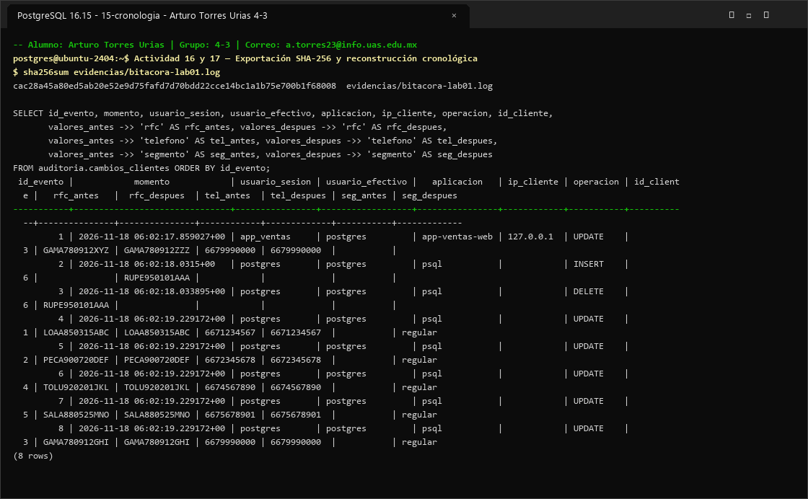

# Evidencia 15 — Exportación, Integridad, Cronología y Respuestas a Dirección

- **Alumno:** Arturo Torres Urias
- **Grupo:** 4-3
- **Correo institucional:** a.torres23@info.uas.edu.mx
- **Materia:** Gestión de Seguridad y Desempeño de Bases de Datos
- **Unidad:** III — Auditoría, trazabilidad y gobierno práctico de datos
- **Laboratorio:** LAB-01 — Bitácoras y auditoría del dato en PostgreSQL
- **Motor:** PostgreSQL 16.15 (Ubuntu 16.15-0ubuntu0.24.04.1 on x86_64-pc-linux-gnu)
- **Actividades cubiertas:** Actividad 16 (Exportar y conservar la bitácora) y Actividad 17 (Reconstruir la cronología y responder a Dirección)
- **Archivos asociados:** `evidencias/bitacora-lab01.log` y `evidencias/bitacora-lab01.sha256`

---

## 1. Actividad 16 — Exportar y Conservar la Bitácora (Retiro de Secretos y Hash SHA-256)

### Comandos ejecutados
```bash
# 1. Exportar la bitácora vigente sustituyendo la contraseña expuesta en la Actividad 6 por <REDACTED>
sudo -u postgres psql -d comercial -At \
  -c "SELECT replace(pg_read_file(pg_current_logfile()), '<CONTRASEÑA_TEMPORAL>', '<REDACTED>')" \
  > evidencias/bitacora-lab01.log

# 2. Calcular el resumen criptográfico SHA-256 (Linux y Windows PowerShell)
sha256sum evidencias/bitacora-lab01.log > evidencias/bitacora-lab01.sha256
Get-FileHash evidencias/bitacora-lab01.log -Algorithm SHA256
```

### Resultado obtenido (`evidencias/bitacora-lab01.sha256`)


```text
cac28a45a80ed5ab20e52e9d75fafd7d70bdd22cce14bc1a1b75e700b1f68008  evidencias/bitacora-lab01.log
```
*(Se documenta formalmente que `evidencias/bitacora-lab01.log` fue exportado reemplazando la contraseña de `rol_temporal` por `<REDACTED>` antes de abandonar el motor).*

### Respuestas a las Preguntas de la Actividad 16

1. **Un resumen SHA-256, ¿impide que alguien modifique la bitácora? ¿Qué permite demostrar?**
   **No impide físicamente que alguien modifique o borre el archivo**, ya que un hash no es un control de acceso ni bloquea la escritura en disco. Lo que permite es **demostrar la integridad del archivo (o detectar cualquier alteración)**: gracias a la resistencia a colisiones y al efecto avalancha de SHA-256, si alguien modifica aunque sea un solo carácter, espacio o milisegundo en `bitacora-lab01.log`, el nuevo hash calculado será completamente distinto del hash original registrado.

2. **¿Dónde debería guardarse el hash para que sea útil como control de integridad?**
   Debe guardarse **en un repositorio o sistema distinto y con control de acceso independiente** de donde reside el archivo de bitácora (por ejemplo, en una bóveda de evidencias del área de Auditoría Interna / Seguridad, en un registro con sello de tiempo criptográfico o en un sistema de control de versiones protegido). Si el archivo `.sha256` se guarda únicamente en la misma carpeta y con los mismos permisos que el archivo `.log`, quien modifique la bitácora simplemente volverá a calcular y sobrescribir también el archivo `.sha256`.

3. **La guía NIST SP 800-92 trata la conservación y protección de bitácoras (REF-U3-03). ¿Qué riesgos tiene conservar la bitácora solo en el servidor que la produce?**
   Conservar la bitácora únicamente en el propio servidor de base de datos presenta cuatro riesgos críticos señalados en NIST SP 800-92:
   - **Alteración o borrado por un atacante o administrador malicioso:** Quien comprometa la cuenta `postgres` o `root` del servidor puede editar o eliminar los logs locales para borrar sus huellas.
   - **Pérdida por rotación o falta de espacio:** Las políticas de rotación (`log_rotation_age`, `log_rotation_size`, `log_truncate_on_rotation`) sobrescriben archivos antiguos si no se externalizan.
   - **Pérdida por falla catastrófica o recreación del entorno:** Si el disco falla o el contenedor/máquina virtual se destruye o reinstala, toda la evidencia desaparece junto con el servidor.
   - **Falta de correlación centralizada:** Impide cruzar en tiempo real eventos de la base de datos con eventos de red, firewall y aplicación.

4. **Propón durante cuánto tiempo conservarías esta bitácora y justifica tu criterio.**
   Propongo un esquema escalonado de conservación para **Comercializadora Norte S.A. de C.V.**:
   - **90 días en almacenamiento activo (caliente / SIEM):** Para investigación rápida de incidentes operativos, errores de permisos o anomalías de acceso.
   - **5 años en almacenamiento histórico inmutable (frío / archivo comprimido y firmado con SHA-256):** Porque la tabla `clientes` involucra datos fiscales (`rfc`) asociados a facturación (CFDI), y el artículo 30 del Código Fiscal de la Federación (CFF) en México exige conservar la documentación y elementos contables/fiscales durante un plazo general de **5 años** (en concordancia también con la política de retención definida en la Unidad II).

---

## 2. Actividad 17 — Tabla de Cronología Reconstruida (14 Eventos en Orden Cronológico)

| # | Fecha y hora (UTC) | Usuario | Cliente | Tipo de evento | Qué ocurrió | ¿Exitoso? | Fuente (`línea` de `bitacora-lab01.log` o `id_evento` de `auditoria.cambios_clientes`) |
| :-: | :--- | :--- | :--- | :--- | :--- | :---: | :--- |
| **0** | *(Sin registro — previo a 06:02:07)* | *(Hueco de evidencia)* | *(Hueco de evidencia)* | **Datos (Sin bitácora)** | Modificación inicial del RFC de María García (`id = 3`) a `GAMA780912XXX` durante la Actividad 3 con `log_statement = none` y sin disparador. | Sí | **No hay evidencia** (0 filas en `dba.bitacora` y aún no existía `auditoria.cambios_clientes`). |
| **1** | `2026-11-18 06:02:07.421 UTC` | *(Proceso principal PID 647)* | Local (Servidor) | **Configuración** | Recarga de configuración (`SIGHUP`): activación de `log_connections = on`, `log_disconnections = on`, `log_line_prefix` enriquecido y `log_statement = 'ddl'`. | Sí | `bitacora-lab01.log` líneas `6–10` |
| **2** | `2026-11-18 06:02:08.540 UTC` | `app_ventas` | `127.0.0.1` | **Acceso** | Intento de conexión fallido por contraseña incorrecta (`FATAL: password authentication failed for user "app_ventas"`, regla `pg_hba.conf` línea 4). | **No** | `bitacora-lab01.log` líneas `14–16` (`PID 687`) |
| **3** | `2026-11-18 06:02:08.587 UTC` | `usuario_inexistente` | `127.0.0.1` | **Acceso** | Intento de conexión fallido con un rol que no existe (`DETAIL: Role "usuario_inexistente" does not exist.`). | **No** | `bitacora-lab01.log` líneas `17–20` (`PID 689`) |
| **4** | `2026-11-18 06:02:08.634 UTC` | `app_ventas` | `127.0.0.1` (`app-ventas-web`) | **Acceso** | Conexión autenticada (`scram-sha-256`), autorizada y desconexión normal (`session time: 0:00:00.009`). | Sí | `bitacora-lab01.log` líneas `21–24` (`PID 691`) |
| **5** | `2026-11-18 06:02:09.239 UTC` | `postgres` | `[local]` (`psql`) | **Privilegio** | Ejecución de `REVOKE UPDATE ON clientes FROM soporte_ana;` y `GRANT UPDATE ON clientes TO app_ventas;`. | Sí | `bitacora-lab01.log` líneas `30–31` (`PID 699`) |
| **6** | `2026-11-18 06:02:09.242 UTC` | `postgres` | `[local]` (`psql`) | **Estructura** | Modificación de tabla: `ALTER TABLE clientes ADD COLUMN segmento VARCHAR(20);`. | Sí | `bitacora-lab01.log` línea `32` (`PID 699`) |
| **7** | `2026-11-18 06:02:09.297 UTC` | `app_ventas` | `127.0.0.1` (`app-ventas-web`) | **Acceso (con hueco de Datos)** | Sesión de `app_ventas` de 12 ms durante la cual se cambió el RFC de `id = 3` a `GAMA780912XYZ`; solo quedó registrada la conexión/desconexión porque `log_statement` valía `'ddl'`. | Sí | `bitacora-lab01.log` líneas `36–39` (`PID 701`) |
| **8** | `2026-11-18 06:02:09.857 UTC` | `postgres` | `[local]` (`psql`) | **Configuración** | Cambio de parámetro `ALTER SYSTEM SET log_statement = 'mod';` y recarga efectiva (`parameter "log_statement" changed to "mod"`). | Sí | `bitacora-lab01.log` líneas `42–45` (`PID 705` / `647`) |
| **9** | `2026-11-18 06:02:10.909 UTC` | `app_ventas` | `127.0.0.1` (`app-ventas-web`) | **Datos** | Modificación del teléfono de María García: `UPDATE clientes SET telefono = '6679990000' WHERE id = 3`. | Sí | `bitacora-lab01.log` línea `49` (`PID 707`) |
| **10** | `2026-11-18 06:02:11.529 UTC` | `soporte_ana` | `127.0.0.1` (`psql`) | **Error** | Operación rechazada por falta de permisos: `DELETE FROM clientes WHERE id = 5` (`ERROR: permission denied for table clientes`). | **No** | `bitacora-lab01.log` líneas `57–59` (`PID 713`) |
| **11** | `2026-11-18 06:02:17.859 UTC` | `app_ventas` | `127.0.0.1` (`app-ventas-web`) | **Datos (Auditado)** | Cambio del RFC de María García (`id = 3`) de `GAMA780912XYZ` a `GAMA780912ZZZ`, capturado tanto en bitácora como en la tabla de auditoría. | Sí | `bitacora-lab01.log` línea `131` (`PID 763`) e `id_evento = 1` en `auditoria.cambios_clientes` |
| **12** | `2026-11-18 06:02:18.031 UTC` | `postgres` | `[local]` (`psql`) | **Datos (Alta y Baja)** | Inserción (`INSERT`, `id_cliente = 6`, RFC `RUPE950101AAA`) y eliminación inmediata (`DELETE`, `id_cliente = 6`) del cliente Pedro Ruiz. | Sí | `bitacora-lab01.log` líneas `147–149` (`PID 777`) e `id_evento = 2, 3` en `auditoria.cambios_clientes` |
| **13** | `2026-11-18 06:02:18.076 UTC` | `app_ventas` | `127.0.0.1` (`app-ventas-web`) | **Error (Manipulación rechazada)** | Intento fallido de borrar `auditoria.cambios_clientes` (`permission denied`) y desactivar `trg_auditoria_clientes` (`must be owner of table clientes`). | **No** | `bitacora-lab01.log` líneas `154–159` (`PID 779`) |
| **14** | `2026-11-18 06:02:18.625 UTC` | `postgres` | `[local]` (`psql`) | **Estructura y Datos (Evasión de disparador)** | Desactivación temporal de `trg_auditoria_clientes`, `UPDATE clientes SET rfc = 'GAMA780912GHI' WHERE id = 3;` y reactivación del disparador. | Sí | `bitacora-lab01.log` líneas `163–165` (`PID 783`; ausente en `auditoria.cambios_clientes`) |

---

## 3. Respuestas a las Cinco Preguntas de Dirección (Solo con la Evidencia)

### Pregunta 1: ¿Quién cambió el RFC la primera vez (Actividad 3)? ¿Y en las Actividades 7, 12 y 14?
- **Primera vez (Actividad 3 — cambio a `GAMA780912XXX`):** **No hay evidencia.** Cuando ocurrió este evento, `log_connections` estaba en `off`, `log_statement` estaba en `'none'` y aún no existía la tabla `auditoria.cambios_clientes` ni el disparador. Como no se registró en su momento, constituye un hueco de evidencia y no puede demostrarse técnicamente quién lo hizo ni a qué hora ocurrió.
- **Segunda vez (Actividad 7 — cambio a `GAMA780912XYZ`):** **No hay evidencia de la sentencia `UPDATE` ni del cambio en el dato**, porque `log_statement` estaba en `'ddl'` y aún no existía el disparador de auditoría. La bitácora únicamente demuestra que el rol `app_ventas` desde `127.0.0.1` (`app-ventas-web`, `PID 701`) se conectó a las `2026-11-18 06:02:09.297 UTC` y se desconectó a las `06:02:09.300 UTC` (líneas `36–39` de `bitacora-lab01.log`), pero no registró qué sentencia ejecutó en esa sesión.
- **Tercera vez (Actividad 12 — cambio a `GAMA780912ZZZ`):** Lo hizo el rol **`app_ventas`**, el **`2026-11-18 06:02:17.859027+00`**, desde la dirección IP **`127.0.0.1`** declarando la aplicación **`app-ventas-web`**. Está demostrado tanto por el registro `id_evento = 1` de `auditoria.cambios_clientes` como por la línea `131` (`PID 763`) de `bitacora-lab01.log`.
- **Cuarta vez (Actividad 14 — cambio a `GAMA780912GHI`):** Lo hizo el superusuario **`postgres`**, el **`2026-11-18 06:02:18.626 UTC`**, desde una sesión local **`[local]`** (`application_name=psql`), tras haber desactivado intencionalmente el disparador `trg_auditoria_clientes` un milisegundo antes (`06:02:18.625 UTC`). Aunque no dejó fila en `auditoria.cambios_clientes`, quedó demostrado en las líneas `163–165` (`PID 783`) de `bitacora-lab01.log`.

### Pregunta 2: ¿Quién cambió el teléfono?
- Lo cambió el rol **`app_ventas`**, el **`2026-11-18 06:02:10.909 UTC`**, desde el cliente **`127.0.0.1`** con `application_name=app-ventas-web`, ejecutando la sentencia `UPDATE clientes SET telefono = '6679990000' WHERE id = 3` (demostrado en la línea `49`, `PID 707`, de `bitacora-lab01.log`).
- Sin embargo, respecto al **valor anterior del teléfono**, **no hay evidencia en la auditoría**, porque este cambio ocurrió en la Actividad 7 cuando ya estaba activo `log_statement = 'mod'`, pero aún no se había creado la tabla `auditoria.cambios_clientes` (Parte B).

### Pregunta 3: ¿Hubo intentos de acceso fallidos? ¿De qué usuarios y desde dónde?
- **Sí**, quedaron registrados dos intentos de conexión fallidos en `bitacora-lab01.log`:
  1. **`2026-11-18 06:02:08.540 UTC` (`PID 687`, líneas `14–16`):** Intento fallido para el usuario **`app_ventas`** desde la dirección IP **`127.0.0.1`** (`port=41384`) hacia la base `comercial` por contraseña incorrecta (`FATAL: password authentication failed for user "app_ventas"`).
  2. **`2026-11-18 06:02:08.587 UTC` (`PID 689`, líneas `17–20`):** Intento fallido para el usuario **`usuario_inexistente`** desde la dirección IP **`127.0.0.1`** (`port=41398`) hacia la base `comercial`, donde el `DETAIL` interno demuestra que el rol no existe (`Role "usuario_inexistente" does not exist.`).
- Respecto a si hubo intentos de acceso fallidos **antes** del primer cambio de la Actividad 3, **no hay evidencia**, porque antes de la Actividad 4 el parámetro `log_connections` estaba en `off` (y aun así los fallos `FATAL` previos al reinicio del colector de la Actividad 2 no habrían quedado en este archivo). En el archivo `bitacora-lab01.log` desde su inicio (`06:02:03.077 UTC`, línea 1) hasta la Actividad 4 (`06:02:07.420 UTC`, línea 6) **no ocurrió ningún error `FATAL` de autenticación**.

### Pregunta 4: ¿Qué valor tenía el RFC antes de cada cambio?
- **Antes del cambio 1 (Actividad 3):** **No hay evidencia en la bitácora ni en la tabla de auditoría** (sabemos por el script de carga inicial que se insertó con `'GAMA780912GHI'`, pero no existía ningún mecanismo de auditoría activo al momento del cambio).
- **Antes del cambio 2 (Actividad 7):** **No hay evidencia en la bitácora ni en la tabla de auditoría**, pues `log_statement = 'ddl'` no registró el `UPDATE` y la tabla `auditoria.cambios_clientes` aún no existía.
- **Antes del cambio 3 (Actividad 12, `2026-11-18 06:02:17.859027+00`):** Demostrado con certeza por `id_evento = 1` en `auditoria.cambios_clientes`: `valores_antes ->> 'rfc'` tenía el valor **`GAMA780912XYZ`** (y cambió a `valores_despues ->> 'rfc' = 'GAMA780912ZZZ'`).
- **Antes del cambio 4 (Actividad 14, `2026-11-18 06:02:18.626 UTC`):** Como el administrador desactivó el disparador `trg_auditoria_clientes`, no se insertó una fila para ese `UPDATE` en `auditoria.cambios_clientes`; sin embargo, el último estado auditado previo en `id_evento = 1` demuestra que el RFC había quedado en **`GAMA780912ZZZ`**, y el evento posterior `id_evento = 8` (`UPDATE clientes SET segmento = 'regular'`) muestra en `valores_antes ->> 'rfc'` que ya valía **`GAMA780912GHI`**, lo cual concuerda con la sentencia `UPDATE clientes SET rfc = 'GAMA780912GHI' WHERE id = 3;` registrada en la línea `164` de `bitacora-lab01.log`.
