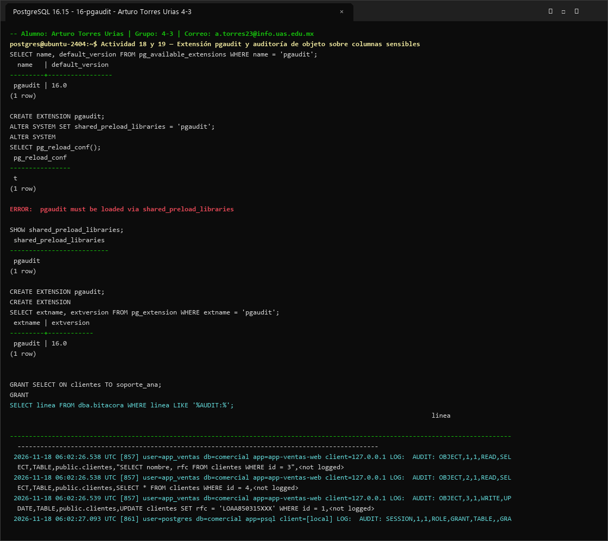

# Evidencia 16 — Parte C (Opcional): Auditoría de Objeto sobre Columnas Sensibles con `pgaudit`

- **Alumno:** Arturo Torres Urias
- **Grupo:** 4-3
- **Correo institucional:** a.torres23@info.uas.edu.mx
- **Materia:** Gestión de Seguridad y Desempeño de Bases de Datos
- **Unidad:** III — Auditoría, trazabilidad y gobierno práctico de datos
- **Laboratorio:** LAB-01 — Bitácoras y auditoría del dato en PostgreSQL
- **Motor:** PostgreSQL 16.15 (Ubuntu 16.15-0ubuntu0.24.04.1 on x86_64-pc-linux-gnu)
- **Actividades cubiertas:** Actividad 18, Actividad 19 y Verificación Final (Sección 26)

---

## 1. Actividad 18 — Instalar y Cargar `pgaudit`

### Comandos ejecutados
```sql
-- 18.1 Comprobar disponibilidad e intentar crear la extensión antes de precargar la biblioteca:
SELECT name, default_version FROM pg_available_extensions WHERE name = 'pgaudit';
CREATE EXTENSION pgaudit;

-- 18.2 Configurar shared_preload_libraries y verificar pending_restart:
ALTER SYSTEM SET shared_preload_libraries = 'pgaudit';
SELECT pg_reload_conf();
SELECT name, setting, pending_restart FROM pg_settings WHERE name = 'shared_preload_libraries';

-- Tras reiniciar el servicio (sudo systemctl restart postgresql):
SHOW shared_preload_libraries;
CREATE EXTENSION pgaudit;
SELECT extname, extversion FROM pg_extension WHERE extname = 'pgaudit';
```

### Resultado obtenido


```text
  name   | default_version 
---------+-----------------
 pgaudit | 16.0
(1 row)

ERROR:  pgaudit must be loaded via shared_preload_libraries

           name           | setting | pending_restart 
--------------------------+---------+-----------------
 shared_preload_libraries |         | t
(1 row)

-- Después de reiniciar el servicio:
 shared_preload_libraries 
--------------------------
 pgaudit
(1 row)

CREATE EXTENSION
 extname | extversion 
---------+------------
 pgaudit | 16.0
(1 row)
```

---

## 2. Actividad 19 — Auditoría de Objeto sobre Columnas Sensibles (`rfc`, `telefono`)

### Comandos ejecutados
```sql
CREATE ROLE auditor_datos NOLOGIN;
GRANT SELECT (rfc, telefono), UPDATE (rfc, telefono) ON clientes TO auditor_datos;

ALTER SYSTEM SET pgaudit.log = 'role, ddl';
ALTER SYSTEM SET pgaudit.role = 'auditor_datos';
ALTER SYSTEM SET pgaudit.log_relation = on;
SELECT pg_reload_conf();
```

```bash
# Tres consultas y dos actualizaciones como app_ventas:
psql "postgresql://app_ventas:<REDACTED>@127.0.0.1/comercial?application_name=app-ventas-web" \
  -c "SELECT nombre, ciudad FROM clientes WHERE id = 2" \
  -c "SELECT nombre, rfc FROM clientes WHERE id = 3" \
  -c "SELECT * FROM clientes WHERE id = 4" \
  -c "UPDATE clientes SET rfc = 'LOAA850315XXX' WHERE id = 1" \
  -c "UPDATE clientes SET ciudad = 'Navolato' WHERE id = 2"
```

```sql
-- Cambio de privilegios como administrador y consulta de entradas AUDIT:
GRANT SELECT ON clientes TO soporte_ana;
SELECT linea FROM dba.bitacora WHERE linea LIKE '%AUDIT:%';
```

### Resultado obtenido
```text
2026-11-18 06:02:26.538 UTC [857] user=app_ventas db=comercial app=app-ventas-web client=127.0.0.1 LOG:  AUDIT: OBJECT,1,1,READ,SELECT,TABLE,public.clientes,"SELECT nombre, rfc FROM clientes WHERE id = 3",<not logged>
2026-11-18 06:02:26.538 UTC [857] user=app_ventas db=comercial app=app-ventas-web client=127.0.0.1 LOG:  AUDIT: OBJECT,2,1,READ,SELECT,TABLE,public.clientes,SELECT * FROM clientes WHERE id = 4,<not logged>
2026-11-18 06:02:26.539 UTC [857] user=app_ventas db=comercial app=app-ventas-web client=127.0.0.1 LOG:  AUDIT: OBJECT,3,1,WRITE,UPDATE,TABLE,public.clientes,UPDATE clientes SET rfc = 'LOAA850315XXX' WHERE id = 1,<not logged>
2026-11-18 06:02:27.093 UTC [861] user=postgres db=comercial app=psql client=[local] LOG:  AUDIT: SESSION,1,1,ROLE,GRANT,TABLE,,GRANT SELECT ON clientes TO soporte_ana;,<not logged>
(4 rows)
```

---

## 3. Respuestas a las Preguntas de la Actividad 19

1. **¿Por qué no apareció `SELECT nombre, ciudad ...`? ¿Por qué sí apareció `SELECT * ...`?**
   Porque en la auditoría de objetos de `pgaudit` (`pgaudit.role = 'auditor_datos'`), únicamente se registran aquellas consultas que tocan las tablas o columnas sobre las cuales el rol `auditor_datos` tiene privilegios (`SELECT (rfc, telefono), UPDATE (rfc, telefono) ON clientes`).
   - La consulta `SELECT nombre, ciudad FROM clientes WHERE id = 2` solo leyó las columnas `nombre` y `ciudad` (no sensibles), por lo que no activó la regla del rol auditor.
   - En cambio, `SELECT * FROM clientes WHERE id = 4` expande todas las columnas de la tabla `clientes`, **incluyendo `rfc` y `telefono`**, por lo que `pgaudit` detecta que se leyeron las columnas auditadas y registra el evento `AUDIT: OBJECT,2,1,READ,SELECT,TABLE,public.clientes`.

2. **¿Por qué no apareció `UPDATE ... ciudad ...`?**
   Porque al rol `auditor_datos` solo se le otorgó `UPDATE (rfc, telefono) ON clientes`, es decir, privilegio de actualización exclusivamente sobre las columnas sensibles `rfc` y `telefono`. La sentencia `UPDATE clientes SET ciudad = 'Navolato' WHERE id = 2` solo modificó la columna `ciudad`, por lo que `pgaudit` no generó entrada `AUDIT: OBJECT` para ella (mientras que `UPDATE clientes SET rfc = 'LOAA850315XXX' WHERE id = 1` sí apareció como `AUDIT: OBJECT,3,1,WRITE,UPDATE`).

3. **¿Qué diferencia de volumen esperarías frente a `log_statement = 'all'`?**
   Una **reducción drástica del volumen de bitácora ( a menudo del 90 % o más)**: mientras que `log_statement = 'all'` registra absolutamente todos los `SELECT` de catálogos, tablas operativas, listados de productos, sesiones o columnas públicas (`nombre`, `ciudad`), `pgaudit` en modo de auditoría de objeto filtra con precisión quirúrgica y **solo escribe en la bitácora cuando alguien lee o modifica específicamente las columnas sensibles (`rfc`, `telefono`)**, más los eventos de `role` y `ddl` configurados en `pgaudit.log`.

4. **El README oficial advierte que `pgaudit` no puede auditar de forma confiable a los superusuarios (REF-U3-09). ¿Qué implica para la separación de funciones?**
   Implica que un superusuario (`SUPERUSER`) puede alterar en cualquier momento los parámetros de su propia sesión (`SET pgaudit.log = 'none'; SET pgaudit.role = '';`) o revocar los permisos de `auditor_datos` sin que `pgaudit` pueda impedirlo. Por lo tanto:
   - Ninguna aplicación ni analista debe conectarse jamás con una cuenta `SUPERUSER`.
   - Para las labores administrativas cotidianas deben utilizarse roles con privilegios acotados (`CREATEDB`, `CREATEROLE`, `NOSUPERUSER`), reservando `postgres` para emergencias bajo monitoreo externo.
   - La custodia de las bitácoras debe recaer en un sistema externo independiente del administrador del motor.

---

## 4. Verificación Final Integrada (Sección 26)

```text
-- Parte A:
        name        |                 setting                 |       source       
--------------------+-----------------------------------------+--------------------
 log_connections    | on                                      | configuration file
 log_disconnections | on                                      | configuration file
 log_line_prefix    | %m [%p] user=%u db=%d app=%a client=%h  | configuration file
 log_statement      | mod                                     | configuration file
 logging_collector  | on                                      | configuration file
(5 rows)

-- Parte B:
         tgname         | tgenabled | tgrelid  
------------------------+-----------+----------
 trg_auditoria_clientes | O         | clientes
(1 row)

 operacion | count 
-----------+-------
 DELETE    |     1
 INSERT    |     1
 UPDATE    |     8
(3 rows)

-- Parte C:
 shared_preload_libraries 
--------------------------
 pgaudit
(1 row)

 extname | extversion 
---------+------------
 pgaudit | 16.0
(1 row)
```
