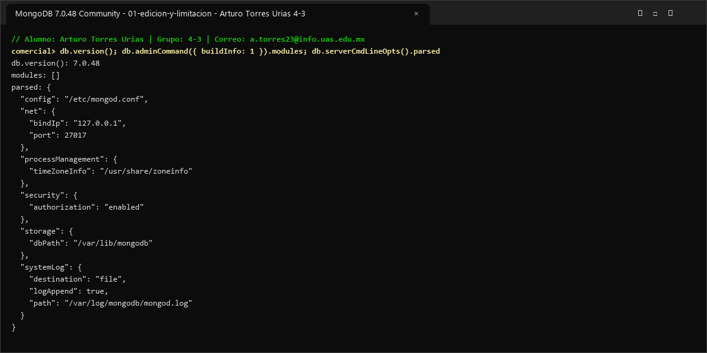

# Evidencia 01 — Lo que No Existe en Esta Edición (Edición y Configuración de Arranque)

- **Alumno:** Arturo Torres Urias
- **Grupo:** 4-3
- **Correo institucional:** a.torres23@info.uas.edu.mx
- **Materia:** Gestión de Seguridad y Desempeño de Bases de Datos
- **Unidad:** III — Auditoría, trazabilidad y gobierno práctico de datos
- **Laboratorio:** LAB-02 — Trazabilidad en MongoDB Community
- **Motor:** MongoDB 7.0.48 Community Edition (`mongosh 2.14.2` en Ubuntu 24.04 LTS)
- **Actividades cubiertas:** Sección 6.3, 6.4 y Actividad 1

---

## 1. Comandos Ejecutados

```javascript
db.version()
db.adminCommand({ buildInfo: 1 }).modules
db.serverCmdLineOpts().parsed
```

---

## 2. Resultado Obtenido



```json
7.0.48
[]
{
  "config": "/etc/mongod.conf",
  "net": {
    "bindIp": "127.0.0.1",
    "port": 27017
  },
  "processManagement": {
    "timeZoneInfo": "/usr/share/zoneinfo"
  },
  "security": {
    "authorization": "enabled"
  },
  "storage": {
    "dbPath": "/var/lib/mongodb"
  },
  "systemLog": {
    "destination": "file",
    "logAppend": true,
    "path": "/var/log/mongodb/mongod.log"
  }
}
```

---

## 3. Respuestas a las Preguntas de la Actividad 1

1. **¿Qué edición de MongoDB estás usando? ¿Qué evidencia lo demuestra?**
   Se está utilizando **MongoDB 7.0.48 Community Edition**. La evidencia técnica directa que lo demuestra desde el propio motor es el resultado del comando `db.adminCommand({ buildInfo: 1 }).modules`, el cual devuelve un arreglo vacío **`[]`**. En MongoDB Enterprise Edition, ese mismo arreglo incluye la cadena `"enterprise"`, la cual habilita los módulos exclusivos de pago como el subsistema de auditoría nativa (`auditLog` / `--auditDestination`).

2. **¿A dónde escribe tu servidor su bitácora? ¿Cómo lo sabes?**
   El servidor escribe su bitácora en el archivo físico **`/var/log/mongodb/mongod.log`**, agregando los nuevos eventos al final del archivo tras cada reinicio sin sobrescribirlo. Lo sabemos con certeza porque la salida de `db.serverCmdLineOpts().parsed` muestra la sección:
   ```json
   "systemLog": {
     "destination": "file",
     "logAppend": true,
     "path": "/var/log/mongodb/mongod.log"
   }
   ```
   cargada desde el archivo de configuración `/etc/mongod.conf`.

3. **Según REF-U3-04, ¿qué cuatro categorías de eventos registraría la auditoría nativa?**
   De acuerdo con la documentación oficial de MongoDB (*Auditing*, REF-U3-04), el sistema de auditoría nativa (disponible únicamente en MongoDB Enterprise y en MongoDB Atlas M10+) puede registrar cuatro categorías de eventos:
   1. **Cambios de esquema (DDL):** creación y eliminación de bases de datos, colecciones e índices (`createCollection`, `dropCollection`, `createIndex`, etc.).
   2. **Eventos de conjuntos de réplicas y clústeres fragmentados (*replica sets and sharded clusters*):** elecciones, reconfiguraciones y cambios de topología.
   3. **Autenticación y autorización:** inicios de sesión exitosos y fallidos, creación/modificación/eliminación de usuarios y roles (`createUser`, `grantRolesToUser`, `revokeRolesFromUser`), y fallos de autorización.
   4. **Operaciones CRUD (lectura y escritura de datos):** consultas `find`, inserciones, actualizaciones y eliminaciones cuando se activa el parámetro `auditAuthorizationSuccess: true`.

4. **¿Qué tendría que evaluar una organización antes de licenciar Enterprise o migrar a Atlas solo para obtener auditoría?**
   La organización tendría que realizar un **análisis costo-beneficio y de riesgos** evaluando:
   - **Costo financiero de licenciamiento o infraestructura nube:** El costo anual por servidor de MongoDB Enterprise Advanced o de clústeres dedicados Atlas (M10 o superior) frente al valor de los activos y el presupuesto de TI.
   - **Obligaciones regulatorias y de cumplimiento:** Si las leyes aplicables (por ejemplo, LFPDPPP, PCI-DSS, HIPAA, SOX) o contratos con clientes exigen obligatoriamente auditoría nativa de lecturas y cambios de privilegios en ese repositorio.
   - **Arquitectura de datos:** Si realmente se justifica almacenar datos sensibles o fiscales (como el `rfc`) duplicados en MongoDB Community para un catálogo de tienda en línea, o si por el **principio de minimización de datos (Unidad II)** es mejor retirar el `rfc` de MongoDB y mantener los datos fiscales exclusivamente en PostgreSQL (donde ya contamos con bitácora, disparadores `SECURITY DEFINER` y `pgaudit` sin costo de licencia).
