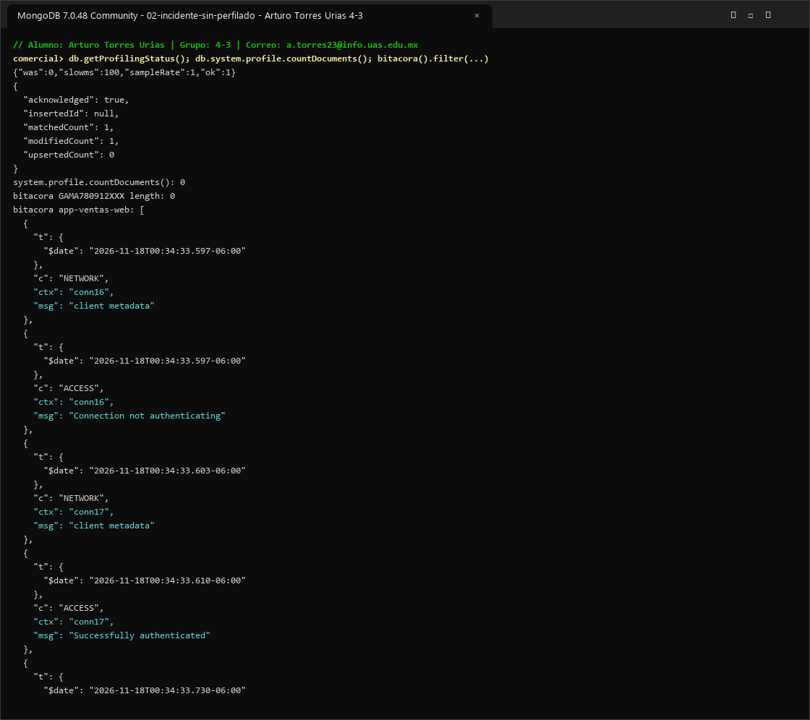

# Evidencia 02 — El Incidente sin Perfilado

- **Alumno:** Arturo Torres Urias
- **Grupo:** 4-3
- **Correo institucional:** a.torres23@info.uas.edu.mx
- **Materia:** Gestión de Seguridad y Desempeño de Bases de Datos
- **Unidad:** III — Auditoría, trazabilidad y gobierno práctico de datos
- **Laboratorio:** LAB-02 — Trazabilidad en MongoDB Community
- **Motor:** MongoDB 7.0.48 Community Edition (`mongosh 2.14.2` en Ubuntu 24.04 LTS)
- **Actividad:** Actividad 2 — Simulación de modificación del RFC con el perfilador apagado (`was: 0`)

---

## 1. Comandos Ejecutados

### En la sesión del DBA (verificar estado inicial del perfilador)
```javascript
db.getProfilingStatus()
```

### En una terminal (simulando a la aplicación `app-ventas-web`)
```bash
mongosh "mongodb://app_ventas:<REDACTED>@127.0.0.1:27017/comercial?appName=app-ventas-web" \
  --quiet --eval 'db.clientes.updateOne({ _id: 3 }, { $set: { rfc: "GAMA780912XXX" } })'
```

### En la sesión del DBA (búsqueda de evidencia en `system.profile` y en `bitacora()`)
```javascript
db.system.profile.countDocuments()
bitacora().filter(e => JSON.stringify(e).includes("GAMA780912XXX")).length
bitacora().filter(e => JSON.stringify(e).includes("app-ventas-web")).map(e => ({ t: e.t, c: e.c, ctx: e.ctx, msg: e.msg }))
```

---

## 2. Resultado Obtenido



```json
// 1. Estado del perfilador:
{ "was": 0, "slowms": 100, "sampleRate": 1, "ok": 1 }

// 2. Resultado del updateOne de app_ventas:
{
  "acknowledged": true,
  "insertedId": null,
  "matchedCount": 1,
  "modifiedCount": 1,
  "upsertedCount": 0
}

// 3. Búsqueda de evidencia:
0
0
[
  { "t": { "$date": "2026-11-18T00:34:33.597-06:00" }, "c": "NETWORK", "ctx": "conn16", "msg": "client metadata" },
  { "t": { "$date": "2026-11-18T00:34:33.597-06:00" }, "c": "ACCESS", "ctx": "conn16", "msg": "Connection not authenticating" },
  { "t": { "$date": "2026-11-18T00:34:33.603-06:00" }, "c": "NETWORK", "ctx": "conn17", "msg": "client metadata" },
  { "t": { "$date": "2026-11-18T00:34:33.610-06:00" }, "c": "ACCESS", "ctx": "conn17", "msg": "Successfully authenticated" },
  { "t": { "$date": "2026-11-18T00:34:33.730-06:00" }, "c": "NETWORK", "ctx": "conn18", "msg": "client metadata" },
  { "t": { "$date": "2026-11-18T00:34:33.730-06:00" }, "c": "NETWORK", "ctx": "conn19", "msg": "client metadata" },
  { "t": { "$date": "2026-11-18T00:34:33.740-06:00" }, "c": "ACCESS", "ctx": "conn18", "msg": "Successfully authenticated" },
  { "t": { "$date": "2026-11-18T00:34:33.741-06:00" }, "c": "ACCESS", "ctx": "conn19", "msg": "Successfully authenticated" }
]
```

---

## 3. Respuestas a las Preguntas de la Actividad 2

1. **¿Puedes demostrar qué cambió? ¿Y quién se conectó a esa hora?**
   - **¿Qué cambió? No hay evidencia con esta edición (con el perfilador apagado en nivel 0):** `db.system.profile.countDocuments()` vale `0` y la bitácora del servidor (`getLog`) tiene `0` ocurrencias de `"GAMA780912XXX"` (porque la operación duró menos que `slowms = 100 ms`). Por lo tanto, no existe ningún registro técnico de que se haya ejecutado un `updateOne` sobre `comercial.clientes` ni sobre `_id: 3`.
   - **¿Quién se conectó a esa hora? Sí:** la bitácora de `mongod` sí demuestra que a las `2026-11-18T00:34:33.610-06:00` se conectó y se autenticó exitosamente (`Successfully authenticated`) el usuario **`app_ventas`** en la base `comercial` desde `127.0.0.1` declarando `appName: "app-ventas-web"` (en `conn17`, `conn18` y `conn19`), aunque sin poder demostrar qué operación ejecutó dentro de esa sesión.

2. **¿Por qué `mongosh` abre varias conexiones (`conn16`, `conn17`, `conn18`, `conn19`) para una sola instrucción? ¿Cuál es la que se autentica?**
   Porque `mongosh` utiliza internamente el *driver* oficial de MongoDB para Node.js, el cual abre por diseño:
   - Una primera conexión dedicada al **monitoreo de topología y latidos del servidor (*topology monitoring / heartbeat*, aquí `conn16`)**, la cual solo ejecuta comandos de descubrimiento (`hello` / `isMaster`) y **no se autentica** (`msg: "Connection not authenticating"`).
   - Un **grupo de conexiones de trabajo (*connection pool*, aquí `conn17`, `conn18`, `conn19`)** para ejecutar comandos de aplicación y telemetría/sesión de `mongosh`. **Son estas conexiones de trabajo (`conn17`, `conn18`, `conn19`) las que ejecutan el apretón de manos `SCRAM` y registran `msg: "Successfully authenticated"`**.
