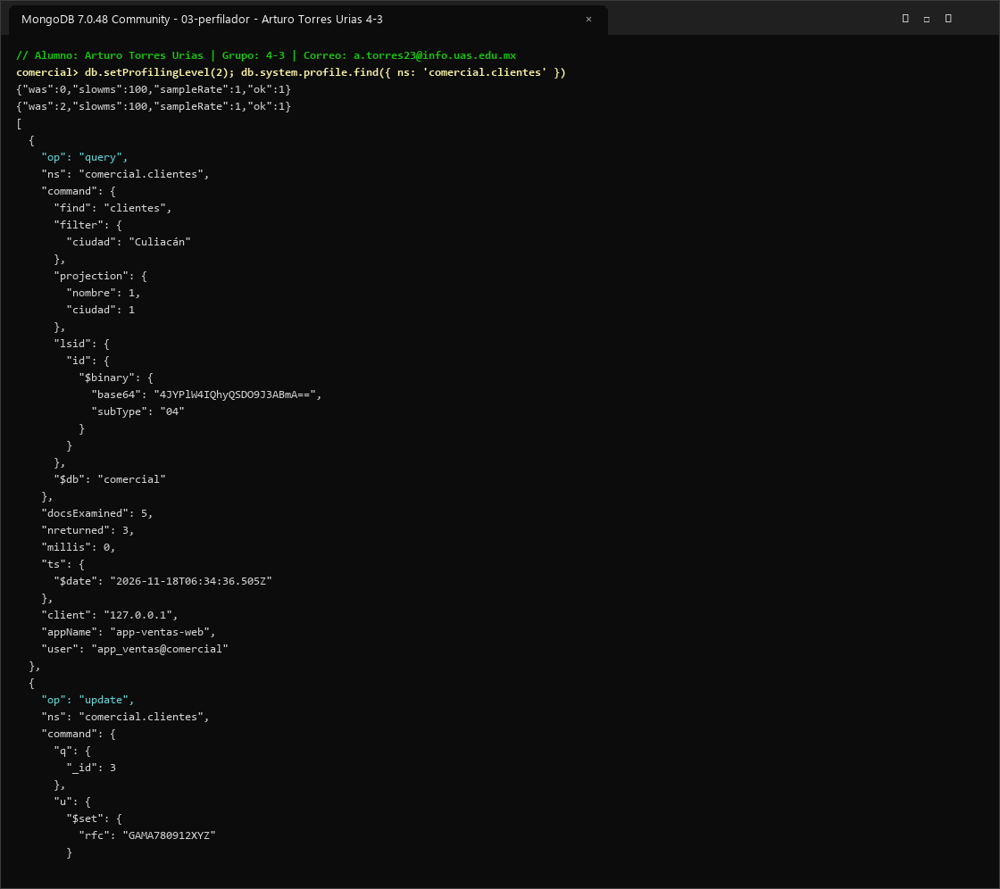

# Evidencia 03 — Activar el Perfilador y Registrar Operaciones

- **Alumno:** Arturo Torres Urias
- **Grupo:** 4-3
- **Correo institucional:** a.torres23@info.uas.edu.mx
- **Materia:** Gestión de Seguridad y Desempeño de Bases de Datos
- **Unidad:** III — Auditoría, trazabilidad y gobierno práctico de datos
- **Laboratorio:** LAB-02 — Trazabilidad en MongoDB Community
- **Motor:** MongoDB 7.0.48 Community Edition (`mongosh 2.14.2` en Ubuntu 24.04 LTS)
- **Actividad:** Actividad 3 — Activación de `db.setProfilingLevel(2)` e interpretación de `system.profile`

---

## 1. Comandos Ejecutados

### En la sesión del DBA (activar nivel 2 en `comercial`)
```javascript
db.setProfilingLevel(2)
db.getProfilingStatus()
```

### En la terminal de la aplicación (`app_ventas`)
```bash
mongosh "mongodb://app_ventas:<REDACTED>@127.0.0.1:27017/comercial?appName=app-ventas-web" \
  --quiet --eval 'db.clientes.find({ ciudad: "Culiacán" }, { nombre: 1, ciudad: 1 }).toArray(); db.clientes.updateOne({ _id: 3 }, { $set: { rfc: "GAMA780912XYZ" } }); db.clientes.deleteOne({ _id: 2 });'
```

### En la sesión del DBA (consultar `system.profile`)
```javascript
db.system.profile.find(
  { ns: "comercial.clientes" },
  { op: 1, ns: 1, command: 1, user: 1, client: 1, appName: 1, ts: 1, millis: 1, nreturned: 1, docsExamined: 1, nModified: 1, ndeleted: 1 }
).sort({ ts: 1 })
```

---

## 2. Resultado Obtenido



```json
// Activación del nivel 2:
{ "was": 0, "slowms": 100, "sampleRate": 1, "ok": 1 }
{ "was": 2, "slowms": 100, "sampleRate": 1, "ok": 1 }

// Documentos registrados en comercial.system.profile:
[
  {
    "op": "query",
    "ns": "comercial.clientes",
    "command": {
      "find": "clientes",
      "filter": { "ciudad": "Culiacán" },
      "projection": { "nombre": 1, "ciudad": 1 },
      "$db": "comercial"
    },
    "docsExamined": 5,
    "nreturned": 3,
    "millis": 0,
    "ts": { "$date": "2026-11-18T06:34:36.505Z" },
    "client": "127.0.0.1",
    "appName": "app-ventas-web",
    "user": "app_ventas@comercial"
  },
  {
    "op": "update",
    "ns": "comercial.clientes",
    "command": {
      "q": { "_id": 3 },
      "u": { "$set": { "rfc": "GAMA780912XYZ" } },
      "multi": false,
      "upsert": false
    },
    "docsExamined": 1,
    "nModified": 1,
    "millis": 0,
    "ts": { "$date": "2026-11-18T06:34:36.509Z" },
    "client": "127.0.0.1",
    "appName": "app-ventas-web",
    "user": "app_ventas@comercial"
  },
  {
    "op": "remove",
    "ns": "comercial.clientes",
    "command": {
      "q": { "_id": 2 },
      "limit": 1
    },
    "docsExamined": 1,
    "ndeleted": 1,
    "millis": 0,
    "ts": { "$date": "2026-11-18T06:34:36.518Z" },
    "client": "127.0.0.1",
    "appName": "app-ventas-web",
    "user": "app_ventas@comercial"
  }
]
```

---

## 3. Tabla 9.1 — Interpretar los Documentos de `system.profile`

| # | `op` | Usuario (`user`) | Cliente (`client`) | Aplicación (`appName`) | Momento (`ts`) | Qué hizo (`command`) | Documentos afectados |
| :-: | :--- | :--- | :--- | :--- | :--- | :--- | :--- |
| **1** | `query` | `app_ventas@comercial` | `127.0.0.1` | `app-ventas-web` | `2026-11-18T06:34:36.505Z` | Consultó `clientes` filtrando `{ ciudad: "Culiacán" }` y proyectando `{ nombre: 1, ciudad: 1 }`. | Examinó `5` (`docsExamined: 5`) y devolvió **`3` documentos** (`nreturned: 3`). |
| **2** | `update` | `app_ventas@comercial` | `127.0.0.1` | `app-ventas-web` | `2026-11-18T06:34:36.509Z` | Actualizó en `clientes` el documento con filtro `q: { _id: 3 }` aplicando `u: { $set: { rfc: "GAMA780912XYZ" } }`. | Examinó `1` y modificó **`1` documento** (`nModified: 1`). |
| **3** | `remove` | `app_ventas@comercial` | `127.0.0.1` | `app-ventas-web` | `2026-11-18T06:34:36.518Z` | Eliminó de `clientes` el documento con filtro `q: { _id: 2 }` y límite `limit: 1`. | Examinó `1` y eliminó **`1` documento** (`ndeleted: 1`). |

---

## 4. Respuestas a las Preguntas de la Actividad 3

1. **¿Puedes saber cuál era el RFC antes del cambio con la información de `system.profile`?**
   **No (No hay evidencia con esta edición).** El perfilador de MongoDB es un mecanismo a nivel de operación/comando: registra la instrucción recibida (`command.q: { _id: 3 }` y `command.u: { $set: { rfc: "GAMA780912XYZ" } }`), pero **no captura el estado previo del documento (`OLD`)** antes de aplicar la actualización, y en un nodo autónomo sin disparadores ni *Change Streams* con `fullDocumentBeforeChange` preconfigurado, el valor anterior se sobrescribe sin dejar rastro en `system.profile`.

2. **¿Puedes saber qué datos tenía el documento eliminado?**
   **No (No hay evidencia con esta edición).** El documento con `op: "remove"` en `system.profile` únicamente registra el predicado de búsqueda usado para borrar (`command: { q: { _id: 2 }, limit: 1 }`) y cuántos documentos se borraron (`ndeleted: 1`), pero no guarda el contenido (`nombre`, `correo`, `telefono`, `rfc`) que tenía el cliente `_id: 2` antes de ser eliminado.

3. **A diferencia de `log_statement = 'mod'` en PostgreSQL, el nivel 2 sí registró la consulta. ¿Qué ventaja y qué riesgo tiene eso?**
   - **Ventaja:** Permite demostrar quién leyó datos de la colección, a qué hora, con qué filtro y cuántos documentos obtuvo (`nreturned: 3`), brindando trazabilidad de lecturas sin instalar extensiones adicionales.
   - **Riesgo:** Tiene tres riesgos importantes:
     1. **Sobrescritura acelerada de evidencia:** Como `system.profile` es una colección limitada (*capped collection*) de solo **1 MB** por defecto, registrar todas las consultas `find` de una tienda en línea llenará rápidamente el megabyte y **sobrescribirá los registros de modificaciones (`update`, `remove`)** en pocos minutos.
     2. **Degradación del rendimiento:** Escribir un documento en `system.profile` por cada lectura agrega latencia y carga de escritura en disco.
     3. **Exposición de datos personales en filtros:** Cualquier dato sensible buscado en un `filter` (como un RFC o correo) queda copiado en `system.profile`.

4. **¿Por qué el campo `user` incluye `@comercial`?**
   Porque en MongoDB cada usuario se define y autentica dentro de una **base de datos de autenticación (`authenticationDatabase` / `authSource`)** específica, de modo que la identidad completa de un usuario es el par `usuario@base_de_origen`. Mientras que el DBA se creó en la base `admin` (`admin@admin`), el usuario `app_ventas` se creó en la base `comercial` (`app_ventas@comercial`).
