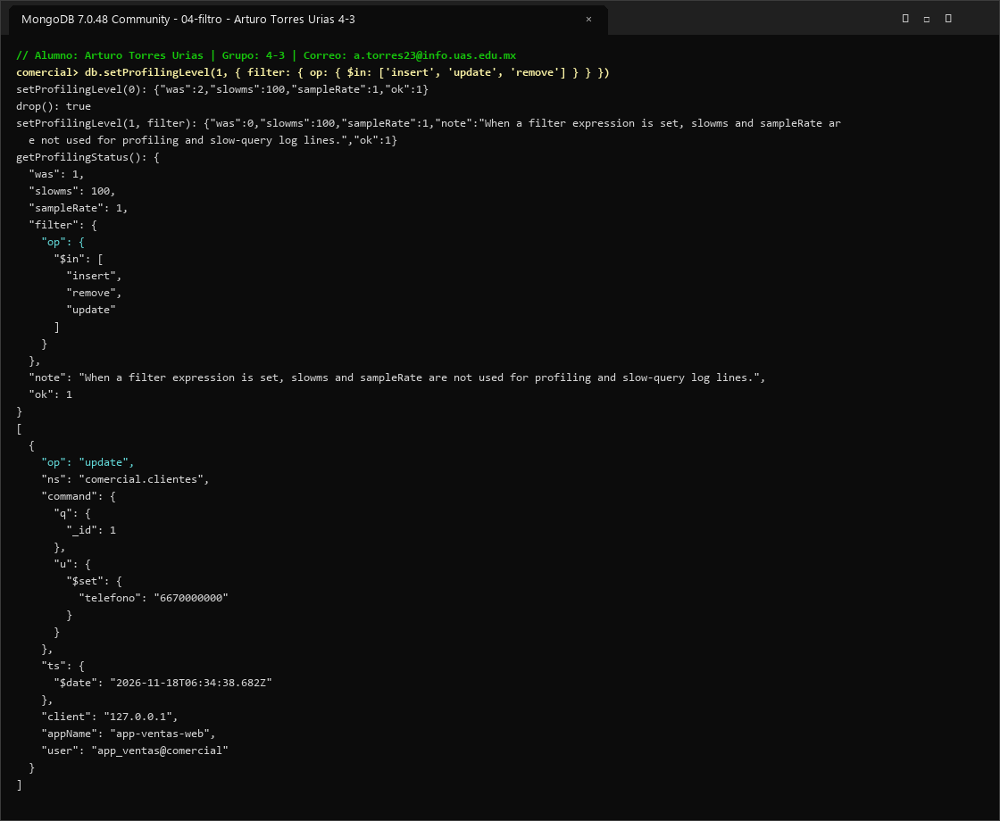

# Evidencia 04 — Reducir el Volumen con un Filtro en el Perfilador

- **Alumno:** Arturo Torres Urias
- **Grupo:** 4-3
- **Correo institucional:** a.torres23@info.uas.edu.mx
- **Materia:** Gestión de Seguridad y Desempeño de Bases de Datos
- **Unidad:** III — Auditoría, trazabilidad y gobierno práctico de datos
- **Laboratorio:** LAB-02 — Trazabilidad en MongoDB Community
- **Motor:** MongoDB 7.0.48 Community Edition (`mongosh 2.14.2` en Ubuntu 24.04 LTS)
- **Actividad:** Actividad 4 — Configuración de un filtro en el perfilador para registrar únicamente operaciones de escritura (`insert`, `update`, `remove`)

---

## 1. Comandos Ejecutados

### En la sesión del DBA (aplicar filtro de operaciones de escritura)
```javascript
db.setProfilingLevel(0)
db.system.profile.drop()
db.setProfilingLevel(1, { filter: { op: { $in: ["insert", "update", "remove"] } } })
db.getProfilingStatus()
```

### En la terminal de la aplicación (`app_ventas`)
```bash
mongosh "mongodb://app_ventas:<REDACTED>@127.0.0.1:27017/comercial?appName=app-ventas-web" \
  --quiet --eval 'db.clientes.find({ _id: 1 }).toArray(); db.clientes.updateOne({ _id: 1 }, { $set: { telefono: "6670000000" } })'
```

### En la sesión del DBA (verificar qué se registró)
```javascript
db.system.profile.find({}, { op: 1, ns: 1, user: 1, appName: 1, "command.q": 1, "command.u": 1, ts: 1 })
```

---

## 2. Resultado Obtenido



```json
// Estado del perfilador con filtro activo:
{
  "was": 1,
  "slowms": 100,
  "sampleRate": 1,
  "filter": {
    "op": {
      "$in": [
        "insert",
        "remove",
        "update"
      ]
    }
  },
  "note": "When a filter expression is set, slowms and sampleRate are not used for profiling and slow-query log lines.",
  "ok": 1
}

// Documentos registrados en system.profile (solo aparece update, NO el find):
[
  {
    "op": "update",
    "ns": "comercial.clientes",
    "command": {
      "q": { "_id": 1 },
      "u": { "$set": { "telefono": "6670000000" } }
    },
    "ts": { "$date": "2026-11-18T06:34:38.682Z" },
    "appName": "app-ventas-web",
    "user": "app_ventas@comercial"
  }
]
```

---

## 3. Respuestas a las Preguntas de la Actividad 4

1. **¿Qué perdiste de evidencia al aplicar el filtro? ¿Qué ganaste?**
   - **Qué se perdió:** Se perdió toda evidencia de las **consultas de lectura (`op: "query"` / comandos `aggregate`, `count`, `distinct`)**; si un usuario o aplicación extrae masivamente los datos de `clientes` mediante `find()`, el perfilador ya no lo registrará. Además, como advierte la nota oficial (`note: "When a filter expression is set, slowms and sampleRate are not used..."`), también se deja de registrar por umbral de lentitud (`slowms`) aquellas consultas lentas que no cumplan con el filtro.
   - **Qué se ganó:** Se redujo drásticamente el volumen de escritura en `system.profile` y el impacto en el desempeño del servidor, logrando un comportamiento equivalente a `log_statement = 'mod'` en PostgreSQL. Gracias a ello, la colección limitada de 1 MB conserva durante mucho más tiempo las operaciones que realmente alteran datos (`insert`, `update`, `remove`) sin que sean desplazadas por miles de lecturas rutinarias del catálogo web.

2. **¿Qué filtro usarías si solo interesaran operaciones sobre la colección `clientes`?**
   Agregando la condición sobre el campo `ns` (*namespace* `base.coleccion` = `"comercial.clientes"`):
   - Si interesan **todas las operaciones** únicamente sobre `comercial.clientes`:
     ```javascript
     db.setProfilingLevel(1, { filter: { ns: "comercial.clientes" } })
     ```
   - Y si solo interesan las **modificaciones (`insert`, `update`, `remove`)** sobre `comercial.clientes`:
     ```javascript
     db.setProfilingLevel(1, {
       filter: {
         ns: "comercial.clientes",
         op: { $in: ["insert", "update", "remove"] }
       }
     })
     ```
