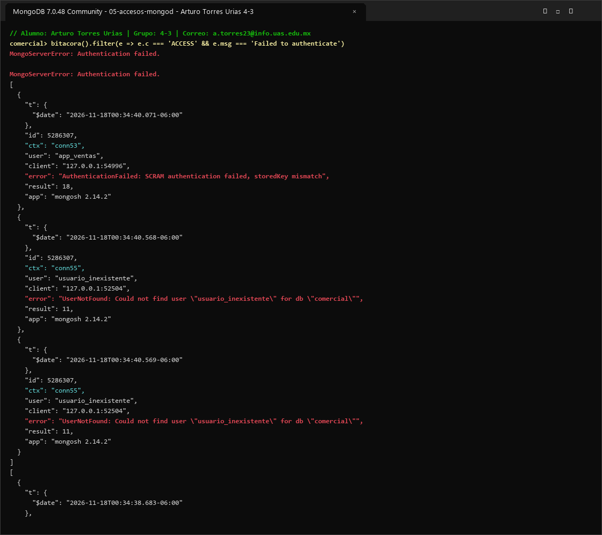

# Evidencia 05 — Accesos en la Bitácora de `mongod`

- **Alumno:** Arturo Torres Urias
- **Grupo:** 4-3
- **Correo institucional:** a.torres23@info.uas.edu.mx
- **Materia:** Gestión de Seguridad y Desempeño de Bases de Datos
- **Unidad:** III — Auditoría, trazabilidad y gobierno práctico de datos
- **Laboratorio:** LAB-02 — Trazabilidad en MongoDB Community
- **Motor:** MongoDB 7.0.48 Community Edition (`mongosh 2.14.2` en Ubuntu 24.04 LTS)
- **Actividad:** Actividad 5 — Registro e interpretación de intentos de acceso fallidos y exitosos en la bitácora JSON de `mongod`

---

## 1. Comandos Ejecutados

### En la terminal (dos intentos de conexión fallidos)
```bash
mongosh "mongodb://app_ventas:<REDACTED>@127.0.0.1:27017/comercial" --quiet --eval "db.clientes.countDocuments()"
mongosh "mongodb://usuario_inexistente:<REDACTED>@127.0.0.1:27017/comercial" --quiet --eval "db.clientes.countDocuments()"
```

### En la sesión del DBA (filtrar eventos `ACCESS` en `bitacora()`)
```javascript
bitacora()
  .filter(e => e.c === "ACCESS" && e.msg === "Failed to authenticate")
  .map(e => ({ t: e.t, id: e.id, ctx: e.ctx, user: e.attr.user, client: e.attr.client, error: e.attr.error, result: e.attr.result, app: e.attr.doc.application.name }))

bitacora()
  .filter(e => e.msg === "Successfully authenticated" && e.attr.user === "app_ventas")
  .slice(-1)
  .map(e => ({ t: e.t, id: e.id, ctx: e.ctx, client: e.attr.client, result: e.attr.result, app: e.attr.doc.application.name }))
```

---

## 2. Resultado Obtenido



```text
-- En la terminal del cliente:
MongoServerError: Authentication failed.
MongoServerError: Authentication failed.
```

```json
// Intentos fallidos en la bitácora JSON de mongod:
[
  {
    "t": { "$date": "2026-11-18T00:34:40.071-06:00" },
    "id": 5286307,
    "ctx": "conn53",
    "user": "app_ventas",
    "client": "127.0.0.1:54996",
    "error": "AuthenticationFailed: SCRAM authentication failed, storedKey mismatch",
    "result": 18,
    "app": "mongosh 2.14.2"
  },
  {
    "t": { "$date": "2026-11-18T00:34:40.568-06:00" },
    "id": 5286307,
    "ctx": "conn55",
    "user": "usuario_inexistente",
    "client": "127.0.0.1:52504",
    "error": "UserNotFound: Could not find user \"usuario_inexistente\" for db \"comercial\"",
    "result": 11,
    "app": "mongosh 2.14.2"
  },
  {
    "t": { "$date": "2026-11-18T00:34:40.569-06:00" },
    "id": 5286307,
    "ctx": "conn55",
    "user": "usuario_inexistente",
    "client": "127.0.0.1:52504",
    "error": "UserNotFound: Could not find user \"usuario_inexistente\" for db \"comercial\"",
    "result": 11,
    "app": "mongosh 2.14.2"
  }
]

// Último acceso exitoso de app_ventas:
[
  {
    "t": { "$date": "2026-11-18T00:34:38.683-06:00" },
    "id": 5286306,
    "ctx": "conn47",
    "client": "127.0.0.1:54930",
    "result": 0,
    "app": "app-ventas-web"
  }
]
```

---

## 3. Respuestas a las Preguntas de la Actividad 5

1. **¿Qué campo distingue un acceso fallido de uno exitoso?**
   Lo distinguen tres campos complementarios dentro del documento JSON de la bitácora (componente `c: "ACCESS"`):
   - **`msg`:** Vale `"Successfully authenticated"` en un acceso exitoso y `"Failed to authenticate"` en uno fallido.
   - **`id`:** El identificador numérico de evento es **`5286306`** para autenticación exitosa y **`5286307`** para autenticación fallida.
   - **`attr.result`:** Vale **`0`** (`OK`) cuando la autenticación es exitosa, y un código de error distinto de cero cuando falla (**`18`** para `AuthenticationFailed` o **`11`** para `UserNotFound`).

2. **¿Qué diferencia hay entre el error de contraseña incorrecta y el de usuario inexistente? ¿Por qué el cliente recibe el mismo mensaje en ambos casos?**
   - **Diferencia en la bitácora interna:** Cuando el usuario sí existe pero la contraseña falla (`app_ventas`), la bitácora registra `result: 18` y `error: "AuthenticationFailed: SCRAM authentication failed, storedKey mismatch"`. Cuando el usuario no existe (`usuario_inexistente`), la bitácora registra `result: 11` y `error: "UserNotFound: Could not find user "usuario_inexistente" for db "comercial""` (además de producir dos líneas en la misma conexión `conn55`: una por autenticación especulativa `isSpeculative: true` en el comando `hello` inicial y otra con `isSpeculative: false` en el comando `saslStart`).
   - **Por qué el cliente recibe el mismo mensaje (`MongoServerError: Authentication failed.`):** Igual que vimos en PostgreSQL en el `LAB-01`, el servidor oculta el motivo exacto al cliente externo para **prevenir ataques de enumeración de usuarios**, evitando que un atacante descubra qué nombres de cuenta existen en la base `comercial`.

3. **¿Por qué el nombre de la aplicación del intento fallido es `mongosh 2.14.2` y no `app-ventas-web`?**
   Porque en los dos comandos de prueba de intentos fallidos la cadena de conexión (`"mongodb://app_ventas:<REDACTED>@127.0.0.1:27017/comercial"`) **no incluyó el parámetro `?appName=app-ventas-web`**. Cuando el cliente no especifica un `appName` en la URI, `mongosh` envía por defecto su propio nombre y versión (`"mongosh 2.14.2"`) dentro de los metadatos del cliente (`client metadata`). Además, a diferencia de PostgreSQL, en MongoDB los metadatos del cliente (`doc.application.name`) se envían en el primer mensaje `hello` antes de terminar de autenticarse, por lo que sí aparecen registrados incluso en los intentos fallidos.
