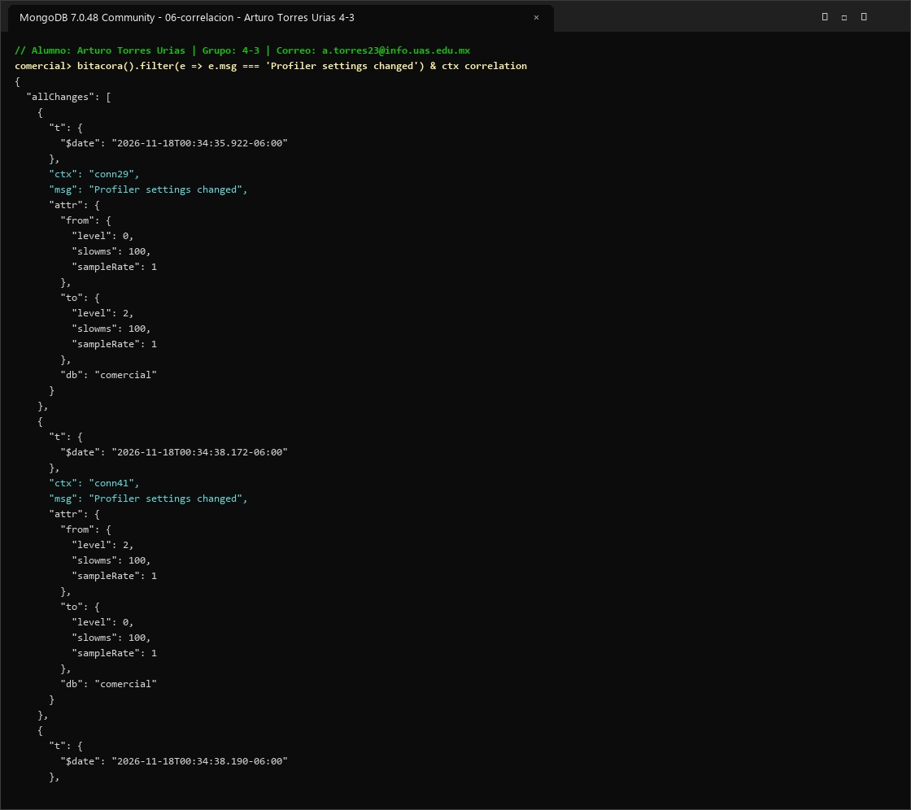

# Evidencia 06 — Correlacionar un Cambio de Configuración con su Autor

- **Alumno:** Arturo Torres Urias
- **Grupo:** 4-3
- **Correo institucional:** a.torres23@info.uas.edu.mx
- **Materia:** Gestión de Seguridad y Desempeño de Bases de Datos
- **Unidad:** III — Auditoría, trazabilidad y gobierno práctico de datos
- **Laboratorio:** LAB-02 — Trazabilidad en MongoDB Community
- **Motor:** MongoDB 7.0.48 Community Edition (`mongosh 2.14.2` en Ubuntu 24.04 LTS)
- **Actividad:** Actividad 6 — Correlación mediante `ctx` entre `"Profiler settings changed"` y `"Successfully authenticated"`

---

## 1. Comandos Ejecutados

```javascript
bitacora()
  .filter(e => e.msg === "Profiler settings changed")
  .map(e => ({ t: e.t, ctx: e.ctx, msg: e.msg, attr: e.attr }))

bitacora()
  .filter(e => e.ctx === "conn42" && e.msg === "Successfully authenticated")
  .map(e => ({ t: e.t, ctx: e.ctx, user: e.attr.user, db: e.attr.db, client: e.attr.client }))
```

---

## 2. Resultado Obtenido



```json
// 1. Último evento "Profiler settings changed" (Actividad 4):
{
  "t": { "$date": "2026-11-18T00:34:38.190-06:00" },
  "ctx": "conn42",
  "msg": "Profiler settings changed",
  "attr": {
    "from": { "level": 0, "slowms": 100, "sampleRate": 1 },
    "to": {
      "level": 1,
      "slowms": 100,
      "sampleRate": 1,
      "filter": { "op": { "$in": [ "insert", "remove", "update" ] } }
    },
    "db": "comercial"
  }
}

// 2. Autenticación asociada a ctx === "conn42":
[
  {
    "t": { "$date": "2026-11-18T00:34:38.176-06:00" },
    "ctx": "conn42",
    "user": "admin",
    "db": "admin",
    "client": "127.0.0.1:54880"
  }
]
```

---

## 3. Respuestas a las Preguntas de la Actividad 6

1. **¿Qué usuario cambió la configuración del perfilador? ¿Qué dos eventos lo demuestran?**
   El cambio de configuración del perfilador lo realizó el usuario **`admin`** (definido en la base `admin`) conectado desde **`127.0.0.1:54880`**. Lo demuestran la correlación de dos eventos en la bitácora de `mongod` unidos por el mismo identificador de contexto **`ctx: "conn42"`**:
   1. El evento `msg: "Successfully authenticated"` a las `2026-11-18T00:34:38.176-06:00` en `ctx: "conn42"`, que demuestra que en esa conexión se autenticó `user: "admin"`, `db: "admin"` desde `client: "127.0.0.1:54880"`.
   2. El evento `msg: "Profiler settings changed"` 14 milisegundos después (`2026-11-18T00:34:38.190-06:00`) en ese mismo `ctx: "conn42"`, que demuestra que esa conexión cambió el perfilador de la base `comercial` de `level: 0` a `level: 1` con el filtro `op: { $in: ["insert", "remove", "update"] }`.

2. **¿Qué condición debe cumplirse para que esta correlación sea válida? (Piensa en qué pasa si el servidor se reinicia y los números de conexión vuelven a empezar.)**
   Para que la correlación por `ctx` (`connN`) sea válida, **ambos eventos deben pertenecer al mismo ciclo de ejecución (misma instancia de arranque del proceso `mongod`) y a la misma sesión TCP sin que el usuario haya cambiado de identidad con `db.auth()` o `logout`**. Si el servidor `mongod` se reinicia, el contador de conexiones vuelve a empezar desde `conn1`; por lo tanto, correlacionar un `conn42` previo al reinicio con un `conn42` posterior al reinicio mezclaría dos sesiones completamente distintas. Además, el evento de inicio de la conexión (`Successfully authenticated`) debe seguir conservado en la bitácora (si solo se consulta `getLog` en memoria y ya pasaron más de 1024 eventos, el evento de autenticación inicial podría haberse desplazado).

3. **¿Por qué es relevante que quede registrado un cambio de configuración del propio mecanismo de registro?**
   Porque si un administrador o un atacante con privilegios elevados apaga el perfilador (`db.setProfilingLevel(0)`) para ejecutar modificaciones maliciosas sin dejar rastro en `system.profile` y luego lo vuelve a encender (exactamente análogo a desactivar el disparador o cambiar `log_statement = 'none'` en PostgreSQL), el evento `"Profiler settings changed"` en la bitácora del servidor actúa como **evidencia de manipulación del mecanismo de trazabilidad**, revelando quién lo apagó, a qué hora exacta comenzó la ventana ciega y cuándo lo reactivó.
