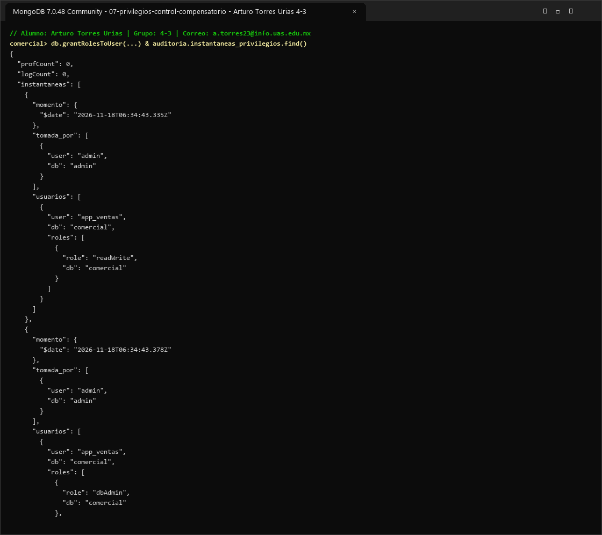

# Evidencia 07 — Cambios de Privilegios: El Límite Más Importante y Control Compensatorio

- **Alumno:** Arturo Torres Urias
- **Grupo:** 4-3
- **Correo institucional:** a.torres23@info.uas.edu.mx
- **Materia:** Gestión de Seguridad y Desempeño de Bases de Datos
- **Unidad:** III — Auditoría, trazabilidad y gobierno práctico de datos
- **Laboratorio:** LAB-02 — Trazabilidad en MongoDB Community
- **Motor:** MongoDB 7.0.48 Community Edition (`mongosh 2.14.2` en Ubuntu 24.04 LTS)
- **Actividad:** Actividad 7 — Comprobación de ausencia de registro en `grantRolesToUser` e implementación de instantáneas de privilegios (`auditoria.instantaneas_privilegios`)

---

## 1. Comandos Ejecutados

```javascript
// 1. Primera instantánea de privilegios:
db.getSiblingDB("auditoria").instantaneas_privilegios.insertOne({
  momento: new Date(),
  tomada_por: db.runCommand({ connectionStatus: 1 }).authInfo.authenticatedUsers,
  usuarios: db.getUsers().users.map(u => ({ user: u.user, db: u.db, roles: u.roles }))
})

// 2. Activar nivel 2 y otorgar rol dbAdmin a app_ventas:
db.setProfilingLevel(2)
db.grantRolesToUser("app_ventas", [{ role: "dbAdmin", db: "comercial" }])

// 3. Buscar evidencia del cambio en system.profile y en la bitácora de mongod:
db.system.profile.countDocuments({ "command.grantRolesToUser": { $exists: true } })
bitacora().filter(e => JSON.stringify(e).includes("grantRoles")).length

// 4. Segunda instantánea de privilegios y comparación:
db.getSiblingDB("auditoria").instantaneas_privilegios.insertOne({
  momento: new Date(),
  tomada_por: db.runCommand({ connectionStatus: 1 }).authInfo.authenticatedUsers,
  usuarios: db.getUsers().users.map(u => ({ user: u.user, db: u.db, roles: u.roles }))
})
db.getSiblingDB("auditoria").instantaneas_privilegios.find({}, { _id: 0 }).sort({ momento: 1 })

// 5. Revocar el rol y restablecer el filtro de la Actividad 4:
db.revokeRolesFromUser("app_ventas", [{ role: "dbAdmin", db: "comercial" }])
db.setProfilingLevel(1, { filter: { op: { $in: ["insert", "update", "remove"] } } })
```

---

## 2. Resultado Obtenido



```json
// Búsqueda en system.profile y en bitacora():
0
0

// Comparación de las dos instantáneas en auditoria.instantaneas_privilegios:
[
  {
    "momento": { "$date": "2026-11-18T06:34:43.335Z" },
    "tomada_por": [ { "user": "admin", "db": "admin" } ],
    "usuarios": [
      {
        "user": "app_ventas",
        "db": "comercial",
        "roles": [
          { "role": "readWrite", "db": "comercial" }
        ]
      }
    ]
  },
  {
    "momento": { "$date": "2026-11-18T06:34:43.378Z" },
    "tomada_por": [ { "user": "admin", "db": "admin" } ],
    "usuarios": [
      {
        "user": "app_ventas",
        "db": "comercial",
        "roles": [
          { "role": "dbAdmin", "db": "comercial" },
          { "role": "readWrite", "db": "comercial" }
        ]
      }
    ]
  }
]
```

---

## 3. Respuestas a las Preguntas de la Actividad 7

1. **¿Por qué un cambio de privilegios es uno de los eventos auditables más importantes?**
   Porque una **escalada de privilegios** (como otorgar `dbAdmin`, `userAdmin` o `root` a una cuenta de aplicación como `app_ventas`) altera los límites de todo el modelo de control de acceso: a partir de ese momento, esa cuenta puede borrar colecciones, desactivar el perfilador (`db.setProfilingLevel(0)`), eliminar `system.profile` o leer datos sin restricción. En MongoDB Community, ni `system.profile` (incluso en nivel 2) ni la bitácora estándar de `mongod` registran `grantRolesToUser` ni `revokeRolesFromUser`, lo que constituye el límite de seguridad más crítico frente a la edición Enterprise.

2. **¿Con qué frecuencia tomarías instantáneas? ¿Qué factores influyen?**
   Tomaría instantáneas automatizadas **cada hora (o cada 15 minutos en sistemas críticos)**, además de disparar una instantánea inmediata antes y después de cualquier ventana de mantenimiento autorizada. Los factores que influyen son:
   - **La ventana de exposición aceptable:** Si un atacante o administrador otorga un rol indebido, lo usa durante 10 minutos y luego lo revoca (`revokeRolesFromUser`) antes de la siguiente instantánea diaria, **una instantánea cada 24 horas jamás detectaría esa escalada temporal**.
   - **La criticidad de los datos y la frecuencia de cambios administrativos:** En producción los roles casi nunca cambian, por lo que comparar el hash de `db.getUsers()` cada 15–60 minutos tiene un costo computacional prácticamente nulo y reduce la ventana ciega.

3. **¿Quién debería poder escribir en `auditoria.instantaneas_privilegios`?**
   Únicamente un **proceso automatizado de monitoreo / auditoría externa** con una cuenta de servicio dedicada (o mejor aún, que el script externo consulte `usersInfo` con un rol de solo lectura sobre el catálogo y **guarde la instantánea fuera de MongoDB**, en un servidor SIEM o repositorio inmutable del área de Seguridad). Si las instantáneas se guardan únicamente dentro del propio servidor MongoDB donde el DBA (`root`) tiene control total, el mismo administrador que otorgó un permiso indebido podría modificar o borrar los documentos de `auditoria.instantaneas_privilegios`.

4. **Redacta en tres líneas cómo comunicarías esta limitación a Dirección.**
   > En MongoDB Community Edition no existe auditoría nativa, por lo que los cambios de permisos sobre usuarios (`grantRolesToUser` / `revokeRolesFromUser`) no quedan registrados ni en la bitácora del servidor ni en el perfilador. Implementamos como control compensatorio la toma periódica de instantáneas de roles, la cual permite **detectar qué privilegios cambiaron** entre dos cortes de tiempo, pero **no permite demostrar quién ejecutó el cambio ni el segundo exacto en que ocurrió**. Si el negocio requiere atribución forense inmutable de cambios de privilegios o detectar escaladas temporales entre dos instantáneas, será necesario evaluar MongoDB Enterprise/Atlas o retirar los datos sensibles de esta instancia.
