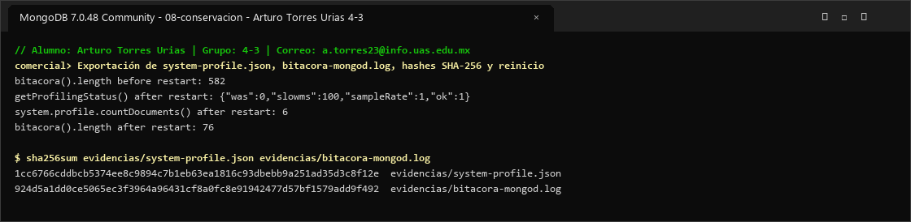

# Evidencia 08 — Conservación: Exportar Antes de Perder

- **Alumno:** Arturo Torres Urias
- **Grupo:** 4-3
- **Correo institucional:** a.torres23@info.uas.edu.mx
- **Materia:** Gestión de Seguridad y Desempeño de Bases de Datos
- **Unidad:** III — Auditoría, trazabilidad y gobierno práctico de datos
- **Laboratorio:** LAB-02 — Trazabilidad en MongoDB Community
- **Motor:** MongoDB 7.0.48 Community Edition (`mongosh 2.14.2` en Ubuntu 24.04 LTS)
- **Actividad:** Actividad 8 — Verificación de volatilidad tras reinicio, exportación de `system-profile.json` y `bitacora-mongod.log`, y cálculo de hashes SHA-256
- **Archivos exportados:** `evidencias/system-profile.json`, `evidencias/bitacora-mongod.log` y `evidencias/hashes.sha256`

---

## 1. Comandos Ejecutados

### 14.2 y 14.3 Exportar `system.profile` y la bitácora antes de reiniciar, y calcular SHA-256
```bash
mongosh "mongodb://admin:<REDACTED>@127.0.0.1:27017/comercial?authSource=admin" \
  --quiet --eval 'EJSON.stringify(db.system.profile.find({ ns: "comercial.clientes" }, { op: 1, ns: 1, user: 1, client: 1, appName: 1, ts: 1, millis: 1, nreturned: 1, docsExamined: 1, nModified: 1, ndeleted: 1, "command.find": 1, "command.filter": 1, "command.projection": 1, "command.q": 1, "command.u": 1, "command.limit": 1 }).sort({ ts: 1 }).toArray(), null, 2)' > evidencias/system-profile.json

mongosh "mongodb://admin:<REDACTED>@127.0.0.1:27017/comercial?authSource=admin" \
  --quiet --eval 'db.adminCommand({ getLog: "global" }).log.join("\n")' > evidencias/bitacora-mongod.log

sha256sum evidencias/system-profile.json evidencias/bitacora-mongod.log > evidencias/hashes.sha256
```

### 14.1 Reiniciar el servicio y comprobar pérdida del nivel de perfilado y de la memoria `getLog`
```bash
sudo systemctl restart mongod
```
```javascript
db.getProfilingStatus()
db.system.profile.countDocuments()
bitacora().length
```

---

## 2. Resultado Obtenido



```text
-- Antes de reiniciar:
bitacora().length: 582

-- Después de reiniciar mongod (sudo systemctl restart mongod):
getProfilingStatus() after restart: {"was":0,"slowms":100,"sampleRate":1,"ok":1}
system.profile.countDocuments() after restart: 6
bitacora().length after restart: 76

-- Hashes SHA-256 generados en evidencias/hashes.sha256:
1cc6766cddbcb5374ee8c9894c7b1eb63ea1816c93dbebb9a251ad35d3c8f12e  evidencias/system-profile.json
924d5a1dd0ce5065ec3f3964a96431cf8a0fc8e91942477d57bf1579add9f492  evidencias/bitacora-mongod.log
```

---

## 3. Respuestas a las Preguntas de la Actividad 8

1. **Menciona tres formas en que la evidencia del perfilador o de la bitácora puede perderse sin que nadie la borre deliberadamente.**
   1. **Sobrescritura circular en `system.profile`:** Al ser una colección limitada (*capped collection*) de **1 MB** por defecto, en cuanto el volumen de operaciones registradas alcanza 1 MB, MongoDB sobrescribe automáticamente los documentos más antiguos con los nuevos sin emitir error ni alerta.
   2. **Reinicio del servicio `mongod` cuando el perfilador solo se activó con `db.setProfilingLevel()`:** Al no estar declarado `operationProfiling.mode` en `/etc/mongod.conf`, tras cualquier reinicio del servicio o del servidor el nivel del perfilador **vuelve automáticamente a `0` (apagado)** y dejan de registrarse las operaciones subsecuentes; además, el búfer en memoria de `getLog` se vacía por completo (pasando en nuestra práctica de `582` a `76` eventos).
   3. **Rotación del búfer en memoria de `getLog` (límite de 1024 eventos) o salida estándar volátil en contenedores:** `db.adminCommand({ getLog: "global" })` solo conserva en RAM los últimos **1024 eventos**, descartando los anteriores conforme avanza la operación; y si el servidor no tiene `systemLog.destination: file` con `logAppend: true`, reiniciar o recrear el proceso/contenedor pierde la historia previa.

2. **¿Por qué el tamaño de 1 MB de `system.profile` es un problema de conservación y no solo de espacio?**
   Porque convierte la ventana de retención en **impredecible y vulnerable a inundación**: en una auditoría formal, la política de conservación se define en tiempo (por ejemplo, conservar registros durante 90 días o 5 años). Con una colección circular de 1 MB, si hay un pico de tráfico normal —o si un atacante ejecuta deliberadamente miles de operaciones inocuas después de hacer un cambio malicioso—, ese megabyte se llena en segundos y **el propio motor destruye la evidencia del incidente** antes de que nadie pueda exportarla.

3. **¿Por qué `getLog` sirve para interpretar pero no para conservar?**
   Porque `getLog` lee únicamente un **búfer circular en memoria RAM** limitado a las **1024 líneas más recientes** del proceso `mongod` actual. Es muy práctico para inspeccionar y filtrar rápidamente desde `mongosh` eventos que acaban de ocurrir durante un diagnóstico, pero no sirve como mecanismo de conservación porque **se borra totalmente al reiniciar el servicio** y descarta silenciosamente cualquier evento anterior a los últimos 1024 mensajes. La conservación real requiere escribir en disco (`systemLog.destination: file`, `logAppend: true`) y exportar periódicamente hacia almacenamiento externo con control de integridad (SHA-256).
