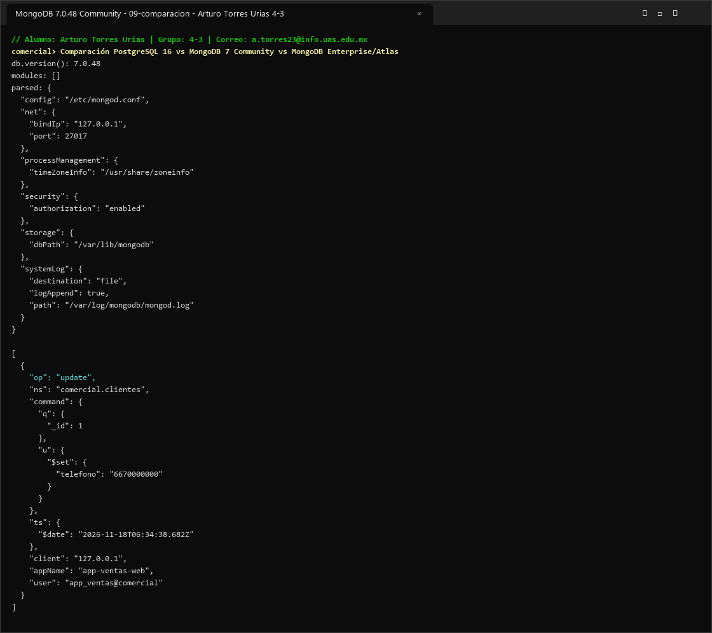

# Evidencia 09 — Comparar los Tres Escenarios (PostgreSQL vs. MongoDB Community vs. MongoDB Enterprise/Atlas)

- **Alumno:** Arturo Torres Urias
- **Grupo:** 4-3
- **Correo institucional:** a.torres23@info.uas.edu.mx
- **Materia:** Gestión de Seguridad y Desempeño de Bases de Datos
- **Unidad:** III — Auditoría, trazabilidad y gobierno práctico de datos
- **Laboratorio:** LAB-02 — Trazabilidad en MongoDB Community
- **Motor:** MongoDB 7.0.48 Community Edition (`mongosh 2.14.2` en Ubuntu 24.04 LTS)
- **Actividad:** Actividad 9 — Matriz comparativa de capacidades de trazabilidad y auditoría

---

## 1. Tabla Comparativa de los Tres Escenarios

| Evento auditable | PostgreSQL 16 (`bitácora + disparador` + `pgaudit`, LAB-01) | MongoDB 7 Community (`perfilador + bitácora`, LAB-02) | MongoDB Enterprise / Atlas (`auditoría nativa`, REF-U3-04) |
| :--- | :--- | :--- | :--- |
| **Acceso exitoso** | **Sí (observado):** Registrado en `dba.bitacora` con `log_connections = on` y `log_disconnections = on` (usuario, DB, app, IP y duración). | **Sí (observado):** Registrado en la bitácora JSON de `mongod` (`c: "ACCESS"`, `id: 5286306`, `msg: "Successfully authenticated"`, `result: 0`). | **Documentado, no practicado:** Sí, mediante eventos `authenticate` en `auditLog` (`--auditDestination`). |
| **Acceso fallido** | **Sí (observado):** Registrado siempre como `FATAL: password authentication failed` (y `DETAIL: Role ... does not exist` en la bitácora interna). | **Sí (observado):** Registrado en la bitácora JSON de `mongod` (`c: "ACCESS"`, `id: 5286307`, `msg: "Failed to authenticate"`, `result: 18` o `11`). | **Documentado, no practicado:** Sí, mediante eventos `authenticate` con resultado de fallo en `auditLog`. |
| **Cambio de privilegios** | **Sí (observado):** `GRANT`, `REVOKE`, `CREATE ROLE` y `DROP ROLE` quedan registrados en `dba.bitacora` desde `log_statement = 'ddl'` (y en `pgaudit` con `ROLE`). | **No (observado):** Ni `system.profile` (aun en nivel 2) ni la bitácora de `mongod` registran `grantRolesToUser` ni `revokeRolesFromUser`. *(Con instantáneas solo es **Parcial** como control compensatorio: detecta qué cambió entre dos cortes, pero **no quién ni cuándo exactamente**).* | **Documentado, no practicado:** Sí, registra nativamente `grantRolesToUser`, `revokeRolesFromUser`, `createUser`, `dropUser`, `createRole`, etc. |
| **Cambio de estructura** | **Sí (observado):** `CREATE TABLE`, `ALTER TABLE`, `DROP` y `CREATE TRIGGER` quedan registrados en `dba.bitacora` con `log_statement = 'ddl'` o `'mod'`. | **Parcial (explicado):** La bitácora de `mongod` registra algunos eventos de almacenamiento (`createCollection`, `Index build`), y el perfilador en nivel 2 registra comandos sobre la base perfilada, pero no existe un filtro de auditoría DDL dedicado y persistente como en Enterprise. | **Documentado, no practicado:** Sí, registra nativamente todas las operaciones DDL (`createCollection`, `dropCollection`, `createDatabase`, `dropDatabase`, `createIndex`). |
| **Modificación de datos** | **Sí (observado):** Registrada a nivel de sentencia con `log_statement = 'mod'` y a nivel de fila con el disparador en `auditoria.cambios_clientes`. | **Parcial (observado):** Sí se registra el comando (`insert`, `update`, `remove`) con usuario, IP, `appName` y `ts` **solo si el perfilador está activo** (nivel 2 o nivel 1 con filtro), pero vive en una colección circular volátil de 1 MB (`system.profile`) y el nivel se pierde al reiniciar si no está en `mongod.conf`. | **Documentado, no practicado:** Sí, registra operaciones CRUD cuando se habilita `auditAuthorizationSuccess: true` con filtros de auditoría (`--auditFilter`). |
| **Valor anterior del dato** | **Sí (observado):** Conservado íntegramente como `JSONB` (`to_jsonb(OLD)`) en `auditoria.cambios_clientes` gracias al disparador `AFTER UPDATE OR DELETE`. | **No (observado):** `system.profile` solo registra el comando ejecutado (`command.q` y `command.u`), **nunca el estado previo del documento** modificado ni los campos del documento eliminado. | **Documentado, no practicado:** **No** en la bitácora de auditoría nativa (`auditLog` registra la operación/comando, no el documento anterior; para capturar el estado anterior se requiere configurar *Change Streams* con `fullDocumentBeforeChange`). |
| **Lectura de datos sensibles** | **Sí (observado en Parte C con `pgaudit`):** Con `log_statement = 'mod'` y disparadores **No** se registra, pero con `pgaudit` (`pgaudit.role = 'auditor_datos'`) **Sí** se registra por tabla y columna sensible (`rfc`, `telefono`). | **Parcial (observado):** El nivel 2 del perfilador (`db.setProfilingLevel(2)`) **Sí** registra las consultas `query` (`find`), pero para toda la base de datos (sin poder filtrar solo lecturas de una columna sensible) y llenando rápidamente el límite de 1 MB de `system.profile`. | **Documentado, no practicado:** Sí, habilitando `auditAuthorizationSuccess: true` y acotando con `--auditFilter` sobre las colecciones sensibles. |
| **Cambio de configuración del registro** | **Sí (observado):** `dba.bitacora` registra tanto la sentencia `ALTER SYSTEM` / `DISABLE TRIGGER` como el mensaje del proceso principal `parameter "..." changed to "..."`. | **Parcial (observado):** La bitácora de `mongod` registra `msg: "Profiler settings changed"`, pero **no incluye el usuario en esa línea**: requiere correlacionar manualmente el campo `ctx` (`connN`) con el evento `"Successfully authenticated"` previo antes de que `getLog` rote o el servidor se reinicie. | **Documentado, no practicado:** Sí, los cambios de parámetros administrativos quedan auditados con identidad del usuario en `auditLog`. |
