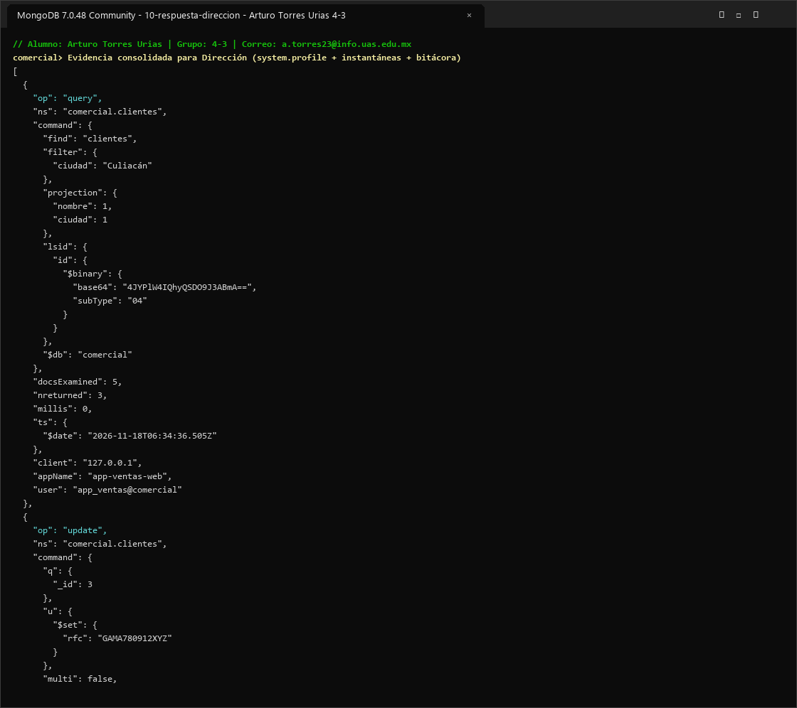

# Evidencia 10 — Responder a Dirección (Solo con la Evidencia de MongoDB Community)

- **Alumno:** Arturo Torres Urias
- **Grupo:** 4-3
- **Correo institucional:** a.torres23@info.uas.edu.mx
- **Materia:** Gestión de Seguridad y Desempeño de Bases de Datos
- **Unidad:** III — Auditoría, trazabilidad y gobierno práctico de datos
- **Laboratorio:** LAB-02 — Trazabilidad en MongoDB Community
- **Motor:** MongoDB 7.0.48 Community Edition (`mongosh 2.14.2` en Ubuntu 24.04 LTS)
- **Actividad:** Actividad 10 — Respuestas formales a las cuatro preguntas de Dirección bajo las reglas estrictas del laboratorio

---

## Respuestas a las Cuatro Preguntas de Dirección (Sección 5 y Actividad 10)

### 1. ¿Quién cambió el RFC de María García en la Actividad 2? ¿Y en la Actividad 3?

- **En la Actividad 2 (cambio a `"GAMA780912XXX"`):**
  **No hay evidencia con esta edición (respecto a la operación de cambio).**
  - *Motivo técnico:* Cuando ocurrió el cambio de la Actividad 2, el perfilador de la base `comercial` estaba en su valor por defecto apagado (`was: 0`), la operación duró menos que el umbral de consultas lentas (`slowms: 100`) y MongoDB Community Edition carece de auditoría nativa. Por ello, `db.system.profile.countDocuments()` devolvió `0` y en la bitácora del servidor (`getLog`) hay `0` apariciones de `"GAMA780912XXX"`. La bitácora de `mongod` únicamente demuestra que el usuario **`app_ventas`** se conectó y autenticó exitosamente desde `127.0.0.1` con `appName: "app-ventas-web"` (`conn17`, `conn18`, `conn19` a las `2026-11-18T00:34:33.610-06:00`), pero no existe evidencia que vincule esa conexión con la modificación del RFC de María García.

- **En la Actividad 3 (cambio a `"GAMA780912XYZ"`):**
  Lo cambió el usuario **`app_ventas@comercial`** desde la dirección IP **`127.0.0.1`**.
  - *Evidencia técnica:* Con el perfilador activo en nivel 2 (`was: 2`), quedó registrado en `comercial.system.profile` (y exportado en `evidencias/system-profile.json`) el documento con `op: "update"`, `ns: "comercial.clientes"`, `user: "app_ventas@comercial"`, `client: "127.0.0.1"`, `command: { q: { _id: 3 }, u: { $set: { rfc: "GAMA780912XYZ" } } }` y `nModified: 1`.

---

### 2. ¿Cuándo y desde qué aplicación?

- **En la Actividad 2:**
  - **Respecto al cambio del RFC:** **No hay evidencia con esta edición**, porque con el perfilador apagado (`was: 0`) no se registró la operación `updateOne` ni su marca de tiempo.
  - **Respecto a la conexión de la aplicación:** La bitácora de `mongod` (`c: "NETWORK"` y `c: "ACCESS"`) demuestra que la aplicación **`app-ventas-web`** se conectó y autenticó a las **`2026-11-18T00:34:33.610-06:00`** (`ctx: "conn17"`).

- **En la Actividad 3:**
  - **Cuándo:** El **`2026-11-18T06:34:36.509Z`** (registrado en el campo `ts` del documento `op: "update"` en `comercial.system.profile`).
  - **Desde qué aplicación:** Desde la aplicación **`app-ventas-web`** (registrada en el campo `appName: "app-ventas-web"` junto con `client: "127.0.0.1"` en `comercial.system.profile`).

---

### 3. ¿Qué valor tenía antes?

- **No hay evidencia con esta edición (ni en la Actividad 2 ni en la Actividad 3).**
- *Motivo técnico:* Ni la bitácora de `mongod` ni el perfilador (`system.profile`) de MongoDB Community Edition almacenan el estado anterior (`OLD` / pre-imagen) de los documentos modificados o eliminados. En la Actividad 3, `system.profile` registra únicamente el comando ejecutado (`command: { q: { _id: 3 }, u: { $set: { rfc: "GAMA780912XYZ" } } }`), lo cual demuestra qué valor nuevo se escribió (`"GAMA780912XYZ"`), pero **no conserva qué RFC tenía María García antes del cambio**.

---

### 4. ¿Cambió alguien los privilegios de `app_ventas` recientemente?

- **¿Ocurrió un cambio de privilegios y qué rol se modificó?**
  **Sí (detectado únicamente mediante el control compensatorio de instantáneas en `auditoria.instantaneas_privilegios`):**
  Al comparar la primera instantánea (`momento: 2026-11-18T06:34:43.335Z`, donde `app_ventas` solo tenía el rol `readWrite` en `comercial`) contra la segunda instantánea (`momento: 2026-11-18T06:34:43.378Z`), se demuestra que a `app_ventas` se le agregó el rol **`dbAdmin`** sobre la base `comercial`.

- **¿Quién hizo ese cambio de privilegios y en qué instante exacto ocurrió?**
  **No hay evidencia con esta edición.**
  - *Motivo técnico:* En MongoDB Community Edition no existe el subsistema de auditoría nativa (`auditLog`). Como se demostró en la Actividad 7, aun teniendo el perfilador en su nivel máximo (`db.setProfilingLevel(2)`), el comando administrativo `db.grantRolesToUser("app_ventas", [{ role: "dbAdmin", db: "comercial" }])` produjo **`0` documentos** en `system.profile` y **`0` líneas** en la bitácora de `mongod`. Las instantáneas periódicas revelan la diferencia de estado entre dos cortes de tiempo (y quién tomó la instantánea en `tomada_por`), pero no registran qué usuario ejecutó `grantRolesToUser`, desde qué IP lo hizo ni si hubo otros cambios revocados entre dos instantáneas.
