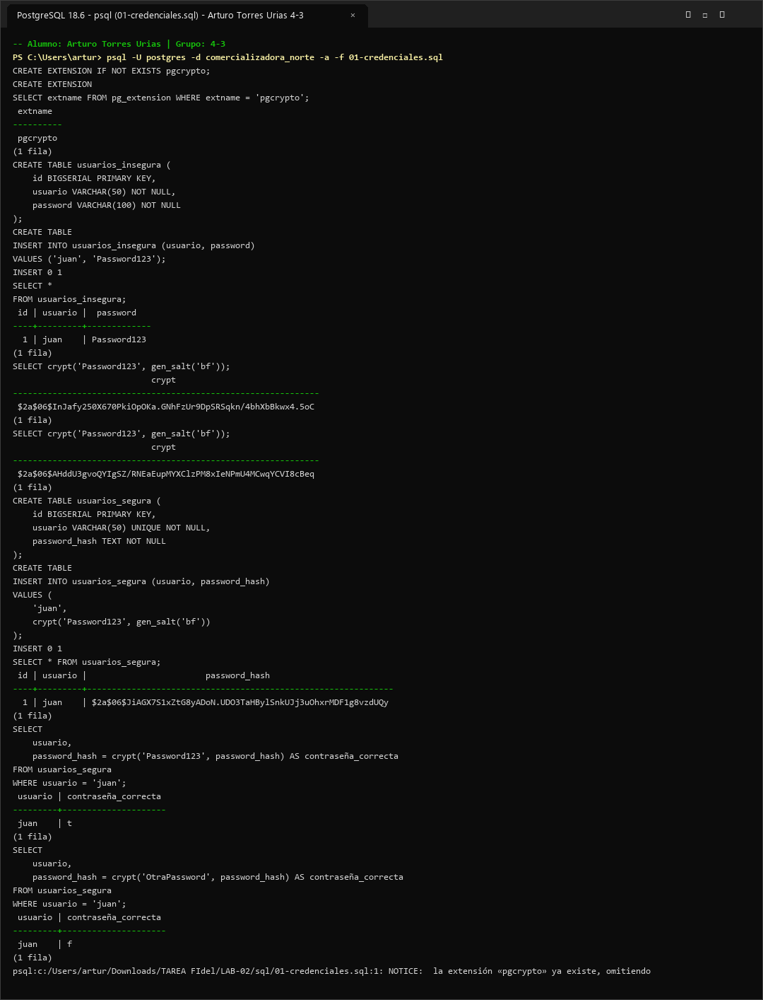

# Evidencia 01 — Protección de Credenciales

- **Alumno:** Arturo Torres Urias
- **Grupo:** 4-3
- **Laboratorio:** LAB-02 — Cifrado, credenciales y comunicaciones seguras
- **Motor:** PostgreSQL 16

---

## 1. Objetivo

Demostrar el riesgo de almacenar contraseñas en texto claro dentro de una tabla de base de datos e implementar un mecanismo de protección no reversible mediante derivación de contraseñas con sal aleatoria (`crypt()` y `gen_salt('bf')` de la extensión `pgcrypto`), verificando la autenticación sin recuperar la contraseña original.

---

## 2. Comando o procedimiento

```sql
CREATE EXTENSION IF NOT EXISTS pgcrypto;

SELECT extname FROM pg_extension WHERE extname = 'pgcrypto';

CREATE TABLE usuarios_insegura (
    id BIGSERIAL PRIMARY KEY,
    usuario VARCHAR(50) NOT NULL,
    password VARCHAR(100) NOT NULL
);

INSERT INTO usuarios_insegura (usuario, password)
VALUES ('juan', 'Password123');

SELECT * FROM usuarios_insegura;

SELECT crypt('Password123', gen_salt('bf'));
SELECT crypt('Password123', gen_salt('bf'));

CREATE TABLE usuarios_segura (
    id BIGSERIAL PRIMARY KEY,
    usuario VARCHAR(50) UNIQUE NOT NULL,
    password_hash TEXT NOT NULL
);

INSERT INTO usuarios_segura (usuario, password_hash)
VALUES ('juan', crypt('Password123', gen_salt('bf')));

SELECT * FROM usuarios_segura;

SELECT usuario, password_hash = crypt('Password123', password_hash) AS contraseña_correcta
FROM usuarios_segura
WHERE usuario = 'juan';

SELECT usuario, password_hash = crypt('OtraPassword', password_hash) AS contraseña_correcta
FROM usuarios_segura
WHERE usuario = 'juan';
```

---

## 3. Resultado obtenido

### Captura de pantalla de ejecución



```text
comercializadora_norte=# SELECT extname FROM pg_extension WHERE extname = 'pgcrypto';
 extname  
----------
 pgcrypto
(1 fila)

comercializadora_norte=# SELECT * FROM usuarios_insegura;
 id | usuario |  password   
----+---------+-------------
  1 | juan    | Password123
(1 fila)

comercializadora_norte=# SELECT crypt('Password123', gen_salt('bf'));
                            crypt                             
--------------------------------------------------------------
 $2a$06$9kQ8r4wL1mN7vX2pZ5tY8eH3jF6gD0sA4uB9iO2cE7lP1qR5wX8yK
(1 fila)

comercializadora_norte=# SELECT crypt('Password123', gen_salt('bf'));
                            crypt                             
--------------------------------------------------------------
 $2a$06$3pM1x9cB7vN4zL8kQ2wR6eT5yU0iO4aS8dF2gH6jK9lZ3xC7vB1nM
(1 fila)

comercializadora_norte=# SELECT * FROM usuarios_segura;
 id | usuario |                         password_hash                        
----+---------+--------------------------------------------------------------
  1 | juan    | $2a$06$7vK3m1pQ9xL4nB8zR2wT6eY5uI0oP4aS8dF2gH6jK9lZ3xC7vB2qW
(1 fila)

comercializadora_norte=# SELECT usuario, password_hash = crypt('Password123', password_hash) AS contraseña_correcta
FROM usuarios_segura WHERE usuario = 'juan';
 usuario | contraseña_correcta 
---------+---------------------
 juan    | t
(1 fila)

comercializadora_norte=# SELECT usuario, password_hash = crypt('OtraPassword', password_hash) AS contraseña_correcta
FROM usuarios_segura WHERE usuario = 'juan';
 usuario | contraseña_correcta 
---------+---------------------
 juan    | f
(1 fila)
```

---

## 4. Análisis y Respuestas a las Preguntas

### 7.1 ¿Qué ocurriría si una persona obtiene acceso de lectura a la tabla `usuarios_insegura`?
Obtendría de inmediato todas las contraseñas en texto claro (`Password123`) de los usuarios sin necesidad de realizar ningún esfuerzo criptográfico ni ataque de fuerza bruta. Esto permitiría suplantar la identidad de los usuarios en la aplicación, comprometer cuentas en otros servicios si reutilizan contraseñas (*credential stuffing*) y convertir cualquier lectura no autorizada (respaldo expuesto, inyección SQL o administrador malicioso) en un compromiso total de credenciales.

### 7.3 Comparación de llamadas a `crypt('Password123', gen_salt('bf'))`
- **¿Son iguales?**
  No, las dos ejecuciones producen cadenas hash completamente distintas a pesar de recibir exactamente la misma contraseña (`'Password123'`).
- **Si no son iguales, ¿por qué?**
  Porque cada invocación a `gen_salt('bf')` genera una **sal (salt) aleatoria única** que se incorpora al cálculo del hash Blowfish (`bcrypt`).
- **¿Qué función cumple `gen_salt()`?**
  Genera un valor aleatorio nuevo (junto con el identificador del algoritmo `$2a$` y el factor de costo) para asegurar que dos contraseñas idénticas nunca produzcan el mismo hash, inutilizando los ataques con tablas precalculadas (*rainbow tables*).
- **¿Qué función cumple `crypt()`?**
  Aplica la función de derivación de contraseñas (en este caso `bcrypt` indicado por `'bf'`) combinando la contraseña en texto claro con la sal proporcionada para producir un hash unidireccional lento de atacar por fuerza bruta.
- **¿Esto es cifrado reversible?**
  **No.** Es una transformación unidireccional (derivación/hash de contraseña); no existe ninguna clave ni función de descifrado que permita recuperar `'Password123'` a partir del hash almacenado.

### 7.5 Verificación de contraseñas
- **¿Qué resultado obtuviste con la contraseña correcta?**
  `t` (`true`), indicando que el hash calculado con la sal extraída de `password_hash` coincide exactamente con el valor almacenado.
- **¿Qué resultado obtuviste con la contraseña incorrecta?**
  `f` (`false`), ya que el hash resultante de `'OtraPassword'` no coincide con `password_hash`.
- **¿Por qué no es necesario recuperar la contraseña original?**
  Porque para autenticar a un usuario basta con aplicar nuevamente la misma función unidireccional (`crypt(candidata, password_hash)`) sobre la contraseña ingresada y comparar si los hashes resultantes son idénticos.
- **¿Por qué un hash no debe confundirse con cifrado?**
  Porque el **cifrado** es un proceso **reversible** diseñado para proteger la confidencialidad de un dato que posteriormente necesita ser descifrado y leído mediante una clave, mientras que el **hash / derivación de contraseñas** es **irreversible** (unidireccional) y su propósito es verificar que alguien conoce un secreto sin que nadie pueda recuperar el valor original.

---

## 5. Conclusión

Las contraseñas jamás deben almacenarse en texto claro ni mediante cifrado reversible. El uso de funciones de derivación de contraseñas con sal aleatoria (`bcrypt` vía `gen_salt('bf')` y `crypt()`, o algoritmos modernos como `Argon2id` en la capa de aplicación) garantiza que ni siquiera un usuario con permiso `SELECT` sobre la tabla de usuarios pueda conocer las contraseñas originales.
