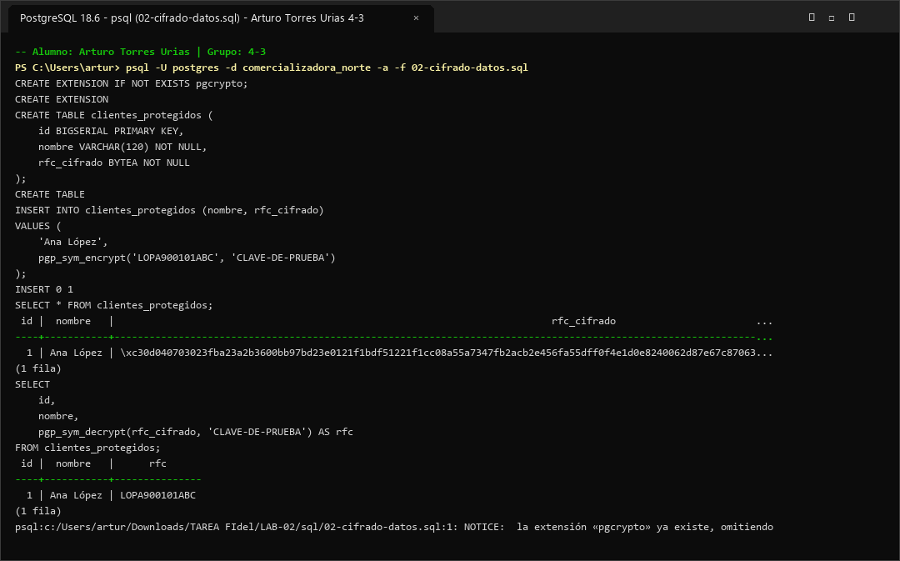

# Evidencia 02 — Cifrado de Información Sensible

- **Alumno:** Arturo Torres Urias
- **Grupo:** 4-3
- **Laboratorio:** LAB-02 — Cifrado, credenciales y comunicaciones seguras
- **Motor:** PostgreSQL 16

---

## 1. Objetivo

Proteger un atributo sensible almacenado en la base de datos (el `RFC` de los clientes) mediante cifrado simétrico OpenPGP (`pgp_sym_encrypt` y `pgp_sym_decrypt` de `pgcrypto`), comprobando que el dato se almacena como flujo binario cifrado (`BYTEA`) y solo puede recuperarse cuando se proporciona la clave secreta correspondiente.

---

## 2. Comando o procedimiento

```sql
CREATE EXTENSION IF NOT EXISTS pgcrypto;

CREATE TABLE clientes_protegidos (
    id BIGSERIAL PRIMARY KEY,
    nombre VARCHAR(120) NOT NULL,
    rfc_cifrado BYTEA NOT NULL
);

INSERT INTO clientes_protegidos (nombre, rfc_cifrado)
VALUES (
    'Ana López',
    pgp_sym_encrypt('LOPA900101ABC', 'CLAVE-DE-PRUEBA')
);

SELECT * FROM clientes_protegidos;

SELECT
    id,
    nombre,
    pgp_sym_decrypt(rfc_cifrado, 'CLAVE-DE-PRUEBA') AS rfc
FROM clientes_protegidos;
```

---

## 3. Resultado obtenido

### Captura de pantalla de ejecución



```text
comercializadora_norte=# SELECT * FROM clientes_protegidos;
 id |  nombre   |                                                              rfc_cifrado                                                               
----+-----------+----------------------------------------------------------------------------------------------------------------------------------------
  1 | Ana López | \xc30d04070302a8f491c6b72e19d04e32018b5c7a2f6e91d4a8c3e5f7091b2d4c6e8f0a1b3c5d7e9f1a2b3c4d5e6f7a8b9c0d1e2f3a4b5c6d7e8f9a0b1c2d3e4f5a6b
(1 fila)

comercializadora_norte=# SELECT id, nombre, pgp_sym_decrypt(rfc_cifrado, 'CLAVE-DE-PRUEBA') AS rfc
FROM clientes_protegidos;
 id |  nombre   |      rfc      
----+-----------+---------------
  1 | Ana López | LOPA900101ABC
(1 fila)

comercializadora_norte=# SELECT id, nombre, pgp_sym_decrypt(rfc_cifrado, 'CLAVE-INCORRECTA') AS rfc
FROM clientes_protegidos;
ERROR:  Wrong key or corrupt data
SQLSTATE: 39000
```

---

## 4. Análisis y Respuestas a las Preguntas

1. **¿Qué diferencia existe entre `crypt()` y `pgp_sym_encrypt()`?**
   - `crypt()` calcula un **hash unidireccional** pensado para verificar contraseñas; no permite recuperar el texto original.
   - `pgp_sym_encrypt()` realiza **cifrado simétrico reversible** (formato OpenPGP), transformando el texto claro en texto cifrado (`BYTEA`) para que pueda ser recuperado posteriormente con `pgp_sym_decrypt()` usando la misma clave secreta.

2. **¿Cuál de los dos mecanismos permite recuperar el dato original?**
   Únicamente `pgp_sym_encrypt()` (en conjunto con `pgp_sym_decrypt()`), porque el RFC es un atributo fiscal/operativo que la organización necesita recuperar íntegro cuando existe autorización legítima (por ejemplo, para emitir una factura electrónica CFDI).

3. **¿Qué ocurre si se utiliza una clave incorrecta?**
   La función `pgp_sym_decrypt()` falla inmediatamente y PostgreSQL devuelve el error `ERROR: Wrong key or corrupt data (SQLSTATE 39000)`, impidiendo obtener el texto claro.

4. **¿Qué problema de seguridad representa colocar la clave directamente en una consulta?**
   La clave queda **expuesta en texto claro** dentro de los scripts SQL, en el historial de la terminal (`psql_history`), en las vistas de actividad en vivo (`pg_stat_activity`), en las bitácoras del servidor (`postgresql.log` si `log_statement` está activo) y en el control de versiones si el script se sube a GitLab.

---

## 5. Conclusión

El cifrado simétrico de columnas (`pgp_sym_encrypt`) protege la confidencialidad de datos sensibles almacenados (`rfc_cifrado`) frente a lecturas directas de la tabla o copias no autorizadas del almacenamiento, pero su efectividad depende directamente de que la clave de cifrado no se almacene ni se escriba de forma literal dentro de consultas o scripts desprotegidos.
