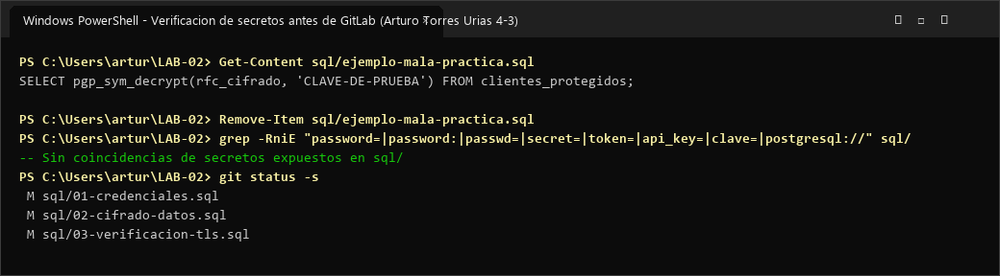

# Evidencia 03 — Gestión de Claves y Verificación de Secretos

- **Alumno:** Arturo Torres Urias
- **Grupo:** 4-3
- **Laboratorio:** LAB-02 — Cifrado, credenciales y comunicaciones seguras
- **Motor:** PostgreSQL 16

---

## 1. Objetivo

Analizar el impacto de seguridad que ocasiona incrustar claves criptográficas o secretos directamente en archivos SQL (*hardcoded secrets*), verificar la ausencia de secretos reales antes de publicar en GitLab y aplicar la regla de higiene del repositorio eliminando el archivo temporal de mala práctica.

---

## 2. Comando o procedimiento

1. Creación temporal del archivo demostrativo `sql/ejemplo-mala-practica.sql` (Actividad 9.1):
   ```sql
   SELECT pgp_sym_decrypt(rfc_cifrado, 'CLAVE-DE-PRUEBA') FROM clientes_protegidos;
   ```
2. Análisis del riesgo y eliminación del archivo temporal conforme a la regla 9.2 del laboratorio (`rm sql/ejemplo-mala-practica.sql`).
3. Ejecución de búsqueda preventiva de secretos antes de realizar commits (Actividad 16):
   ```bash
   grep -RniE 'password=|password:|passwd=|secret=|token=|api_key=|clave=|postgresql://' sql/
   ```

---

## 3. Resultado obtenido

### Captura de pantalla de ejecución



- Al inspeccionar el archivo temporal `sql/ejemplo-mala-practica.sql`, se observa que cualquier persona con lectura al archivo obtiene tanto el nombre de la tabla (`clientes_protegidos`), la columna (`rfc_cifrado`) y la clave exacta (`CLAVE-DE-PRUEBA`) para descifrar toda la información.
- Conforme a la sección 9.2 de la guía, el archivo `sql/ejemplo-mala-practica.sql` fue eliminado antes de la entrega final y únicamente se conservaron en `sql/` los tres scripts requeridos (`01-credenciales.sql`, `02-cifrado-datos.sql` y `03-verificacion-tls.sql`) empleando exclusivamente valores ficticios de laboratorio.

---

## 4. Análisis y Respuesta a la Pregunta (Actividad 3 / 9.1)

### ¿Qué ocurriría si esta clave fuera una clave utilizada realmente por una organización y el archivo se publicara en un repositorio Git?
1. **Compromiso inmediato del cifrado:** Cualquier desarrollador, contratista, sistema de CI/CD, copia clonada del repositorio o atacante que obtenga acceso al repositorio tendría la llave maestra para descifrar todos los registros de `clientes_protegidos` (y los respaldos históricos cifrados con esa misma clave).
2. **Persistencia en el historial de Git:** Incluso si alguien borra el archivo en un commit posterior, **la clave permanece grabada permanentemente en el historial de objetos de Git** (`git log -p`, `git reflog`), por lo que borrar el archivo no revierte la exposición.
3. **Necesidad de rotación de emergencia y recifrado:** La organización tendría que declarar la clave como comprometida, revocarla inmediatamente, generar una nueva clave criptográfica en un gestor de secretos (KMS / Vault) y **volver a cifrar todos los datos afectados**.

---

## 5. Conclusión

Escribir claves criptográficas o contraseñas directamente dentro del código fuente o scripts SQL (*hardcoded secrets*) anula la protección que brinda el cifrado, pues equivale a dejar la llave pegada en la cerradura. Las claves reales deben inyectarse en tiempo de ejecución desde un gestor de secretos o servicio KMS y jamás almacenarse en repositorios Git.
