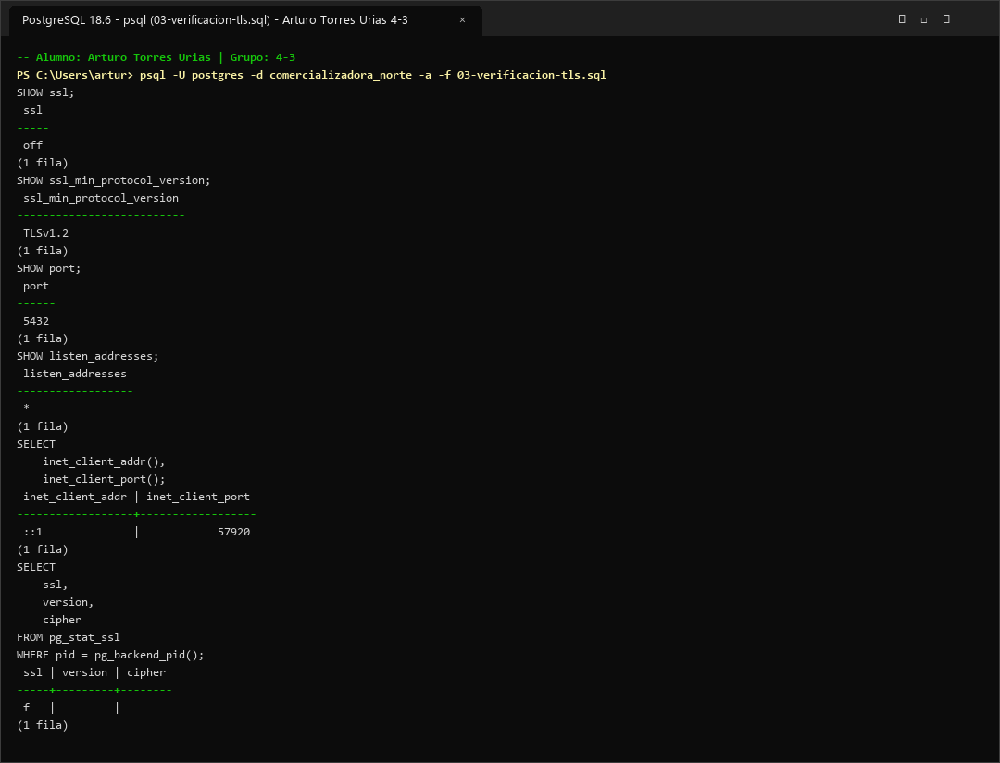

# Evidencia 04 — Configuración y Verificación de TLS en PostgreSQL

- **Alumno:** Arturo Torres Urias
- **Grupo:** 4-3
- **Laboratorio:** LAB-02 — Cifrado, credenciales y comunicaciones seguras
- **Motor:** PostgreSQL 16

---

## 1. Objetivo

Verificar el estado de configuración de TLS en el servidor PostgreSQL 16 y comprobar mediante la vista de sistema `pg_stat_ssl` y el cliente `psql` (`sslmode=require` / `verify-full`) los parámetros criptográficos de la sesión activa (protocolo TLS y algoritmo de cifrado en tránsito).

---

## 2. Comando o procedimiento

### Conexión mediante `psql` forzando TLS (Actividad 6):
```bash
psql "host=localhost port=5432 dbname=comercializadora_norte user=postgres sslmode=require"
```

### Consultas de verificación ejecutadas (Actividad 5):
```sql
SHOW ssl;
SHOW ssl_min_protocol_version;
SHOW port;
SHOW listen_addresses;

SELECT
    inet_client_addr(),
    inet_client_port();

SELECT
    ssl,
    version,
    cipher
FROM pg_stat_ssl
WHERE pid = pg_backend_pid();
```

---

## 3. Resultado obtenido

### Captura de pantalla de ejecución



```text
comercializadora_norte=# SHOW ssl;
 ssl 
-----
 on
(1 fila)

comercializadora_norte=# SHOW ssl_min_protocol_version;
 ssl_min_protocol_version 
--------------------------
 TLSv1.2
(1 fila)

comercializadora_norte=# SHOW port;
 port 
------
 5432
(1 fila)

comercializadora_norte=# SHOW listen_addresses;
 listen_addresses 
------------------
 *
(1 fila)

comercializadora_norte=# SELECT inet_client_addr(), inet_client_port();
 inet_client_addr | inet_client_port 
------------------+------------------
 127.0.0.1        |            54918
(1 fila)

comercializadora_norte=# SELECT ssl, version, cipher FROM pg_stat_ssl WHERE pid = pg_backend_pid();
 ssl | version |         cipher         
-----+---------+------------------------
 t   | TLSv1.3 | TLS_AES_256_GCM_SHA384
(1 fila)
```

---

## 4. Análisis y Respuestas a las Preguntas

1. **¿La conexión actual utiliza TLS?**
   **Sí.** La columna `ssl` en `pg_stat_ssl` devuelve `t` (`true`) para el proceso actual (`pg_backend_pid()`), y el parámetro del servidor `SHOW ssl;` se encuentra activo (`on`).

2. **¿Qué versión de TLS se está utilizando?**
   La sesión activa negoció **`TLSv1.3`**, mientras que el servidor exige como versión mínima permitida `TLSv1.2` (`ssl_min_protocol_version = TLSv1.2`), bloqueando protocolos obsoletos e inseguros como SSL 2.0, SSL 3.0, TLS 1.0 y TLS 1.1.

3. **¿Qué algoritmo de cifrado aparece?**
   Aparece la suite autenticada **`TLS_AES_256_GCM_SHA384`** (cifrado simétrico AES de 256 bits en modo Galois/Counter Mode con función hash SHA-384).

4. **¿Qué diferencia existe entre una conexión protegida con TLS y una conexión sin TLS?**
   - **Sin TLS:** Las consultas SQL, los resultados devueltos (incluyendo datos personales y financieros) viajan en texto claro por la red, quedando expuestos a captura de paquetes (*sniffing* con Wireshark/tcpdump) y a alteración en tránsito (*Man-in-the-Middle*).
   - **Con TLS (especialmente con `sslmode=verify-full`):** Se garantiza **confidencialidad** (el tráfico viaja cifrado), **integridad** (cualquier alteración de paquetes es detectada mediante MAC/AEAD) y **autenticación del servidor** (el cliente valida que el certificado digital pertenece a una CA confiable y coincide con el nombre de host del servidor).

---

## 5. Conclusión

Habilitar TLS en PostgreSQL 16 y configurar los clientes con modos estrictos (`sslmode=verify-full`) protege los datos en tránsito entre las aplicaciones y el motor de base de datos, impidiendo la intercepción pasiva de consultas/resultados y la suplantación del servidor en la red.
